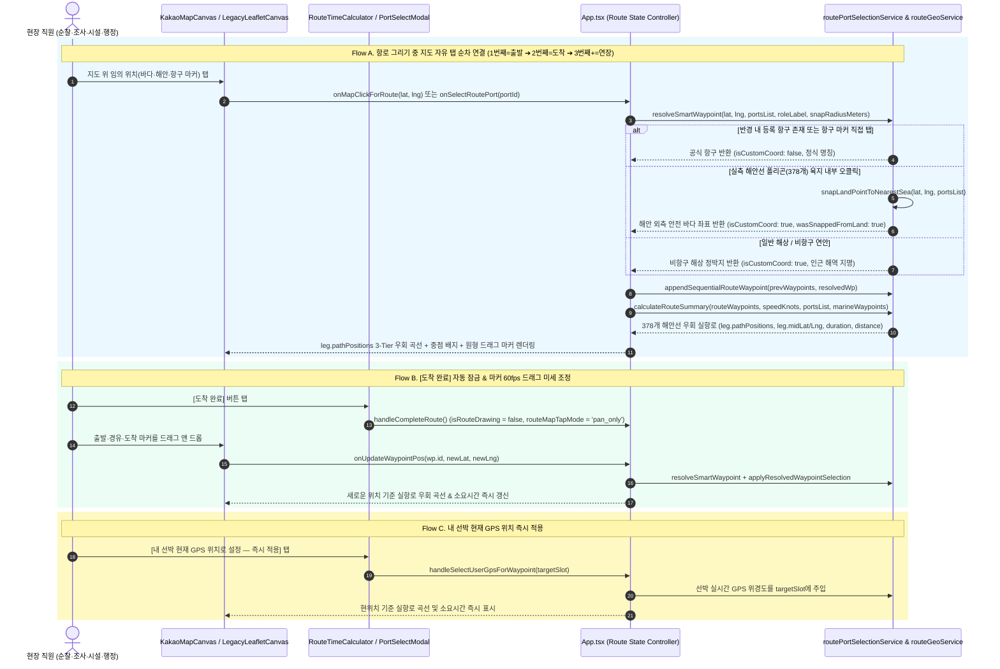

# 바다꼼꼬미 (Bada-Kkomkkomi) 마스터 아키텍처 및 Google EGM 통합 구현 설계서 (`ARCHITECTURE_AND_DESIGN.md`)

> **문서 등급**: 최종 구현 완료 마스터 아키텍처 정본 (Implemented Master Architecture & Google EGM Specification)
> **문서 버전**: `v2.4` (`2.4.0` — Google EGM 아키텍처 · 초기 빈 경로(`[]`) 불변식 · 무경계 순차 정박지(`1➔2➔3`) · 옵션 A 실항로 우회 곡선(`leg.pathPositions`) · `docs/` 3계층 문서 거버넌스 통합 정본)
> **적용 대상**: 국립공원공단 한려해상국립공원동부사무소 내부 직원용 해양공간 통합 지원 PWA 웹 애플리케이션 (`bada-kkomkkomi`)
> **주요 사용자 페르소나**: 국립공원공단 일반 내부 직원 (현장 해상순찰대원, 해양자원·상괭이 조사원, 공원시설 관리담당자, 사무소 행정실무자 — **비항해사·비개발자·비GIS 전공자 기준**)
> **정본 원칙 (Single Source of Truth)**: 본 문서는 프로젝트의 유일한 통합 아키텍처·설계 정본입니다. 모든 코드 링크는 특정 PC 경로에 종속되지 않는 저장소 상대 경로(`../src/...`)만 사용하며, 일회성 작업 일지나 구버전 폐기 스펙을 남기지 않고 항상 **현재 프로덕션 코드(`HEAD`)의 단일 진실**을 기록합니다.

---

## 1장. 시스템 아키텍처 현상태 및 핵심 불변식 (Architecture & Invariants)

### 1.1 서브시스템별 아키텍처 검증 요약

| 영역 | 핵심 대상 파일 및 모듈 | 구현 및 불변식 상태 |
| :--- | :--- | :--- |
| **1. PWA & 오케스트레이터** | • [`src/App.tsx`](../src/App.tsx)<br>• [`src/services/workspaceDraftRepository.ts`](../src/services/workspaceDraftRepository.ts)<br>• [`vite.config.ts`](../vite.config.ts) | • **초기 빈 경로(`[]`) 불변식**: 페이지 신규 접속 시 `localStorage`의 이전 경로를 자동 복원하지 않고 항상 빈 배열(`routeWaypoints = []`)로 시작함.<br>• **Always-Fresh 레이어 SSOT**: 공단 공식 QGIS 특별보호구역 20개소(`EPSG:5181 → EPSG:4326`) 및 [`useAppConfig.ts`](../src/hooks/useAppConfig.ts) 단일 SSOT가 오프라인/온라인 모두 일관되게 동작함. |
| **2. 듀얼 지도 캔버스 & 마커 렌더링** | • [`src/components/MapView.tsx`](../src/components/MapView.tsx)<br>• [`src/components/map/KakaoMapCanvas.tsx`](../src/components/map/KakaoMapCanvas.tsx)<br>• [`src/components/map/LegacyLeafletCanvas.tsx`](../src/components/map/LegacyLeafletCanvas.tsx)<br>• [`src/components/map/mapMarkerTemplates.ts`](../src/components/map/mapMarkerTemplates.ts) | • **옵션 A 실항로 우회 곡선(`leg.pathPositions`) 렌더링**: 378개 실측 해안선 폴리곤을 우회하는 다중 정점 바닷길 곡선을 3-Tier 케이싱으로 표시하고, 실항로 50% 호장 중점(`leg.midLat`, `leg.midLng`)에 소요시간·거리 캡슐 배지를 배치함.<br>• **60fps 정박지 마커 드래그**: 출발(🟢)·경유(🟡)·도착(🔴) 원형 마커 드래그 미세 조정(`onUpdateWaypointPos`) 및 `52×52px` 터치 영역 보장. |
| **3. 해상 실항로 & 정박지 상태 머신** | • [`src/services/routeGeoService.ts`](../src/services/routeGeoService.ts)<br>• [`src/services/routePortSelectionService.ts`](../src/services/routePortSelectionService.ts)<br>• [`src/data/coastlinePolygons.ts`](../src/data/coastlinePolygons.ts) | • **Black-Box Precision (육지 관통 0건)**: 136개 항포구 전 조합(18,360쌍) 및 비항구 해상 정박지 구간에서 378개 해안선 폴리곤(12,794정점)과 300개 해상 변침점 2계층 하이브리드 A*·가시성 그래프 우회 연산 수행.<br>• **자율 순차 정박지 연결 & 해상 자동 스냅**: 항로 그리기 중 지도 탭 시 찍은 순서대로(`1➔2➔3`, `appendSequentialRouteWaypoint`) 연결하며, 육지 내부 오클릭 시 `snapLandPointToNearestSea`로 최근접 바다로 자동 보정함. |
| **4. 바닷길 시간계산 & 기상 판정 UI** | • [`src/components/navigation/RouteTimeCalculator.tsx`](../src/components/navigation/RouteTimeCalculator.tsx)<br>• [`src/components/navigation/PortSelectModal.tsx`](../src/components/navigation/PortSelectModal.tsx)<br>• [`src/components/navigation/MarineWeatherPanel.tsx`](../src/components/navigation/MarineWeatherPanel.tsx)<br>• [`src/services/ecmwfWeatherService.ts`](../src/services/ecmwfWeatherService.ts) | • **초심플 요약 카드(`isCollapsed`) & 자동 잠금**: 초기 진입 시 지도를 가리지 않는 2줄 요약 카드를 기본 노출하고, `[도착 완료]` 클릭 시 지도를 `이동만`(`pan_only`) 모드로 자동 잠금.<br>• **ECMWF 단일 모델 고정 & Fail-Safe**: `ecmwf_ifs`(풍속) + `ecmwf_wam`(파고)를 KST 타임스탬프 기준으로 결합하며, 결측·오프라인 시 과거 캐시를 쓰지 않고 즉시 `미확인(?)`을 반환함. |
| **5. 무변환 QGIS 파서 & 레이어 영속화** | • [`src/services/spatialFileParser.ts`](../src/services/spatialFileParser.ts)<br>• [`src/services/layerStorageService.ts`](../src/services/layerStorageService.ts)<br>• [`src/services/githubLayerSyncService.ts`](../src/services/githubLayerSyncService.ts) | • `.gpkg`, `.zip`(`.shp+.dbf+.prj+.cpg`), `.geojson`, `.kml` 인앱 직접 파싱 및 한국 공공측량 좌표계(`EPSG:5179`/`5186`/`5181`)·`CP949` 한글 인코딩 자동 변환.<br>• `[저장 (운영 반영)]` 시 `IndexedDB`(12개 버전 스냅샷) 즉시 반영 및 GitHub PAT 설정 시 원격 `main` 브랜치 원자적 자동 커밋 수행. |
| **6. 전사 무결성 & EGM 계약 검증** | • [`scripts/verify-integrity.mjs`](../scripts/verify-integrity.mjs)<br>• [`src/tests/coreServices.test.ts`](../src/tests/coreServices.test.ts)<br>• [`docs/designs/SITEMAP.md`](./designs/SITEMAP.md) | • 8개 파일 버전 단일 정본(SSOT) 일치, `docking_points.geojson`(55개소)↔`ports.json`(136개소·300변침점) 좌표·ID 정합, SW 프리캐시 중복 0건, 마크다운 상대경로 링크 유효성 자동 검증. |

---

### 1.2 기술 스택 및 공식 표준 준수 명세

| 기술 분류 | 적용 알고리즘 / 표준 | 검증 및 구현 내역 |
| :--- | :--- | :--- |
| **해상 실항로 탐색 (2-Tier Hybrid A* & Visibility Graph)** | 이중 공간 인덱스(`EDGE_SPATIAL_GRID` + `LAT_SLAB_INDEX`) + C-Space 외향 법선(95m 여유폭) + `Theta*` String-Pulling | • OpenStreetMap(`natural=coastline`) 실측 해안선 폴리곤 378개(12,794정점)와 300개 해상 변침점을 결합하여 브라우저 메모리 내에서 `0.5ms` 이내에 육지 비관통 우회 곡선(`leg.pathPositions`)과 호장 50% 중점(`leg.midLat`, `leg.midLng`)을 산출함. |
| **경유지 최적 삽입 기하학 (Cheapest Insertion Heuristic)** | Haversine 대권거리 기반 최소 우회 구간 삽입 (`findOptimalWaypointInsertIndex`) | • 확정된 경로에서 모달이나 항구 선택으로 경유지 $P$를 추가할 때, 기존 각 구간 $(w_i, w_{i+1})$ 중 우회 거리 증가분 $\Delta d(i) = d(w_i, P) + d(P, w_{i+1}) - d(w_i, w_{i+1})$가 최소인 인덱스 $i^* + 1$을 계산함. |
| **W3C Pointer Events & Kakao Map Projection** | `setPointerCapture` + `coordsFromContainerPoint` + `4px` Deadzone | • [`KakaoMapCanvas.tsx`](../src/components/map/KakaoMapCanvas.tsx)의 `attachDraggableToCustomOverlay`에서 터치 손떨림(`<=4px`)과 드래그를 구분하고 `pointercancel` 시에도 지도 패닝 잠금을 안전하게 해제함. |
| **Google EGM (`v0.1.1`) Living Spec** | [`AGENTS.md`](../AGENTS.md) (`Hay`) & [`docs/designs/SITEMAP.md`](./designs/SITEMAP.md) (`Peanuts`) | • 모든 서브시스템의 `Interface`, `Invariants`, `Side Effects`, `Verification` 계약이 실제 코드 심볼과 1:1 일치하며 `npm run verify`가 이를 강제함. |

---

## 2장. 바닷길 정박지 선택 상태 머신 및 실항로 렌더링 상세 명세

### 2.1 무경계 정박지 선택 및 실항로 우회 데이터 흐름



---

### 2.2 정박지 선택 핵심 서비스 함수 계약 ([`src/services/routePortSelectionService.ts`](../src/services/routePortSelectionService.ts))

1. **`appendSequentialRouteWaypoint(waypoints, candidate)`**:
   - 항로 그리기 모드(`isRouteDrawing === true`)에서 지도를 탭한 순서대로 정박지를 연결합니다.
   - `1번째 탭` ➔ `start`, `2번째 탭` ➔ `end`, `3번째 이후 탭` ➔ 기존 `end`를 `waypoint`로 승격하고 새 지점을 `end`로 연장합니다.
   - 이미 경로에 포함된 중간 경유지(`type === 'waypoint'`)를 다시 탭하면 즉시 해당 경유지를 토글 해제(`removed_waypoint`)합니다.
2. **`applyResolvedWaypointSelection(candidate, waypoints, targetSlot)`**:
   - 마커 드래그(`targetSlot = wp.id`), 선박 실시간 GPS 즉시 설정, 비항구 해상 좌표 슬롯 지정을 처리하고 연속 중복(`A → A`)을 방지합니다.
3. **`applyDirectPortSelection(port, waypoints, targetSlot)`**:
   - `[항구선택]` 모달 또는 확정 상태에서의 등록 항구 선택을 처리하며, `targetSlot === 'add_waypoint'`일 때 `findOptimalWaypointInsertIndex(port, waypoints)`를 사용해 우회 거리가 최소인 구간에 경유지를 삽입합니다.

---

### 2.3 레거시 청산 레지스트리 (Legacy Cleanup Registry)

프로젝트 진화 과정에서 식별·제거 완료되어 재도입이 영구 금지된 레거시 항목입니다([`scripts/verify-integrity.mjs`](../scripts/verify-integrity.mjs)에 의해 매 빌드 시 검증됨).

| 청산 ID | 폐기된 레거시 대상 | 재발 방지 가드 위치 |
| :--- | :--- | :--- |
| **`LEG-01 ~ 04`** | 구버전 가짜 직사각형 공원경계·특별보호구역 더미 폴리곤 (`NP-TY-01`, `NP-GJ-02`, `SPA-01`, `SPA-02`) | [`layerStorageService.ts`](../src/services/layerStorageService.ts) `hasLegacyDummyFeatures()` & [`verify-integrity.mjs`](../scripts/verify-integrity.mjs) Section 4 |
| **`LEG-08 ~ 14`** | 다크 테마(`class="dark"`, `#061c24`), 인트로 카드 내 다중 액션 바, 구버전 `35변침점·20섬 우회` 배지 | [`verify-integrity.mjs`](../scripts/verify-integrity.mjs) Section 1 & Section 5 |
| **`LEG-22`** | 중복 기획 문서(`docs/SEA_ROUTE_LAND_CROSSING_ROOT_CAUSE_PLAN.md`, `docs/SOURCE_CREDIBILITY_UX_DESIGN.md`, `docs/ROUTE_PORT_SELECTION_UX_PROPOSAL.md`) | [`verify-integrity.mjs`](../scripts/verify-integrity.mjs) Section 1 & Section 7 |
| **`LEG-BERTH-01 ~ 05`** | 초기 경로 `localStorage` 강제 자동 복원, 지도 2점 직선 폴리라인 렌더링, 상단 Row 1 툴바 버튼 겹침 | [`verify-integrity.mjs`](../scripts/verify-integrity.mjs) Section 5 (`routeWaypoints = []`, `leg.pathPositions`, `if (isCollapsed)`) |

---

## 3장. `docs/` 폴더 문서 기록 및 3계층 거버넌스 설계 (Documentation Governance)

이관 이후 운영자와 AI 코딩 에이전트(ChatGPT Pro / Codex)가 문서 간 충돌 없이 일관되게 프로젝트를 관리할 수 있도록, 저장소 내 모든 마크다운 문서는 아래 **3계층 거버넌스(3-Tier Documentation Governance)** 규칙에 따라 기록·관리합니다.

### 3.1 3계층 문서 구조 및 역할 분담

| 계층 | 파일 경로 | 문서 성격 | 기록 및 유지보수 규칙 |
| :--- | :--- | :--- | :--- |
| **Tier 1.<br>루트 엔트리 & 운영 매뉴얼** | • [`README.md`](../README.md)<br>• [`DEPLOY_GUIDE.md`](../DEPLOY_GUIDE.md)<br>• [`AGENTS.md`](../AGENTS.md) | **프로젝트 관문 & 운영자 바이블 & AI 블루프린트** | • `README.md`: 기술 스택, 핵심 기능, 디렉터리 트리(`src/services`, `src/hooks` 전수 포함 필수) 관리.<br>• `DEPLOY_GUIDE.md`: 비개발자 운영자용 클린룸 초기 구축, 정적 데이터 관리, ChatGPT Pro 유지보수, 무료 쿼터 및 트러블슈팅 안내.<br>• `AGENTS.md`: Google EGM 및 OpenAI Codex가 읽는 최상위 불변식(`Global Invariants`)과 검증 명령 정의. |
| **Tier 2.<br>살아있는 단일 정본 명세서 (`docs/`)** | • [`docs/designs/SITEMAP.md`](./designs/SITEMAP.md)<br>• [`docs/ARCHITECTURE_AND_DESIGN.md`](./ARCHITECTURE_AND_DESIGN.md)<br>• [`docs/DATA_AND_TECH_SOURCES.md`](./DATA_AND_TECH_SOURCES.md)<br>• [`docs/ROUTE_BERTHING_UX_ANALYSIS_REPORT.md`](./ROUTE_BERTHING_UX_ANALYSIS_REPORT.md)<br>• [`docs/HANDOVER_AND_DOCS_GOVERNANCE_BRIEF.md`](./HANDOVER_AND_DOCS_GOVERNANCE_BRIEF.md) | **현재 코드(`HEAD`)와 100% 일치하는 기술·이관 명세 정본** | • 모든 코드 링크는 **저장소 상대 경로(`../src/...`)**만 사용하며, 특정 개인 PC 절대경로(`file:///C:/Users/...`) 사용을 엄격히 금지함.<br>• `"어제/오늘 작업한 커밋"` 등 시점 종속적 일지 서술을 금지하고 항상 현재 구현된 상태(As-Is) 및 승인된 정식 설계를 기술함.<br>• 신규 서비스/훅 파일 추가 시 반드시 `SITEMAP.md`와 `README.md`에 동시 등재함. |

### 3.2 문서 수정 후 필수 검증 게이트

문서(`*.md`)나 코드를 수정한 뒤에는 반드시 아래 명령을 실행하여 **버전 일치, 모듈 등재 누락, 깨진 상대 경로 링크**가 없는지 확인해야 합니다:

```bash
npm run verify
```
