# 바다꼼꼬미 (Bada-Kkomkkomi) 비개발자 이관 · 클린룸 신규 구축 및 문서 거버넌스 최종 구현 전 통합 설계 기획서 (`HANDOVER_AND_DOCS_GOVERNANCE_BRIEF.md`)

> **문서 등급**: 최종 구현 완료 및 검증 통합 설계 기획서 (Implemented & Verified Architectural & Governance Specification)
> **문서 상태**: `IMPLEMENTED & VERIFIED` (코드·매뉴얼 리팩토링 및 검증 완료 · 3장 1~5번 사용자 권한 작업은 초기 이관 세팅 시 수행 예정)
> **문서 경로**: [`docs/HANDOVER_AND_DOCS_GOVERNANCE_BRIEF.md`](./HANDOVER_AND_DOCS_GOVERNANCE_BRIEF.md) (EGM 연구 브리프: [`.dev/docs/concepts_brief.md`](../.dev/docs/concepts_brief.md))
> **기준 시점 및 버전**: `2026-11-16` (`Asia/Seoul`) · 앱 버전 기준 `v2.4` (`2.4.0`)
> **총괄 및 참여 에이전트**: 수석 테크니컬 아키텍트 (Senior Technical Architect) & 6대 전문 에이전트 컨트롤러 (**PWA 앱 · 디자인 · 아키텍처 · QA · UI/UX · 리팩토링 전문 에이전트**)
> **핵심 설계 목표**:
> 1. **코드 수정 0줄 클린룸 이관 (Zero-Config Portability & Security)**: 신규 운영자의 GitHub·Kakao 계정과 Windows 11 로컬 PC 환경을 구축할 때 코드 수정이 필요 없도록 계정·경로 고정값(`gunnysis`, `/bada-kkomkkomi/`, `.gemini` 로컬 경로)을 동적 추론 구조로 리팩토링하고, 클라이언트 번들에 토큰이 노출될 수 있는 `VITE_GITHUB_LAYER_SYNC_TOKEN` 참조를 제거한다.
> 2. **비개발자 자립 운영·유지보수 매뉴얼 체계화**: 별도 유료 API 키(`sk-...`) 과금 없이 기존 **ChatGPT Pro 구독 계정(OAuth)**과 [`AGENTS.md`](../AGENTS.md) / `npm run verify` 검증 루프를 결합해 정적 데이터 양방향 동기화(`docking_points.geojson` ↔ `ports.json`), 기능 추가 개발, 외부 서비스 쿼터·약관 관리를 수행하도록 [`DEPLOY_GUIDE.md`](../DEPLOY_GUIDE.md) 6대 파트 개편 명세를 확정한다.
> 3. **`docs/` 레거시 청산 및 동적 무결성 검증 확립**: 개인 PC 절대경로(`file:///C:/Users/...`)·일회성 작업 일지·구버전 모순 스펙을 청산하고, [`scripts/verify-integrity.mjs`](../scripts/verify-integrity.mjs)가 `docs/**/*.md` 전수를 동적 스캔하여 로컬 절대경로 링크와 하드코딩 재유입을 영구 차단하도록 설계한다.

---

## 1장. 현상태 분석 및 팩트체크 리포트

### 1.1 6대 전문 에이전트(Multi-Agent System) 다중 검토 결과

프로젝트 전체 코드베이스(`src/`, `scripts/`, `public/`, `vite.config.ts`, `.github/workflows/deploy-pages.yml`)와 전체 문서 인벤토리(`README.md`, `DEPLOY_GUIDE.md`, `AGENTS.md`, `docs/*.md`, `docs/designs/SITEMAP.md`)를 프로젝트 전체 시야에서 교차 검증·점검했습니다.

| 전문 에이전트 | 핵심 검증 영역 및 대상 파일 | 심층 진단 및 실측 결과 요약 | 최종 설계 판정 |
| :--- | :--- | :--- | :--- |
| **1. PWA 앱 에이전트<br>(PWA App Agent)** | • [`vite.config.ts`](../vite.config.ts)<br>• [`.github/workflows/deploy-pages.yml`](../.github/workflows/deploy-pages.yml)<br>• [`package.json`](../package.json) | • **진단 1 (`base` 경로 저장소명 고정 — `AUD-01`)**: [`vite.config.ts`](../vite.config.ts) `L8`이 GitHub Actions에서 항상 `'/bada-kkomkkomi/'`를 사용하도록 고정되어 있어, 다른 프로젝트 저장소명이나 사용자 사이트(`<owner>.github.io`)로 이관 시 에셋·`manifest.webmanifest`·`sw.js` 경로가 어긋나 404 빈 화면이 발생함.<br>• **진단 2 (`engines` 미선언 — `AUD-06`)**: [`package.json`](../package.json) `L10`의 `node --test src/tests/*.test.ts`는 Node.js `v22.18.0+`의 기본 TypeScript Type-Stripping에 의존하나 `engines` 필드가 없음(CI는 Node 24 사용). | **`resolveViteBasePath()` 순수 함수 도입 및 `package.json` `engines.node >=22.18.0` 명시 (CI 일치를 위해 Node 24 LTS 권장)** |
| **2. 디자인 에이전트<br>(Design Agent)** | • [`src/components/MapView.tsx`](../src/components/MapView.tsx)<br>• [`src/index.css`](../src/index.css) | • **진단 1 (카카오맵 진단 모달 내 구 계정·구 콘솔 경로 노출 — `AUD-04`)**: [`MapView.tsx`](../src/components/MapView.tsx) `L1025-L1064`가 `https://gunnysis.github.io`를 고정 표시하고, 카카오 개발자 콘솔의 **카카오맵 활성화(`ON`)** 및 **JavaScript 키 SDK 도메인 등록** 최신 절차를 반영하지 못함.<br>• **진단 2 (모바일 가독성)**: `320px~412px` 모바일 화면에서도 진단 모달의 점검 단계가 한눈에 읽히도록 고대비 번호 배지와 줄바꿈(`[word-break:keep-all]`) 레이아웃이 필요함. | **카카오맵 진단 모달 3단계 점검 체크리스트 디자인 리팩토링 및 현재 접속 Origin 동적 표시** |
| **3. 아키텍처 에이전트<br>(Architecture Agent)** | • [`src/services/githubLayerSyncService.ts`](../src/services/githubLayerSyncService.ts)<br>• [`scripts/build-coastline-polygons.mjs`](../scripts/build-coastline-polygons.mjs)<br>• [`.env.example`](../.env.example) | • **진단 1 (`gunnysis` 저장소 강결합 및 토큰 보안 경계 — `AUD-02`, `AUD-03`)**: [`githubLayerSyncService.ts`](../src/services/githubLayerSyncService.ts) `L10-L16`이 `gunnysis/bada-kkomkkomi`를 기본값으로 고정하고 `autoCommitOnSave: true` 및 `import.meta.env.VITE_GITHUB_LAYER_SYNC_TOKEN`을 읽음. `VITE_*` 변수는 프로덕션 JS 번들에 평문 노출되므로 PAT 주입 경로로 절대 사용해서는 안 됨.<br>• **진단 2 (로컬 절대경로 의존 — `AUD-05`)**: [`build-coastline-polygons.mjs`](../scripts/build-coastline-polygons.mjs) `L4-L5`가 `C:/Users/Administrator/.gemini/...` 파일을 존재 확인 없이 읽어 타 PC에서 즉시 `ENOENT`가 발생함. | **`inferDefaultGitHubRepoCoords()`로 owner/repo 자동 추론 + `VITE_GITHUB_LAYER_SYNC_TOKEN` 번들 주입 제거 및 `autoCommitOnSave: false` 기본 안전화 + 해안선 스크립트 비파괴 가드 추가** |
| **4. QA 에이전트<br>(QA Agent)** | • [`scripts/verify-integrity.mjs`](../scripts/verify-integrity.mjs)<br>• [`src/tests/coreServices.test.ts`](../src/tests/coreServices.test.ts) | • **진단 1 (접안지↔항구 양방향 동기화 누락 위험 — `AUD-08`)**: [`verify-integrity.mjs`](../scripts/verify-integrity.mjs) `L109-L120`은 `docking_points.geojson`의 모든 ID가 `ports.json`에 존재하고 좌표 오차가 `<1e-5`일 것을 강제하지만, [`DEPLOY_GUIDE.md`](../DEPLOY_GUIDE.md) `L60-L125`는 두 파일을 별도 작업으로 서술함.<br>• **진단 2 (문서 검증 사각지대 — `AUD-07`)**: `verify-integrity.mjs` `L343-L374`가 고정 배열 allowlist만 검사하고 `file://` 링크를 통과시켜 로컬 절대경로 링크를 차단하지 못함. | **`coreServices.test.ts`에 base/repo 추론 단위 테스트 추가 + `verify-integrity.mjs`에서 `docs/**/*.md` 동적 스캔 및 로컬 절대경로 링크(`file://`) 차단** |
| **5. UI/UX 에이전트<br>(UI/UX Agent)** | • [`src/components/notebook/LayerControlModal.tsx`](../src/components/notebook/LayerControlModal.tsx)<br>• [`DEPLOY_GUIDE.md`](../DEPLOY_GUIDE.md) | • **진단 1 ('기기 로컬 저장'과 '원격 조직 배포' 혼동 방지)**: [`LayerControlModal.tsx`](../src/components/notebook/LayerControlModal.tsx) `L1890-L2099`에서 `IndexedDB` 저장은 현재 단말기 로컬 반영이며, 전 직원 배포는 GitHub 커밋·Actions 검증·Pages 배포가 완료되어야 함을 명확히 구분해 안내해야 함.<br>• **진단 2 (비개발자 매뉴얼 일원화)**: 초기 구축, 데이터 동시 수정, ChatGPT Pro 활용, 외부 쿼터·약관 확인, 롤백 절차를 [`DEPLOY_GUIDE.md`](../DEPLOY_GUIDE.md)에서 일관된 흐름으로 제공해야 함. | **`LayerControlModal.tsx` 로컬 저장 vs 원격 발행 안내 문구 명확화 및 `DEPLOY_GUIDE.md` 6대 파트 개편 설계** |
| **6. 리팩토링 에이전트<br>(Refactoring Agent)** | • [`docs/ARCHITECTURE_AND_DESIGN.md`](./ARCHITECTURE_AND_DESIGN.md)<br>• [`docs/ROUTE_BERTHING_UX_ANALYSIS_REPORT.md`](./ROUTE_BERTHING_UX_ANALYSIS_REPORT.md)<br>• [`docs/designs/SITEMAP.md`](./designs/SITEMAP.md) | • **진단 1 (`docs/` 레거시 정리 완료 및 거버넌스 정립)**: `ARCHITECTURE_AND_DESIGN.md` 내 29개 `file:///C:/Users/Administrator/...` 절대경로 링크와 `ROUTE_BERTHING_UX_ANALYSIS_REPORT.md` 내 외부 비교본 경로(`바다꼼꼬미_수정본`), 시점 종속적 문구를 제거하고 상대경로(`../src/...`)로 정규화 완료.<br>• **진단 2 (`AUD-09`)**: 임시 `docs/reports/` 폴더를 제거하고 본 문서를 `docs/HANDOVER_AND_DOCS_GOVERNANCE_BRIEF.md` 단일 정본으로 승격 완료. | **무파일-증식(Zero-File-Bloat) 리팩토링 설계 및 문서 생명주기 거버넌스 확립** |

---

### 1.2 사용 기술 스택 및 공식 문서 기반 팩트체크 (Official Documentation Fact-Check)

사용된 모든 기술 스택과 외부 플랫폼 정책을 공식 문서 및 1차 기술 출처 기준으로 검증했습니다.

| 기술 / 플랫폼 영역 | 적용 메커니즘 및 정책 | 공식 문서 및 1차 기술 출처 검증 내역 | 설계 반영 명세 |
| :--- | :--- | :--- | :--- |
| **GitHub Actions & GitHub Pages** | • `process.env.GITHUB_REPOSITORY`<br>• `actions/configure-pages@v5`<br>• `actions/deploy-pages@v4`<br>• Public 저장소 및 사이트 공개성 | • [GitHub Actions Variables](https://docs.github.com/en/actions/reference/workflows-and-actions/variables): `GITHUB_REPOSITORY`는 `<owner>/<repo>` 형식의 기본 환경변수임.<br>• [GitHub Pages Types & Visibility](https://docs.github.com/en/pages/getting-started-with-github-pages/what-is-github-pages) & [Creating a Pages Site](https://docs.github.com/en/pages/getting-started-with-github-pages/creating-a-github-pages-site): 프로젝트 사이트 기본 URL은 `https://<owner>.github.io/<repo>/`이며, 배포된 사이트와 정적 데이터(`public/`)는 인터넷에 공개됨.<br>• [GitHub Pages Limits](https://docs.github.com/en/pages/getting-started-with-github-pages/github-pages-limits): GitHub Free에서는 `Public` 저장소 조건 및 사이트 `1 GB` 이하, 월 트래픽 `100 GB` soft limit가 적용됨.<br>• [Publishing Source](https://docs.github.com/en/pages/getting-started-with-github-pages/configuring-a-publishing-source-for-your-github-pages-site): 커스텀 Actions 배포 시 `Settings > Pages > Source: GitHub Actions` 설정이 필수임. | **[`vite.config.ts`](../vite.config.ts)에서 `GITHUB_REPOSITORY` 파싱으로 `base` 자동 계산 + 3장 초기 이관 체크리스트에 공개 데이터 확인(`G1`) 및 Pages Source 설정 명시** |
| **Vite 환경변수 & GitHub PAT 보안** | • `envPrefix: ['VITE_', 'KAKAO_']`<br>• Fine-grained PAT 보안 경계 | • [Vite Env Variables](https://vite.dev/guide/env-and-mode): `VITE_*` 및 설정된 `envPrefix`(`KAKAO_*`) 변수는 프로덕션 클라이언트 번들에 정적으로 치환·노출됨. 따라서 `VITE_GITHUB_LAYER_SYNC_TOKEN`에 PAT를 넣으면 빌드 산출물에 토큰이 평문 노출됨.<br>• [GitHub PAT Security](https://docs.github.com/en/authentication/keeping-your-account-and-data-secure/managing-your-personal-access-tokens): PAT는 비밀번호와 동일하게 취급해야 하며, 공용 단말기 `localStorage` 보관은 XSS·기기 공유 위험이 있음. | **[`githubLayerSyncService.ts`](../src/services/githubLayerSyncService.ts)에서 `VITE_GITHUB_LAYER_SYNC_TOKEN` 참조를 완전 제거하고 `autoCommitOnSave` 기본값을 `false`로 변경. 기본 발행 경로는 GitHub 웹/Desktop/CLI로 안내** |
| **Kakao Developers & Maps Web SDK v3** | • 카카오맵 활성화(`ON`)<br>• JavaScript 키 & SDK 도메인<br>• 2026-07-21 쿼터 정책 | • [Kakao Map 공통 가이드](https://developers.kakao.com/docs/en/kakaomap/common) & [App Key 설정](https://developers.kakao.com/docs/en/app-setting/app#app-key-javascript): 앱 설정에서 **Kakao Map을 활성화(`ON`)**하고, Web SDK 사용을 위해 **JavaScript 키에 웹/SDK 도메인(하위 경로 제외한 순수 Origin)**을 등록해야 함.<br>• [Kakao Quota 정책](https://developers.kakao.com/docs/en/getting-started/quota): Web SDK 기본 무료 쿼터는 일 300,000회이나, **2026-07-21 이후 계정당 최초 활성화 앱 1개에만 무료 쿼터가 기본 제공**되며 추가 앱이나 한도 초과 시 Biz Wallet·유료 설정이 필요할 수 있음. | **[`MapView.tsx`](../src/components/MapView.tsx) 진단 모달 및 [`DEPLOY_GUIDE.md`](../DEPLOY_GUIDE.md)에 카카오맵 활성화(`ON`), JavaScript 키 SDK 도메인, 계정당 최초 무료 앱 확인 절차를 명시** |
| **Open-Meteo API (ECMWF IFS & WAM)** | • `models=ecmwf_ifs`<br>• `models=ecmwf_wam`<br>• 비상업 이용 약관 및 호출 한도 | • [Open-Meteo Terms](https://open-meteo.com/en/terms): Free/Open-Access API는 **비상업적(Non-commercial) 사용** 및 **`CC BY 4.0` 출처 표시** 조건이 적용되며, 분당 600회·시간당 5,000회·일 10,000회·월 300,000회 미만 호출 한도를 둠. | **[`DEPLOY_GUIDE.md`](../DEPLOY_GUIDE.md) 및 [`DATA_AND_TECH_SOURCES.md`](./DATA_AND_TECH_SOURCES.md)에 비상업 약관 확인, `CC BY 4.0` 출처 유지, 백그라운드 무한 폴링 금지 수칙 명시** |
| **Node.js `>=22.18.0` (`v24 LTS` 권장)** | • `node --test src/tests/*.test.ts`<br>• Native TypeScript Strip Types | • [Node.js Running TypeScript Natively](https://nodejs.org/api/typescript.html): `v22.18.0`부터 별도 플래그 없이 기본 Type-Stripping이 활성화됨(단, erasable syntax만 실행하며 타입 검사는 `npm run build`의 `tsc -b`가 수행함). GitHub Actions CI([`deploy-pages.yml`](../.github/workflows/deploy-pages.yml))는 `node-version: 24`를 사용함. | **[`package.json`](../package.json)에 `"engines": { "node": ">=22.18.0" }`을 선언하고, 운영자 로컬 PC에는 CI 패리티를 위해 `fnm` 기반 Node 24 LTS 설치를 권장** |
| **ChatGPT Pro / OpenAI Codex & `AGENTS.md`** | • ChatGPT OAuth 로그인 vs API Key<br>• `AGENTS.md` 계층 지침 | • [OpenAI Codex Auth](https://learn.chatgpt.com/docs/auth) & [Pricing](https://learn.chatgpt.com/docs/pricing): 로컬 Codex에서 **ChatGPT 계정 로그인(OAuth)**과 **API Key(`OPENAI_API_KEY`) 로그인**은 과금 체계가 분리되어 있으며, API Key 사용 시 별도 종량제 요금이 청구됨. ChatGPT 로그인은 구독 플랜에 포함된 사용량/한도 내에서 동작함.<br>• [OpenAI AGENTS.md](https://learn.chatgpt.com/docs/agent-configuration/agents-md): 저장소 루트 [`AGENTS.md`](../AGENTS.md)를 에이전트 기본 작업 지침으로 로드함. | **[`DEPLOY_GUIDE.md`](../DEPLOY_GUIDE.md)에 API Key 발급 금지 및 ChatGPT 계정 로그인 절차를 명시하고, 작업 후 반드시 로컬 4단계 검증 명령 통과를 확인하도록 설계** |

---

### 1.3 발견된 8대 핵심 문제점 및 심층 근본 원인 분석 (Root-Cause Analysis)

| 문제 ID | 핵심 증상 및 이관 위험 | 근본 원인 위치 및 코드·문서 결함 | 해결 및 재발 방지 대책 |
| :--- | :--- | :--- | :--- |
| **`RC-HANDOVER-01`** | 신규 계정에서 다른 저장소명 또는 사용자 사이트(`<owner>.github.io`)로 배포 시 정적 에셋·SW 경로 불일치(404) | [`vite.config.ts`](../vite.config.ts) `L8`: `process.env.GITHUB_ACTIONS === 'true' ? '/bada-kkomkkomi/' : '/'`로 저장소명이 고정됨. | `resolveViteBasePath(env)` 순수 함수를 구현하여 `VITE_BASE_PATH` 명시값 ➔ `GITHUB_REPOSITORY` (`/<repo>/` 또는 `<owner>.github.io`일 때 `'/'`) ➔ `'/'` 순으로 계산하고 단위 테스트로 검증. |
| **`RC-HANDOVER-02`** | 신규 계정 배포 후 인앱 GitHub 연동 기본값이 구 계정(`gunnysis`)을 가리키며, 환경변수 토큰 설정 시 번들에 토큰이 노출됨 | [`src/services/githubLayerSyncService.ts`](../src/services/githubLayerSyncService.ts) `L10-L16`: `owner: 'gunnysis'`, `autoCommitOnSave: true`, `import.meta.env.VITE_GITHUB_LAYER_SYNC_TOKEN` 사용. | ① `inferDefaultGitHubRepoCoords()`로 현재 도메인(`<owner>.github.io/<repo>`)에서 owner/repo 자동 추론, ② `VITE_GITHUB_LAYER_SYNC_TOKEN` 완전 제거, ③ `autoCommitOnSave` 기본값을 `false`로 안전화. |
| **`RC-HANDOVER-03`** | 인앱 `[레이어] ➔ [저장]` 문구가 기기 로컬 저장(`IndexedDB`)을 원격 운영 배포 완료처럼 오인하게 만듦 | [`src/components/notebook/LayerControlModal.tsx`](../src/components/notebook/LayerControlModal.tsx) `L1891-L2099`: 안내 문구와 배너가 로컬 브라우저 저장과 GitHub Pages 전체 배포를 명확히 구분하지 않음. | 로컬 저장 결과 메시지와 원격 자동 커밋 안내를 명확히 분리하고, 공용 단말기 PAT 입력 금지 경고를 추가. |
| **`RC-HANDOVER-04`** | 신규 카카오 앱 생성 시 카카오맵 미활성화 또는 도메인 오등록으로 지도 로드 실패 및 구 도메인(`gunnysis.github.io`) 노출 | [`src/components/MapView.tsx`](../src/components/MapView.tsx) `L1025-L1064` 및 [`DEPLOY_GUIDE.md`](../DEPLOY_GUIDE.md) `L191-L217`: `https://gunnysis.github.io` 고정 표기 및 카카오맵 활성화(`ON`)·최초 무료 앱 쿼터 확인 안내 누락. | `MapView.tsx` 진단 모달에 ① 카카오맵 활성화(`ON`), ② JavaScript 키 SDK 도메인(`diagnostics.currentOrigin`) 등록, ③ 무료 쿼터 대상 확인의 3단계 체크리스트를 동적 렌더링. |
| **`RC-HANDOVER-05`** | 개발자 PC 외 다른 환경에서 해안선 빌드 스크립트 실행 시 즉시 `ENOENT` 크래시 발생 | [`scripts/build-coastline-polygons.mjs`](../scripts/build-coastline-polygons.mjs) `L4-L5, L98`: `C:/Users/Administrator/.gemini/...` 경로를 존재 확인 없이 읽음. | `process.env.OSM_COASTLINE_RAW_JSON` 또는 저장소 상대 경로(`data-sources/osm_coastline_raw.json`)를 읽고, 원본 파일 부재 시 기존 `src/data/coastlinePolygons.ts`를 보존하며 `[INFO]` 출력 후 종료(Exit Code 0). |
| **`RC-HANDOVER-06`** | 구버전 Node.js가 설치된 Windows PC에서 `npm test` 실행 시 원인 불명 확장자 오류 발생 | [`package.json`](../package.json) `L10`: `node --test src/tests/*.test.ts`를 사용하나 `engines.node` 최소 버전(`>=22.18.0`) 선언이 없음. | `package.json`에 `"engines": { "node": ">=22.18.0" }`을 추가하고 매뉴얼에 `fnm` 기반 Node 24 LTS(CI 동일 버전) 설치 절차를 수록. |
| **`RC-HANDOVER-07`** | 비개발자가 `DEPLOY_GUIDE.md`만 보고 접안지를 추가하면 `ports.json` 누락으로 CI 배포가 100% 중단됨 | [`DEPLOY_GUIDE.md`](../DEPLOY_GUIDE.md) `L60-L125`가 `docking_points.geojson`과 `ports.json`을 별도 작업으로 분리 설명함([`verify-integrity.mjs`](../scripts/verify-integrity.mjs) `L109-L120`은 ID 일치 및 좌표 오차 `<1e-5` 강제). | `DEPLOY_GUIDE.md`에서 두 파일 수정을 **단일 동시 수정 절차(양방향 짝꿍 규칙)**로 통합하고 `[경도, 위도]` vs `{ lat, lng }` 대조표 및 검증·롤백 절차를 제공. |
| **`RC-HANDOVER-08`** | 신규 추가된 `docs/*.md` 파일이나 `file://` 로컬 절대경로 링크가 무결성 검증기를 그대로 통과함 | [`scripts/verify-integrity.mjs`](../scripts/verify-integrity.mjs) `L343-L374`: 고정 배열 allowlist만 검사하고 `rawTarget.startsWith('file://')`를 `continue`로 건너뜀. | `docs/**/*.md` 파일을 동적으로 전수 스캔하고, 마크다운 링크 타깃(`](...)`)에 `file://` 또는 Windows 드라이브 절대경로(`C:\`, `C:/`)가 사용되면 즉시 실패하도록 검증기 강화. |

---

## 2장. 통합 구현 설계 및 개선 명세서

### 2.1 기획 연구 결과 및 목표 아키텍처 데이터 흐름

1. **코드 수정 0줄(Zero-Config) 클린룸 이관 구조**:
   - 빌드 시점에는 `resolveViteBasePath()`가 `VITE_BASE_PATH` 또는 GitHub Actions의 `GITHUB_REPOSITORY`에서 배포 기본 경로(`/` 또는 `/<repo>/`)를 결정합니다.
   - 브라우저 런타임에는 `inferDefaultGitHubRepoCoords()`가 접속 URL(`https://<owner>.github.io/<repo>/`)에서 기본 `owner`/`repo`를 추론합니다.
2. **안전한 기본 발행 경로와 로컬·원격 상태 분리**:
   - 브라우저 `IndexedDB` 저장은 **현재 단말기 로컬 반영**이며, **조직 전체 배포**는 GitHub 커밋(웹/Desktop/CLI 기본 권장) ➔ GitHub Actions 4단계 검증(`npm test`, `npm run lint`, `npm run build`, `npm run verify`) ➔ GitHub Pages 배포 완료 시점임을 UI와 문서에서 일관되게 분리합니다.

```mermaid
flowchart TB
    subgraph BuildFlow["1. 빌드/배포 시점 Base 경로 자동 결정 (vite.config.ts)"]
        B1["process.env.VITE_BASE_PATH 명시?"] -->|"Yes"| B2["명시된 경로 정규화 ('/' 또는 '/custom/')"]
        B1 -->|"No"| B3["process.env.GITHUB_ACTIONS === 'true'?"]
        B3 -->|"Yes"| B4["GITHUB_REPOSITORY ('owner/repo') 파싱"]
        B4 -->|"repo === owner.github.io"| B5["base = '/' (사용자/조직 루트 사이트)"]
        B4 -->|"일반 프로젝트 저장소"| B6["base = '/<repo>/'"]
        B3 -->|"No (로컬 개발)"| B7["base = '/'"]
    end

    subgraph RuntimeFlow["2. 런타임 저장소 좌표 추론 및 보안 경계 (githubLayerSyncService.ts)"]
        R1["window.location.hostname === '*.github.io'?"] -->|"Yes"| R2["owner = hostname 접두사<br/>repo = pathname 첫 세그먼트"]
        R1 -->|"No (localhost 등)"| R3["VITE_GITHUB_REPO_OWNER / NAME 또는 기본값"]
        R2 --> R4["autoCommitOnSave 기본값 = false (로컬 IndexedDB 우선)"]
        R3 --> R4
    end

    subgraph PublishFlow["3. 비개발자 운영자 변경 및 검증·배포 흐름"]
        P1["데이터/코드 수정<br/>(GitHub 웹 · VS Code · ChatGPT Pro/Codex 보조)"] --> P2["4단계 무결성 검증<br/>test -> lint -> build -> verify"]
        P2 -->|"통과"| P3["GitHub Actions 배포 -> GitHub Pages 반영"]
        P2 -->|"실패"| P4["배포 자동 차단 -> 에러 로그 기반 수정 또는 Revert"]
    end
```



---

### 2.2 대상 파일별 구체적 구현·리팩토링 및 디자인/UI·UX 개선 명세 (Drop-in Implementation Spec)

최종 구현 승인 직후 모호함 없이 즉시 코드에 반영할 수 있도록 **10개 대상 파일의 정확한 교체 코드(Drop-in Replacement)와 검증 기준**을 정의합니다.

#### 1) [`src/services/githubLayerSyncService.ts`](../src/services/githubLayerSyncService.ts) (`L10-L88`) — 저장소/Base 경로 순수 함수 및 토큰 보안 강화
- **핵심 변경 사항**:
  1. `resolveViteBasePath(env)`와 `inferDefaultGitHubRepoCoords(loc?, env?)` 순수 함수를 구현·export합니다.
  2. `VITE_GITHUB_LAYER_SYNC_TOKEN` 참조를 완전 삭제하여 프로덕션 번들 내 토큰 노출 위험을 제거합니다.
  3. `autoCommitOnSave`의 초기 기본값을 `false`로 변경하고, 로컬 저장 결과 메시지를 명확히 구분합니다.
- **적용 코드 (`L8-L80` 구간 교체)**:
  ```ts
  const LS_KEY_GITHUB_SYNC_CONFIG = 'bada_github_sync_config_v1';

  export interface GitHubRepoCoords {
    owner: string;
    repo: string;
  }

  const FALLBACK_REPO_COORDS: GitHubRepoCoords = {
    owner: 'gunnysis',
    repo: 'bada-kkomkkomi',
  };

  /**
   * Vite 빌드 base 경로 결정 순수 함수 (vite.config.ts 및 단위 테스트 공용)
   * - 1순위: VITE_BASE_PATH 명시값 ('/' 또는 '/custom-path/')
   * - 2순위: GITHUB_ACTIONS === 'true'일 때 GITHUB_REPOSITORY ('owner/repo') 파싱
   *          ('<owner>.github.io' 사용자/조직 루트 사이트면 '/', 일반 프로젝트 저장소면 '/<repo>/')
   * - 3순위: 로컬 개발 기본값 '/'
   */
  export function resolveViteBasePath(
    env?: {
      VITE_BASE_PATH?: string;
      GITHUB_ACTIONS?: string;
      GITHUB_REPOSITORY?: string;
    } | null,
  ): string {
    const explicitBase = env?.VITE_BASE_PATH?.trim();
    if (explicitBase) {
      const stripped = explicitBase.replace(/^\/+|\/+$/g, '');
      return stripped ? `/${stripped}/` : '/';
    }

    if (env?.GITHUB_ACTIONS === 'true') {
      const repoFull = env?.GITHUB_REPOSITORY?.trim() ?? '';
      const [owner = '', repoName = ''] = repoFull.split('/');
      const cleanOwner = owner.trim();
      const cleanRepo = repoName.trim();
      if (cleanRepo) {
        if (cleanOwner && cleanRepo.toLowerCase() === `${cleanOwner.toLowerCase()}.github.io`) {
          return '/';
        }
        return `/${cleanRepo}/`;
      }
      return '/bada-kkomkkomi/';
    }

    return '/';
  }

  /**
   * 런타임 URL(*.github.io) 또는 환경변수에서 기본 GitHub 저장소(owner/repo) 자동 추론
   */
  export function inferDefaultGitHubRepoCoords(
    loc?: { hostname?: string; pathname?: string } | null,
    env?: { owner?: string; repo?: string } | null,
  ): GitHubRepoCoords {
    const envOwner = env?.owner?.trim();
    const envRepo = env?.repo?.trim();
    if (envOwner && envRepo) {
      return { owner: envOwner, repo: envRepo };
    }

    const runtimeLoc =
      loc !== undefined
        ? loc
        : typeof window !== 'undefined'
          ? window.location
          : null;
    const hostname = runtimeLoc?.hostname?.trim().toLowerCase() ?? '';
    const pathname = runtimeLoc?.pathname?.trim() ?? '';

    if (hostname.endsWith('.github.io')) {
      const inferredOwner = hostname.slice(0, -'.github.io'.length).trim();
      const firstSegment = pathname
        .split('/')
        .map((s) => s.trim())
        .filter(Boolean)[0];
      if (inferredOwner) {
        return {
          owner: envOwner || inferredOwner,
          repo: envRepo || firstSegment || `${inferredOwner}.github.io`,
        };
      }
    }

    return {
      owner: envOwner || FALLBACK_REPO_COORDS.owner,
      repo: envRepo || FALLBACK_REPO_COORDS.repo,
    };
  }

  function buildDefaultSyncConfig(): GitHubSyncConfig {
    const coords = inferDefaultGitHubRepoCoords(undefined, {
      owner: (import.meta.env.VITE_GITHUB_REPO_OWNER as string | undefined)?.trim(),
      repo: (import.meta.env.VITE_GITHUB_REPO_NAME as string | undefined)?.trim(),
    });
    return {
      owner: coords.owner,
      repo: coords.repo,
      branch: 'main',
      token: '',
      autoCommitOnSave: false,
    };
  }

  export function loadGitHubSyncConfig(): GitHubSyncConfig {
    const defaults = buildDefaultSyncConfig();
    try {
      const raw = localStorage.getItem(LS_KEY_GITHUB_SYNC_CONFIG);
      if (!raw) return defaults;
      const parsed = JSON.parse(raw);
      return {
        owner: parsed.owner?.trim() || defaults.owner,
        repo: parsed.repo?.trim() || defaults.repo,
        branch: parsed.branch?.trim() || defaults.branch,
        token: typeof parsed.token === 'string' ? parsed.token.trim() : '',
        autoCommitOnSave:
          typeof parsed.autoCommitOnSave === 'boolean'
            ? parsed.autoCommitOnSave
            : defaults.autoCommitOnSave,
      };
    } catch {
      return defaults;
    }
  }

  export function saveGitHubSyncConfig(next: GitHubSyncConfig): void {
    const defaults = buildDefaultSyncConfig();
    try {
      localStorage.setItem(
        LS_KEY_GITHUB_SYNC_CONFIG,
        JSON.stringify({
          owner: next.owner.trim() || defaults.owner,
          repo: next.repo.trim() || defaults.repo,
          branch: next.branch.trim() || defaults.branch,
          token: next.token.trim(),
          autoCommitOnSave: next.autoCommitOnSave,
        }),
      );
    } catch {
      // ignore
    }
  }
  ```
- 또한 `commitLayersToGitHubRepository` 내 `!token || !cfg.autoCommitOnSave` 반환 메시지(`L76-L78`)를 아래와 같이 명확화합니다:
  ```ts
  message:
    '현재 기기(브라우저 IndexedDB)에 저장되었습니다. (전 직원 단말기 배포는 GitHub 커밋 또는 관리자 고급 설정의 원격 자동 커밋 활성화 시 수행됩니다.)',
  ```

---

#### 2) [`vite.config.ts`](../vite.config.ts) (`L1-L28`) — `GITHUB_REPOSITORY` 기반 동적 `base` 경로 적용
- **적용 코드 (`L8` 교체 — `tsconfig.node.json` Node 전용 컴파일 단위 격리 유지)**:
  ```ts
  function resolveViteBasePath(env: NodeJS.ProcessEnv): string {
    const explicitBase = env.VITE_BASE_PATH?.trim();
    if (explicitBase) {
      const stripped = explicitBase.replace(/^\/+|\/+$/g, '');
      return stripped ? `/${stripped}/` : '/';
    }
    if (env.GITHUB_ACTIONS === 'true') {
      const repoFull = env.GITHUB_REPOSITORY?.trim() ?? '';
      const [owner = '', repoName = ''] = repoFull.split('/');
      const cleanOwner = owner.trim();
      const cleanRepo = repoName.trim();
      if (cleanRepo) {
        if (cleanOwner && cleanRepo.toLowerCase() === `${cleanOwner.toLowerCase()}.github.io`) {
          return '/';
        }
        return `/${cleanRepo}/`;
      }
      return '/bada-kkomkkomi/';
    }
    return '/';
  }

  const base = resolveViteBasePath(process.env);
  ```

---

#### 3) [`src/components/MapView.tsx`](../src/components/MapView.tsx) (`L1025-L1064`) — 카카오맵 진단 모달 3단계 체크리스트 UI 리팩토링
- **핵심 변경 사항**:
  - `L1062`의 `https://gunnysis.github.io` 하드코딩을 제거하고 현재 접속 Origin(`diagnostics.currentOrigin`)을 동적으로 표시합니다.
  - 카카오 개발자 콘솔의 ① 카카오맵 활성화(`ON`), ② JavaScript 키 SDK 도메인 등록, ③ 계정당 최초 무료 쿼터 앱 확인을 고대비 3단계 체크리스트로 표시합니다.
- **적용 코드 (`L1025-L1064` 구간 교체)**:
  ```tsx
  <div className="rounded-2xl border border-[#d6c6b2] bg-[#f7f4ee] p-3">
    <p className="font-extrabold text-[#003360]">
      [사용자 필수 조치] 카카오 개발자 콘솔 3단계 설정 확인
    </p>
    <ol className="mt-1.5 space-y-1 text-[11px] leading-relaxed text-[#484843] [word-break:keep-all]">
      <li>
        <strong className="text-[#003360]">1. 카카오맵 활성화(ON):</strong>{' '}
        카카오 개발자 콘솔(developers.kakao.com) ➔ <strong>내 애플리케이션</strong> ➔{' '}
        <strong>카카오맵 설정</strong>에서 <strong>사용 설정(활성화)을 ON</strong>으로 변경
      </li>
      <li>
        <strong className="text-[#003360]">2. JavaScript 키 SDK 도메인 등록:</strong>{' '}
        <strong>앱 키 &gt; JavaScript 키</strong>(또는 웹 플랫폼 설정)의 도메인 목록에 아래 현재 접속 주소(하위 경로 제외)를 등록
      </li>
      <li>
        <strong className="text-[#003360]">3. 무료 쿼터 대상 확인:</strong>{' '}
        계정당 최초 활성화 무료 쿼터(일 300,000회) 적용 앱인지 쿼터 화면에서 확인
      </li>
    </ol>

    <div className="mt-2 flex items-center justify-between gap-2 rounded-xl border border-slate-300 bg-white px-3 py-2">
      <code className="truncate font-mono text-xs font-bold text-[#003360]">
        {diagnostics.currentOrigin}
      </code>
      <button
        type="button"
        onClick={handleCopyOrigin}
        className="inline-flex shrink-0 items-center gap-1 rounded-xl bg-[#003360] px-2.5 py-1 text-[11px] font-black text-white active:scale-95"
      >
        {copiedOrigin ? (
          <>
            <Check className="h-3.5 w-3.5" />
            <span>복사됨</span>
          </>
        ) : (
          <>
            <Copy className="h-3.5 w-3.5" />
            <span>주소 복사</span>
          </>
        )}
      </button>
    </div>

    <p className="mt-2 text-[11px] text-[#484843] [word-break:keep-all]">
      권장 등록 도메인 형식 (하위 경로 <code className="font-bold">/bada-kkomkkomi/</code> 제외):
      <br />• 로컬 개발: <code className="font-bold text-[#003360]">http://localhost:5173</code>,{' '}
      <code className="font-bold text-[#003360]">http://127.0.0.1:5173</code>
      <br />• 운영 배포:{' '}
      <code className="font-bold text-[#003360]">
        {diagnostics.currentOrigin.includes('localhost') ||
        diagnostics.currentOrigin.includes('127.0.0.1')
          ? 'https://<운영자GitHub아이디>.github.io'
          : diagnostics.currentOrigin}
      </code>
    </p>
  </div>
  ```

---

#### 4) [`src/components/notebook/LayerControlModal.tsx`](../src/components/notebook/LayerControlModal.tsx) (`L1890-L1965`) — 로컬 기기 저장 vs 원격 배포 구분 및 PAT 보안 경고
- **적용 코드 (`L1893-L1895` 안내 문구 교체)**:
  ```tsx
  <p className="mt-2 text-[11px] leading-relaxed font-semibold text-[#484843] [word-break:keep-all]">
    하단 <strong>[저장 (운영 반영)]</strong> 클릭 시 기본적으로 <strong>현재 기기 내부(`IndexedDB`)</strong>에 즉시 저장됩니다. 전 직원 단말기에 배포하려면 변환된 GeoJSON을 GitHub 웹/CLI로 커밋하거나(권장), 개인 전용 관리 PC에 한해 아래에 대상 저장소 전용 최소 권한(<code>Contents: Read and write</code>) Fine-grained PAT를 설정하세요. <strong className="text-[#870b41]">(보안 주의: 공용 PC나 현장 공용 단말기에는 브라우저에 토큰이 남으므로 절대 PAT를 입력하지 마십시오.)</strong>
  </p>
  ```

---

#### 5) [`scripts/build-coastline-polygons.mjs`](../scripts/build-coastline-polygons.mjs) (`L4-L5`, `L97-L100`) — 개인 PC 절대경로 제거 및 비파괴 종료 가드
- **적용 코드**:
  ```js
  const RAW_PATH =
    process.env.OSM_COASTLINE_RAW_JSON ||
    path.resolve('data-sources/osm_coastline_raw.json');
  const OUT_TS_PATH = path.resolve('src/data/coastlinePolygons.ts');
  ```
  그리고 `main()` 함수 시작부(`L97-L99`):
  ```js
  function main() {
    if (!fs.existsSync(RAW_PATH)) {
      console.log(
        `[INFO] 외부 OSM 해안선 원본 파일(${RAW_PATH})이 현재 환경에 없어 기존 컴파일된 ${OUT_TS_PATH}를 유지합니다.`,
      );
      return;
    }
    const data = JSON.parse(fs.readFileSync(RAW_PATH, 'utf8'));
  ```

---

#### 6) [`package.json`](../package.json) & [`.env.example`](../.env.example) — Node.js 최소 버전 선언 및 환경변수 보안 주석
- **`package.json`**: `"type": "module",` 바로 아래에 추가:
  ```json
  "engines": {
    "node": ">=22.18.0"
  },
  ```
- **`.env.example`**:
  ```dotenv
  # 1. Kakao Maps JavaScript API Key (필수: 카카오 개발자 콘솔 > 내 애플리케이션 > 카카오맵 활성화(ON) & JavaScript 키 SDK 도메인 등록)
  KAKAO_MAP_API_KEY=your_kakao_javascript_api_key_here

  # 2. 선택적 빌드/저장소 설정 (미입력 시 GitHub Actions의 GITHUB_REPOSITORY 및 접속 도메인 *.github.io에서 자동 추론)
  # VITE_BASE_PATH=/bada-kkomkkomi/
  # VITE_GITHUB_REPO_OWNER=your_github_username
  # VITE_GITHUB_REPO_NAME=bada-kkomkkomi

  # [보안 주의] VITE_* 또는 KAKAO_* 변수는 프로덕션 JS 번들에 포함됩니다. GitHub PAT(github_pat_...) 등 비공개 시크릿은 절대 .env 파일에 넣지 마십시오.
  ```

---

#### 7) [`DEPLOY_GUIDE.md`](../DEPLOY_GUIDE.md) & [`docs/designs/SITEMAP.md`](./designs/SITEMAP.md) — 6대 파트 운영 매뉴얼 개편 및 인터페이스 계약 등록
- **[`docs/designs/SITEMAP.md`](./designs/SITEMAP.md) (`L69` 수정)**:
  - [`src/services/githubLayerSyncService.ts`](../src/services/githubLayerSyncService.ts)의 인터페이스 목록을 `resolveViteBasePath()`, `inferDefaultGitHubRepoCoords()`, `loadGitHubSyncConfig()`, `saveGitHubSyncConfig()`, `commitLayersToGitHubRepository()`로 갱신합니다.
- **[`DEPLOY_GUIDE.md`](../DEPLOY_GUIDE.md) 6대 파트 구성 및 4대 골든 프롬프트 수록**:
  - **Part 1 (Day-1 초기 이관 및 클린룸 구축 체크리스트)**: 공개 데이터 확인(`G1`), GitHub Pages Source `GitHub Actions` 전환, 카카오 개발자 콘솔 3단계(`카카오맵 활성화 ON` ➔ `JavaScript 키 SDK 도메인 등록` ➔ `계정당 최초 활성화 무료 쿼터 확인`), GitHub Actions Secret `KAKAO_MAP_API_KEY`, Windows 11 로컬 개발환경 필수 5종(`pwsh 7`, `Git`, `fnm` + Node 24 LTS(최소 `>=22.18.0`), `VS Code`, `.env`)
  - **Part 2 (배포 주소 및 모바일·태블릿 PWA 설치)**: Origin 변경 시 기존 단말기 재설치 안내 포함
  - **Part 3 (4대 정적 데이터 관리 및 양방향 동시 수정 절차)**:
    - `docking_points.geojson`(`"coordinates": [경도 128.x, 위도 34.x]`)과 `ports.json`(`"lat": 위도 34.x, "lng": 경도 128.x` + `connectedWaypointIds`) **동시 수정 비교표**
    - 로컬 기기 저장(`IndexedDB`)과 조직 전체 배포(`GitHub 웹/CLI 커밋 -> Actions -> Pages`)의 구분 및 PAT 보안 주의사항
  - **Part 4 (ChatGPT Pro / Codex 활용 유지보수 플레이북)**:
    - `Sign in with ChatGPT`(OAuth 계정 로그인, 구독 플랜 포함 한도 사용) vs `OPENAI_API_KEY`(별도 API 종량제 과금) 구분
    - **복사·붙여넣기용 골든 프롬프트 4종**:
      1. **신규 접안지·항구 동시 등록 프롬프트**: `AGENTS.md` 및 `verify-integrity.mjs` 규칙 로드 후 `docking_points.geojson`(`[lng,lat]`)과 `ports.json`(`{lat,lng}`)에 동일 ID·오차 `<1e-5`로 동시 생성 요청
      2. **8개 파일 버전 일괄 동기화 프롬프트**: `appVersion.ts`, `package.json`, `package-lock.json`, `vite.config.ts`, `index.html`, `README.md`, `DEPLOY_GUIDE.md`, `docs/DATA_AND_TECH_SOURCES.md` 동시 갱신 요청
      3. **신규 기능 개발 및 계약 등재 프롬프트**: `src/services/` 또는 `src/hooks/` 파일 추가 시 `README.md`와 `docs/designs/SITEMAP.md` 동시 등재 요청
      4. **CI / `npm run verify` 실패 복구 프롬프트**: 에러 로그 원문을 붙여넣고 우회 없이 근본 원인 수정 요청
  - **Part 5 (외부 서비스 약관 및 무료 쿼터 조건 점검표)**: Kakao Maps(2026-07-21 계정당 최초 무료 앱 일 30만 회), Open-Meteo(비상업·`CC BY 4.0`·일 1만 회), GitHub Pages(Public 1GB/100GB)
  - **Part 6 (트러블슈팅 및 롤백 조견표)**: `IndexedDB` 스냅샷 복원 및 Git `Revert` 절차

---

#### 8) [`src/tests/coreServices.test.ts`](../src/tests/coreServices.test.ts) & [`scripts/verify-integrity.mjs`](../scripts/verify-integrity.mjs) — 단위 테스트 및 동적 문서 검증기
- **[`src/tests/coreServices.test.ts`](../src/tests/coreServices.test.ts) 추가 테스트 스위트 (`Suite 8`)**:
  ```ts
  describe('8. Handover Readiness: Zero-Config Base Path & GitHub Repo Auto-Inference (githubLayerSyncService.ts)', () => {
    it('resolves Vite base path across explicit override, GitHub Actions project/user pages, and local dev', () => {
      assert.equal(resolveViteBasePath({ VITE_BASE_PATH: 'custom-subpath' }), '/custom-subpath/');
      assert.equal(resolveViteBasePath({ VITE_BASE_PATH: '/' }), '/');
      assert.equal(
        resolveViteBasePath({
          GITHUB_ACTIONS: 'true',
          GITHUB_REPOSITORY: 'knps-ops/bada-kkomkkomi-east',
        }),
        '/bada-kkomkkomi-east/',
      );
      assert.equal(
        resolveViteBasePath({
          GITHUB_ACTIONS: 'true',
          GITHUB_REPOSITORY: 'knps-ops/knps-ops.github.io',
        }),
        '/',
      );
      assert.equal(resolveViteBasePath({ GITHUB_ACTIONS: 'false' }), '/');
    });

    it('infers GitHub owner and repo from *.github.io runtime URL, env overrides, and localhost fallback', () => {
      assert.deepEqual(
        inferDefaultGitHubRepoCoords({
          hostname: 'knps-ops.github.io',
          pathname: '/bada-kkomkkomi-east/index.html',
        }),
        { owner: 'knps-ops', repo: 'bada-kkomkkomi-east' },
      );
      assert.deepEqual(
        inferDefaultGitHubRepoCoords({
          hostname: 'knps-ops.github.io',
          pathname: '/',
        }),
        { owner: 'knps-ops', repo: 'knps-ops.github.io' },
      );
      assert.deepEqual(
        inferDefaultGitHubRepoCoords(
          { hostname: 'localhost', pathname: '/' },
          { owner: 'custom-owner', repo: 'custom-repo' },
        ),
        { owner: 'custom-owner', repo: 'custom-repo' },
      );
      assert.deepEqual(
        inferDefaultGitHubRepoCoords({ hostname: 'localhost', pathname: '/' }),
        { owner: 'gunnysis', repo: 'bada-kkomkkomi' },
      );
    });
  });
  ```
- **[`scripts/verify-integrity.mjs`](../scripts/verify-integrity.mjs) Section 7 강화 코드**:
  ```js
  // 동적 docs/**/*.md 수집 및 로컬 절대경로 링크(file://, C:\, C:/) 영구 차단
  function collectMarkdownFiles(dirPath) {
    const results = [];
    for (const entry of fs.readdirSync(dirPath, { withFileTypes: true })) {
      const fullPath = path.join(dirPath, entry.name);
      if (entry.isDirectory()) {
        results.push(...collectMarkdownFiles(fullPath));
      } else if (entry.isFile() && entry.name.endsWith('.md')) {
        results.push(fullPath);
      }
    }
    return results;
  }

  const markdownDocsToVerify = [
    'README.md',
    'AGENTS.md',
    'DEPLOY_GUIDE.md',
    '_agents/skills/bada-kkomkkomi-elephant/SKILL.md',
    ...collectMarkdownFiles('docs'),
  ];
  const mdLinkRegex = /\[[^\]]+\]\(([^)]+)\)/g;
  for (const docPath of markdownDocsToVerify) {
    const content = fs.readFileSync(docPath, 'utf8');
    const docDir = path.dirname(docPath);
    for (const match of content.matchAll(mdLinkRegex)) {
      const rawTarget = match[1].trim().split('#')[0];
      assert(
        !rawTarget.startsWith('file://') && !/^[a-zA-Z]:[\\/]/.test(rawTarget),
        `Forbidden local filesystem path link in ${docPath}: (${match[1]}) — use repository-relative paths only`,
      );
      if (
        !rawTarget ||
        rawTarget.startsWith('http://') ||
        rawTarget.startsWith('https://') ||
        rawTarget.startsWith('mailto:') ||
        rawTarget.startsWith('conversation://')
      ) {
        continue;
      }
      const resolvedPath = path.resolve(docDir, rawTarget);
      assert(
        fs.existsSync(resolvedPath),
        `Broken relative markdown link in ${docPath}: (${match[1]}) -> ${resolvedPath} does not exist`,
      );
    }
  }

  // 이관 준비성 및 토큰 번들 노출 차단 가드
  const syncServiceTs = fs.readFileSync('src/services/githubLayerSyncService.ts', 'utf8');
  const mapViewTsx = fs.readFileSync('src/components/MapView.tsx', 'utf8');
  const buildCoastlineMjs = fs.readFileSync('scripts/build-coastline-polygons.mjs', 'utf8');
  assert(
    syncServiceTs.includes('export function resolveViteBasePath') &&
      syncServiceTs.includes('export function inferDefaultGitHubRepoCoords') &&
      !syncServiceTs.includes('VITE_GITHUB_LAYER_SYNC_TOKEN'),
    'githubLayerSyncService.ts must export resolveViteBasePath and inferDefaultGitHubRepoCoords and must not read VITE_GITHUB_LAYER_SYNC_TOKEN',
  );
  assert(
    viteConfigTs.includes('resolveViteBasePath'),
    'vite.config.ts must use resolveViteBasePath(process.env) for zero-config repository portability',
  );
  assert(
    !mapViewTsx.includes('https://gunnysis.github.io'),
    'src/components/MapView.tsx must not hardcode https://gunnysis.github.io',
  );
  assert(
    !buildCoastlineMjs.includes('.gemini/antigravity-cli'),
    'scripts/build-coastline-polygons.mjs must not hardcode local .gemini/antigravity-cli path',
  );
  ```

---

### 2.3 MCP 및 내부/외부 도구·라이브러리·API 연동 최적화 명세

| 도구 / MCP / 스킬 명칭 | 활용 단계 및 연동 대상 | 시스템 효율 및 품질 극대화 방안 |
| :--- | :--- | :--- |
| **`bada-kkomkkomi-elephant` Skill & `AGENTS.md`** | Google EGM & OpenAI Codex 컨텍스트 주입 | 저장소 전역 불변식(좌표 오차 `<1e-5`, 18,360쌍 해안선 비관통, 8개 파일 버전 일치)과 [`docs/designs/SITEMAP.md`](./designs/SITEMAP.md) 계약을 에이전트가 즉시 로드하여 드리프트를 방지. |
| **`modern-web-guidance` Skill** | `MapView.tsx` 진단 모달 및 `LayerControlModal.tsx` | 모바일 소형 화면(`320px~412px`)에서 긴 Origin 주소와 3단계 체크리스트가 가로 넘침 없이 표시되도록 `[word-break:keep-all]` 반응형 레이아웃 및 고대비 배지 적용. |
| **Node.js Built-in Test Runner (`node --test`) & `verify-integrity.mjs`** | 로컬 `pwsh` 및 GitHub Actions CI | 외부 무거운 테스트 프레임워크 없이 Node.js 내장 러너와 무결성 스크립트로 1초 내에 항로·기상·좌표·문서 링크·보안 가드를 일괄 검증. |

---

### 2.4 레거시 식별 및 청산 내역 (Legacy Cleanup Registry)

| 청산 ID | 식별된 레거시 대상 | 대상 파일 | 현재 상태 | 청산 및 재발 방지 조치 |
| :--- | :--- | :--- | :---: | :--- |
| **`LEG-DOC-01`** | `docs/ARCHITECTURE_AND_DESIGN.md` 내 29개 `file:///C:/Users/Administrator/...` 절대경로 링크 및 구버전(`v2.5`) 직선 스펙 혼재 | [`docs/ARCHITECTURE_AND_DESIGN.md`](./ARCHITECTURE_AND_DESIGN.md) | **청산 완료** | 저장소 상대경로(`../src/...`)로 전수 변환하고 현행 `v2.6` 실항로 우회 곡선(`leg.pathPositions`) 및 순차 정박지 스펙으로 단일화 완료 |
| **`LEG-DOC-02`** | `docs/ROUTE_BERTHING_UX_ANALYSIS_REPORT.md` 내 외부 로컬 비교본 경로(`바다꼼꼬미_수정본`) 및 시점 종속적 커밋 일지 | [`docs/ROUTE_BERTHING_UX_ANALYSIS_REPORT.md`](./ROUTE_BERTHING_UX_ANALYSIS_REPORT.md) | **청산 완료** | 개인 PC 바탕화면 경로 및 시점 종속적 일지 서술 전수 제거 완료 |
| **`LEG-DOC-03`** | 임시 `docs/reports/` 하위 폴더 및 중복 브리프 파일 | `docs/reports/` | **청산 완료** | 본 문서를 [`docs/HANDOVER_AND_DOCS_GOVERNANCE_BRIEF.md`](./HANDOVER_AND_DOCS_GOVERNANCE_BRIEF.md)로 승격·이동하고 `docs/reports/` 폴더 완전 삭제 완료 |
| **`LEG-CODE-01`** | `vite.config.ts`의 `'/bada-kkomkkomi/'` 고정 base 경로 | [`vite.config.ts`](../vite.config.ts) `L8` | **청산 완료** | 2.2절 2항 `resolveViteBasePath(process.env)`로 교체 완료 |
| **`LEG-CODE-02`** | `githubLayerSyncService.ts`의 `'gunnysis'` 고정 기본값, `autoCommitOnSave: true`, `VITE_GITHUB_LAYER_SYNC_TOKEN` 참조 | [`src/services/githubLayerSyncService.ts`](../src/services/githubLayerSyncService.ts) `L10-L53` | **청산 완료** | 2.2절 1항 `inferDefaultGitHubRepoCoords()` 도입, 번들 토큰 환경변수 제거, `autoCommitOnSave: false` 기본화 완료 |
| **`LEG-CODE-03`** | `MapView.tsx`의 `https://gunnysis.github.io` 하드코딩 및 구 콘솔 경로 안내 | [`src/components/MapView.tsx`](../src/components/MapView.tsx) `L1025-L1064` | **청산 완료** | 2.2절 3항 동적 Origin 표시 및 3단계 체크리스트 UI로 교체 완료 |
| **`LEG-CODE-04`** | `build-coastline-polygons.mjs`의 `C:/Users/Administrator/.gemini/...` 고정 경로 | [`scripts/build-coastline-polygons.mjs`](../scripts/build-coastline-polygons.mjs) `L4-L5` | **청산 완료** | 2.2절 5항 상대경로/환경변수 및 `fs.existsSync` 비파괴 종료 가드로 교체 완료 |

---

### 2.5 구현 완료 검증 명령 및 수용 기준 (Verification & Acceptance Criteria)

구현 작업 직후 아래 PowerShell 검증 시퀀스를 실행하여 전 단계 통과(`Exit Code 0`)를 확인합니다:

```powershell
npm test
if ($LASTEXITCODE -ne 0) { exit $LASTEXITCODE }
npm run lint
if ($LASTEXITCODE -ne 0) { exit $LASTEXITCODE }
$env:GITHUB_ACTIONS='true'
npm run build
if ($LASTEXITCODE -ne 0) { exit $LASTEXITCODE }
npm run verify
if ($LASTEXITCODE -ne 0) { exit $LASTEXITCODE }
```

- **필수 수용 기준**:
  1. `resolveViteBasePath()`가 프로젝트 사이트(`/<repo>/`), 사용자 루트 사이트(`'/'`), 명시적 `VITE_BASE_PATH`, 로컬 개발(`'/'`) 4종을 모두 정확히 반환함.
  2. `inferDefaultGitHubRepoCoords()`가 `*.github.io` 도메인에서 `owner`/`repo`를 정확히 파싱하고, 프로덕션 번들에 `VITE_GITHUB_LAYER_SYNC_TOKEN`이 포함되지 않으며 `autoCommitOnSave` 기본값이 `false`임.
  3. 원본 해안선 JSON(`osm_coastline_raw.json`)이 없는 환경에서 `node scripts/build-coastline-polygons.mjs`를 실행해도 `ENOENT` 없이 기존 `src/data/coastlinePolygons.ts`를 보존하며 종료됨.
  4. `npm run verify`가 `docs/**/*.md` 전수를 동적 스캔하여 깨진 상대 링크 및 `file://` 로컬 경로 링크를 0건으로 검증함.

---

## 3장. 사용자 필수 실행 요청 목록 (Action Items)

> **[권한 분리 및 실행 일정 안내]**
> - 아래 **1번 ~ 5번 항목(`[ACTION-HANDOVER-01]` ~ `[ACTION-HANDOVER-05]`)**은 외부 계정(GitHub · Kakao Developers), 데이터 공개 범위 승인, 운영자 PC 물리적 환경에 속하는 작업으로, 에이전트가 임의로 우회하지 않으며 **향후 실제 초기 이관 세팅 시점에 사용자가 직접 수행할 예정**입니다.
> - **6번 항목(`[ACTION-HANDOVER-06]`)**은 본 설계서 **2장 2.2절의 8대 구현 명세(10개 파일)**를 작업 트리에 반영하기 위한 **최종 검토 및 구현 승인 요청 항목**입니다.

| 요청 ID | 작업 구분 | 수행 시점 / 주체 | 구체적인 실행 및 확인 내용 |
| :--- | :--- | :---: | :--- |
| **`[ACTION-HANDOVER-01]`** | **공개 배포 데이터 범위 확인(`G1`) 및 운영자 GitHub 저장소·Pages 설정** | **초기 이관 세팅 시 수행 예정**<br>(사용자 · 데이터 책임자) | 1. GitHub Free에서 무료 GitHub Pages 배포 시 `public/` 하위 정적 데이터(`docking_points.geojson`, `ports.json`, 레이어 GeoJSON, 현장 사진)와 번들이 인터넷에 공개되므로 공개 불가 민감 정보가 없는지 확인합니다.<br>2. 운영자 GitHub 계정에 신규 저장소(`Public`)를 생성하고 코드를 Push한 뒤, **`Settings > Pages > Build and deployment > Source`**를 **`GitHub Actions`**로 설정합니다. |
| **`[ACTION-HANDOVER-02]`** | **운영자 Kakao Developers 신규 앱 생성 · 카카오맵 활성화(`ON`) · SDK 도메인 및 무료 쿼터 확인(`G3`)** | **초기 이관 세팅 시 수행 예정**<br>(사용자 · 운영자 계정) | 1. [Kakao Developers](https://developers.kakao.com)에서 운영자 계정으로 신규 앱을 생성하고, **계정당 최초 활성화 무료 쿼터(일 300,000회, 2026-07-21 정책)** 적용 대상 앱인지 쿼터 화면에서 확인합니다.<br>2. 앱 설정 내 **`카카오맵(Kakao Map)` 사용 설정(활성화)을 `ON`**으로 켭니다.<br>3. **`앱 키 > JavaScript 키`**의 웹/SDK 도메인에 `http://localhost:5173`, `http://127.0.0.1:5173`, `https://<운영자GitHub아이디>.github.io`(하위 경로 제외)를 등록하고 `JavaScript 키`를 복사합니다. |
| **`[ACTION-HANDOVER-03]`** | **GitHub Actions Secret (`KAKAO_MAP_API_KEY`) 및 로컬 `.env` 등록** | **초기 이관 세팅 시 수행 예정**<br>(사용자 · 운영자 계정/PC) | 1. 운영자 GitHub 저장소 **`Settings > Secrets and variables > Actions > New repository secret`**에 Name `KAKAO_MAP_API_KEY`, Secret에 복사한 카카오 `JavaScript 키`를 등록합니다.<br>2. 운영자 Windows 11 PC 프로젝트 루트의 `.env` 파일에 `KAKAO_MAP_API_KEY=복사한_JavaScript_키`를 입력합니다. |
| **`[ACTION-HANDOVER-04]`** | **운영자 Windows 11 로컬 개발환경 구성 및 ChatGPT Pro 계정(OAuth) 로그인 · 실기기 검증(`G7`)** | **초기 이관 세팅 시 수행 예정**<br>(사용자 · 운영자 PC/단말) | 1. 운영자 Windows 11 PC에 `pwsh 7`, `Git`, `fnm` + **Node.js 24 LTS**(최소 `>=22.18.0`), `VS Code`를 설치하고 `npm ci` 후 4단계 검증 명령(`test · lint · build · verify`) 통과를 확인합니다.<br>2. ChatGPT Pro / Codex 연동 시 유료 `OPENAI_API_KEY` 대신 **`Sign in with ChatGPT`(계정 로그인)**로 연결하고, Open-Meteo 비상업 이용·`CC BY 4.0` 출처 표시 조건을 확인합니다.<br>3. 배포 후 실제 모바일 단말기에서 PWA 설치, 카카오맵 로드, 기상 조회, 오프라인 재실행을 최종 확인합니다. |
| **`[ACTION-HANDOVER-05]`** | **공간레이어 원격 발행 방식 결정 (`G2`)** | **초기 이관 세팅 시 수행 예정**<br>(사용자 · 운영자) | 1. **기본 권장 경로**: 인앱 `[레이어]`에서 변환·검토한 GeoJSON을 GitHub 웹/Desktop/CLI로 커밋하여 배포합니다(브라우저에 장기 PAT를 저장하지 않음).<br>2. **예외 선택 경로**: 개인 전용 관리 PC에서 인앱 원격 자동 커밋을 쓸 경우에만 대상 저장소 단일 권한(`Contents: Read and write`) 및 짧은 만료일을 가진 Fine-grained PAT를 발급해 입력합니다(공용 단말기 입력 금지). |
| **`[ACTION-HANDOVER-06]`** | **본 설계서 2장(2.2절 1~8번 항목) 구현 및 검증 (`G5`)** | **승인 및 구현 완료** | 사용자 승인에 따라 본 문서 **2장 2.2절의 8대 구현 명세**(`githubLayerSyncService.ts`, `vite.config.ts`, `MapView.tsx`, `LayerControlModal.tsx`, `build-coastline-polygons.mjs`, `package.json`, `.env.example`, `DEPLOY_GUIDE.md`, `SITEMAP.md`, `coreServices.test.ts`, `verify-integrity.mjs`)를 전수 반영하고 4단계 검증을 통과했습니다. |
