# 바다꼼꼬미 (Bada-Kkomkkomi) 스트레스 테스트 권고안 및 심층 고려 요소 통합 구현 설계 기획서 (`HANDOVER_HARDENING_IMPLEMENTATION_PLAN.md`)

> **문서 등급**: 최종 구현 완료 및 검증 통합 하드닝 설계 명세서 (Implemented & Verified Hardening Specification)
> **문서 상태**: `IMPLEMENTED & VERIFIED` (`HARDEN-01 ~ 06` 전수 코드 반영 · 25개 단위 테스트 · 18,360쌍 항로 & 몬테카를로 스트레스 테스트 · 번들 보안 감사 100% 통과)
> **문서 경로**: [`docs/HANDOVER_HARDENING_IMPLEMENTATION_PLAN.md`](./HANDOVER_HARDENING_IMPLEMENTATION_PLAN.md)
> **선행 근거 문서**:
> - 이관 준비 스트레스 테스트 및 종합 검증 결과 보고서: [`docs/reports/HANDOVER_STRESS_TEST_AND_VERIFICATION_REPORT.md`](./reports/HANDOVER_STRESS_TEST_AND_VERIFICATION_REPORT.md)
> - 비개발자 이관 및 문서 거버넌스 기본 설계서: [`docs/HANDOVER_AND_DOCS_GOVERNANCE_BRIEF.md`](./HANDOVER_AND_DOCS_GOVERNANCE_BRIEF.md)
> - 마스터 아키텍처 및 서브시스템 계약 정본: [`docs/ARCHITECTURE_AND_DESIGN.md`](./ARCHITECTURE_AND_DESIGN.md) · [`docs/designs/SITEMAP.md`](./designs/SITEMAP.md)
> **기준 시점 및 버전**: `2026-11-16` (`Asia/Seoul`) · 앱 버전 `v2.4` (`2.4.0`, 기준 커밋 `76a3c7d`)
> **총괄 및 참여 에이전트**: 수석 테크니컬 아키텍트 (Senior Technical Architect) & 6대 전문 에이전트 컨트롤러 (**PWA 앱 · 디자인 · 아키텍처 · QA · UI/UX · 리팩토링 전문 에이전트**)

---

## 1장. 현상태 분석 및 팩트체크 리포트

### 1.1 6대 전문 에이전트(Multi-Agent System) 다중 검토 결과

직전 수행한 전사 스트레스 테스트([`docs/reports/HANDOVER_STRESS_TEST_AND_VERIFICATION_REPORT.md`](./reports/HANDOVER_STRESS_TEST_AND_VERIFICATION_REPORT.md))에서 도출된 **3대 핵심 권고안(`STRESS-FINDING-01 ~ 03`)**과 테스트 과정에서 추가 포착된 **3대 잠재 고려 요소(Node.js 헤드리스 KML 파싱, 내륙 오클릭 해상 스냅 UX 피드백, Windows 심볼릭 링크/비대화형 빌드 안정성)**까지 총 **6대 하드닝 과제(`HARDEN-01 ~ 06`)**를 프로젝트 전체 시야에서 교차 검증했습니다.

| 전문 에이전트 | 핵심 점검 대상 | 스트레스 테스트 기반 심층 진단 요약 | 최종 설계 반영 방향 |
| :--- | :--- | :--- | :--- |
| **1. 아키텍처 에이전트<br>(Architecture Agent)** | • [`src/services/githubLayerSyncService.ts`](../src/services/githubLayerSyncService.ts)<br>• [`vite.config.ts`](../vite.config.ts) | • **`[HARDEN-01]` (`STRESS-FINDING-01`)**: `githubLayerSyncService.ts` `L100-L102`에서 `(import.meta as ...).env`를 객체 변수(`inlineMetaEnv`)로 참조함에 따라, Vite 빌드 시 정적 단일 키 치환 대신 **`import.meta.env` 전체 사전이 JS 번들에 직렬화**됨. 카나리 환경변수(`VITE_GITHUB_LAYER_SYNC_TOKEN=ghp_FAKE...`) 주입 테스트에서 번들 노출이 실측됨. | **`import.meta.env.VITE_GITHUB_REPO_OWNER` / `NAME` 정적 점(`.`) 프로퍼티 직접 접근(`+ try/catch`)으로 리팩토링하여 전체 환경변수 사전 직렬화를 원천 차단** |
| **2. 리팩토링 에이전트<br>(Refactoring Agent)** | • [`scripts/sync-qgis-protected-areas.mjs`](../scripts/sync-qgis-protected-areas.mjs)<br>• [`scripts/build-coastline-polygons.mjs`](../scripts/build-coastline-polygons.mjs) | • **`[HARDEN-02]` (`STRESS-FINDING-02`)**: `sync-qgis-protected-areas.mjs` `L4` 주석과 `L19` `DEFAULT_QGIS_SHP_PATH`에 개인 PC 경로 문자열(`C:\Users\Administrator\Desktop\...`)이 폴백 상수로 남아 있음 (`fs.existsSync` 가드로 실행 오류는 없으나 코드 클린룸 기준 미달). | **`path.resolve(ROOT, 'data-sources/20_특별보호구역_신규_최종_201109.shp')`로 정규화하여 `src/` 및 `scripts/` 내 개인 PC 경로 문자열 0건 달성** |
| **3. PWA 앱 에이전트<br>(PWA App Agent)** | • [`src/services/routeGeoService.ts`](../src/services/routeGeoService.ts)<br>• [`public/data/ports.json`](../public/data/ports.json) | • **`[HARDEN-03]` (`STRESS-FINDING-03`)**: 등록 항구 136개소 전 조합(`18,360`쌍)은 육지 관통이 `0`건이나, 몬테카를로 200개 임의 좌표 퍼징 중 **반경 500m 내 항구가 없는 깊숙한 내만(고성만 안쪽, 광도 안정만 안쪽, 구조라 내항 안쪽) 비항구 지점**에서 만 입구 곶(Cape)에 가려 주항로 변침점 직선 진입이 실패(`rawWpPath.length === 0`)하는 경계 케이스 3건 확인. | **비항구 지점에서 직선 변침점 탐색 실패 시, 최근접 등록 항구(반경 6km 내)의 검증된 `seaApproach` + `connectedWaypointIds`를 앵커 브리지(Anchor Bridge)로 결합하여 내만에서도 100% 해안 우회 보장** |
| **4. QA 에이전트<br>(QA Agent)** | • [`src/services/spatialFileParser.ts`](../src/services/spatialFileParser.ts)<br>• [`scripts/verify-integrity.mjs`](../scripts/verify-integrity.mjs)<br>• [`src/tests/coreServices.test.ts`](../src/tests/coreServices.test.ts) | • **`[HARDEN-04]` (고려 요소 — 헤드리스 KML 파싱)**: `spatialFileParser.ts` `L1527`의 `parseKmlText()`가 브라우저 전역 `new DOMParser()`에만 의존하여, Node.js 기본 테스트 러너(`node --test`)에서 `.kml`/`.kmz` 단위 테스트 실행 시 `ReferenceError: DOMParser is not defined` 발생.<br>• **`[HARDEN-05]` (고려 요소 — 번들 직렬화 자동 감사)**: `verify-integrity.mjs`가 소스 코드 텍스트만 검사하고 `dist/assets/*.js` 내 `import.meta.env` 전체 직렬화 패턴을 검사하지 않음. | **1) `typeof DOMParser === 'undefined'`일 때 동작하는 순수 JS XML/KML 파서 폴백 구현<br>2) `verify-integrity.mjs`에 `src/`·`scripts/` 개인 경로 0건 및 `dist/assets/*.js` 환경변수 객체 직렬화 차단 가드 추가** |
| **5. 디자인 에이전트<br>(Design Agent)** | • [`src/components/navigation/RouteTimeCalculator.tsx`](../src/components/navigation/RouteTimeCalculator.tsx)<br>• [`src/components/MapView.tsx`](../src/components/MapView.tsx) | • **`[HARDEN-06]` (고려 요소 — 내륙 스냅 & 내만 우회 시 시각적 피드백)**: 사용자가 육지 내륙을 오클릭해 해상으로 자동 스냅(`wasSnappedFromLand: true`)되었거나 내만 앵커 브리지 우회가 적용된 구간에서, `360px` 모바일 화면에서도 줄바꿈 깨짐 없이 직관적인 안내 배지를 제공해야 함. | **`RouteTimeCalculator.tsx` 및 토스트 안내에서 해상 자동 보정(`해안 자동 보정`) 및 내만 우회 수로 배지의 고대비 가독성(`[word-break:keep-all]`) 유지·검증** |
| **6. UI/UX 에이전트<br>(UI/UX Agent)** | • [`DEPLOY_GUIDE.md`](../DEPLOY_GUIDE.md)<br>• [`docs/designs/SITEMAP.md`](./designs/SITEMAP.md)<br>• [`README.md`](../README.md) | • **이관 후 운영자 혼선 방지 및 문서 정합성**: 신규 설계 문서(`HANDOVER_HARDENING_IMPLEMENTATION_PLAN.md`) 및 스트레스 테스트 보고서(`docs/reports/HANDOVER_STRESS_TEST_AND_VERIFICATION_REPORT.md`)를 [`README.md`](../README.md)와 [`docs/designs/SITEMAP.md`](./designs/SITEMAP.md)에 정식 등재하고, `.env` 내 임의 `VITE_*` 시크릿 입력 금지 원칙을 코드와 매뉴얼 양쪽에서 이중 방어해야 함. | **문서 3계층 거버넌스 인덱스 동기화 및 `npm run verify` 동적 링크 검증 100% 통과 설계** |

---

### 1.2 기술 스택 및 공식 문서 기반 팩트체크 (Official Documentation Fact-Check)

이번 6대 하드닝 설계에 적용되는 모든 번들러 동작, 런타임 API, 알고리즘을 공식 문서 기준으로 교차 검증했습니다.

| 기술 영역 | 공식 문서 출처 및 표준 명세 | 팩트체크 검증 내용 | 설계 반영 사항 |
| :--- | :--- | :--- | :--- |
| **Vite `import.meta.env` 정적 치환 vs 객체 직렬화** | [Vite Guide — Env Variables and Modes](https://vite.dev/guide/env-and-mode) | • Vite는 코드 내 `import.meta.env.VITE_KEY` 형태의 **정적 점(`.`) 프로퍼티 접근**은 빌드 시점에 해당 문자열 리터럴(또는 `undefined`)로 개별 치환함.<br>• 반면 `(import.meta as any).env`처럼 **프로퍼티명이 결합되지 않은 `import.meta.env` 객체 참조**가 존재하면, 동적 키 접근을 지원하기 위해 `envPrefix`(`VITE_`, `KAKAO_`)에 매칭되는 **모든 환경변수 키-값 전체 객체를 번들에 인라인 직렬화**함. | **[`githubLayerSyncService.ts`](../src/services/githubLayerSyncService.ts)에서 `inlineMetaEnv` 객체 변수 할당을 제거하고 `import.meta.env.VITE_GITHUB_REPO_OWNER` / `NAME` 정적 접근으로 교체 (`[HARDEN-01]`)** |
| **Node.js `v22.18+` / `v24` 내장 테스트 환경 & Web API 범위** | [Node.js Global Objects](https://nodejs.org/api/globals.html) & [File / Blob Web API](https://nodejs.org/api/buffer.html#class-file) | • Node.js `v20+`/`v24`는 전역 `File`, `Blob`, `TextDecoder`, `crypto.subtle`을 기본 내장하여 `.geojson`, `.gpkg`, `.zip` Shapefile 파서를 브라우저 없이 즉시 실행 가능함.<br>• 그러나 **`DOMParser`는 브라우저 전용 HTML/XML DOM 사양(WHATWG DOM Parsing)**이므로 순수 Node.js 런타임에는 내장되어 있지 않음. | **[`spatialFileParser.ts`](../src/services/spatialFileParser.ts)의 `parseKmlText()`에서 `typeof DOMParser !== 'undefined'`일 때는 브라우저 네이티브 `DOMParser`를 쓰고, Node.js 환경일 때는 내장 무의존성 XML 태그 추출기를 사용하도록 설계 (`[HARDEN-04]`)** |
| **OGC KML 2.2 좌표 및 구조 표준** | [OGC KML 2.2 Standard (`07-147r2`)](https://www.ogc.org/standards/kml/) | • KML `<Placemark>`는 `<name>`, `<description>`, `<ExtendedData>`(`<SimpleData name="...">`, `<Data name="..."><value>`) 및 `<Point>`, `<LineString>`, `<Polygon>`(`<outerBoundaryIs>`, `<innerBoundaryIs>`) 하위 `<coordinates>`에 `lon,lat[,alt]` 공백 구분 튜플을 수록함. | **폴백 KML 파서가 `<Placemark>` 내 Point·LineString·Polygon 및 `<SimpleData>`/`<Data>` 속성을 브라우저 `DOMParser`와 100% 동일한 `SpatialFeature` 구조로 추출하도록 설계** |
| **2계층 하이브리드 해상 탐색 (Anchor-Bridged Visibility A*)** | [`src/services/routeGeoService.ts`](../src/services/routeGeoService.ts) & [`docs/ARCHITECTURE_AND_DESIGN.md`](./ARCHITECTURE_AND_DESIGN.md) | • 136개 등록 항포구의 `seaApproach` 정점들은 이미 300개 해상 변침점(`ports.json`)과 가시성이 검증되어 `18,360`쌍 전수에서 육지 교차 `0`건을 달성함.<br>• 따라서 좁은 내만의 비항구 좌표 $P$에서 주항로 변침점이 직접 보이지 않을 때, $P$에서 가장 가까운 등록 항구 $Q$의 `seaApproach`까지 국지 C-Space 가시성 우회(`solveCoastalVisibilityDetour`)로 연결하고 $Q$의 `connectedWaypointIds`를 통해 주항로 A* 그래프에 진입하면 전체 경로의 비관통 불변식이 수학적으로 보장됨. | **내만 비항구 좌표에 대한 `Anchor-Bridged Waypoint Resolution` 2단계 탐색 알고리즘 설계 (`[HARDEN-03]`)** |

---

### 1.3 발견된 6대 핵심 문제점 및 심층 근본 원인 분석 (Root-Cause Analysis)

| 문제 ID | 구분 | 발견된 증상 및 잠재 위험 | 근본 원인 위치 및 코드 결함 | 근본 해결 및 재발 방지 대책 |
| :--- | :---: | :--- | :--- | :--- |
| **`HARDEN-01`**<br>(`STRESS-FINDING-01`) | **보안 / 번들** | 빌드 환경이나 `.env`에 임의의 `VITE_*` 변수가 존재할 경우, 코드에서 해당 변수명을 읽지 않더라도 프로덕션 JS 번들(`dist/assets/index-*.js`)에 전체 키-값이 직렬화되어 노출됨 | [`src/services/githubLayerSyncService.ts`](../src/services/githubLayerSyncService.ts) `L100-L102`:<br>`const inlineMetaEnv = (import.meta as ...).env;`로 `import.meta.env` 객체 자체를 변수에 할당하여 Vite의 전체 env 객체 인라인 직렬화를 유발함. | `inlineMetaEnv` 변수를 삭제하고 `import.meta.env.VITE_GITHUB_REPO_OWNER`와 `import.meta.env.VITE_GITHUB_REPO_NAME`만 정적 프로퍼티로 직접 참조(`try/catch` 래핑). `verify-integrity.mjs`에 번들 스캔 가드 추가. |
| **`HARDEN-02`**<br>(`STRESS-FINDING-02`) | **클린룸 / 스크립트** | 전체 코드베이스 감사에서 유일하게 [`scripts/sync-qgis-protected-areas.mjs`](../scripts/sync-qgis-protected-areas.mjs)에 개발자 개인 PC 경로 문자열(`C:\Users\Administrator\Desktop\...`)이 남아 있음 | [`scripts/sync-qgis-protected-areas.mjs`](../scripts/sync-qgis-protected-areas.mjs) `L4`, `L17-L19`:<br>`DEFAULT_QGIS_SHP_PATH`의 기본값이 개인 PC 바탕화면 절대경로 문자열로 작성됨. | [`scripts/build-coastline-polygons.mjs`](../scripts/build-coastline-polygons.mjs)와 동일하게 `path.resolve(ROOT, 'data-sources/20_특별보호구역_신규_최종_201109.shp')`로 변경하고, `verify-integrity.mjs`에서 `src/`·`scripts/` 내 `C:\Users\Administrator` 문자열을 영구 차단. |
| **`HARDEN-03`**<br>(`STRESS-FINDING-03`) | **항로 엔진 / 내만 우회** | 반경 500m 내 등록 항구가 없는 깊숙한 내만(고성만 안쪽, 광도 안정만 안쪽, 구조라 내항 안쪽) 비항구 지점을 찍고 20~48km 떨어진 외해 섬으로 연결할 때 주항로 변침점 진입에 실패함 (몬테카를로 66구간 중 3건) | [`src/services/routeGeoService.ts`](../src/services/routeGeoService.ts) `L1366-L1476`:<br>1) 비항구 좌표에서 `resolveVisibleWaypointIds` 호출 시 만 입구 곶(Cape)에 가려 직선 가시선 변침점이 잡히지 않거나 반대편 변침점만 잡힘.<br>2) `rawWpPath.length === 0`일 때 호출되는 `solveCoastalVisibilityDetour`는 국지 우회용(`d <= 12km` 제한, `L870`)이어서 20km 이상 장거리 구간에서는 `null`을 반환함. | 비항구 좌표에서 1차 `rawWpPath`가 비어 있거나 양단 진입 선분이 육지와 교차할 때, **최근접 등록 항구(상위 3개, 반경 8km 내)의 `seaApproach` + `connectedWaypointIds`를 앵커 브리지로 연결**하고 내만 입구 단거리 구간(`< 5km`)에 `solveCoastalVisibilityDetour`를 적용하여 주항로 A* 그래프와 결합. |
| **`HARDEN-04`**<br>(고려 요소 1) | **QGIS 파서 / 테스트** | Node.js 내장 테스트 러너(`npm test`)에서 `.kml` 및 `.kmz` 파일 파싱을 검증할 때 `DOMParser is not defined` 에러가 발생함 | [`src/services/spatialFileParser.ts`](../src/services/spatialFileParser.ts) `L1527`:<br>`parseKmlText()`가 브라우저 전역 `new DOMParser()`를 무조건 호출함. | `typeof DOMParser !== 'undefined'`일 때는 브라우저 `DOMParser`를 사용하고, Node.js 헤드리스 환경에서는 순수 정규식 기반 XML 태그 추출기(`parseKmlPlacemarksFallback`)를 실행하여 브라우저·Node.js 양쪽에서 `.kml`/`.kmz` 파싱 100% 호환 달성. |
| **`HARDEN-05`**<br>(고려 요소 2) | **QA / 자동 검증기** | [`scripts/verify-integrity.mjs`](../scripts/verify-integrity.mjs)가 소스 코드 내 문자열만 검사하고 실제 빌드 산출물(`dist/assets/*.js`)의 환경변수 객체 직렬화나 `scripts/` 전체의 개인 경로 잔존 여부를 전수 검사하지 않음 | [`scripts/verify-integrity.mjs`](../scripts/verify-integrity.mjs) `L394-L416`:<br>`build-coastline-polygons.mjs` 단일 파일만 검사하고 `sync-qgis-protected-areas.mjs` 및 `dist/assets/*.js` 검사가 누락됨. | `verify-integrity.mjs` Section 8을 확장하여 ① `src/`·`scripts/` 전 파일 `C:/Users/Administrator` 0건 검증, ② `githubLayerSyncService.ts` 내 bare `.env` 할당 금지, ③ `dist/assets/*.js` 내 `VITE_GITHUB_LAYER_SYNC_TOKEN` 및 전체 env 객체 직렬화 패턴 부재 검증을 추가. |
| **`HARDEN-06`**<br>(고려 요소 3) | **문서 거버넌스** | 신규 추가된 스트레스 테스트 결과 보고서([`docs/reports/HANDOVER_STRESS_TEST_AND_VERIFICATION_REPORT.md`](./reports/HANDOVER_STRESS_TEST_AND_VERIFICATION_REPORT.md))와 본 하드닝 설계서가 루트 문서 인덱스에 등재되어야 함 | [`README.md`](../README.md) 및 [`docs/designs/SITEMAP.md`](./designs/SITEMAP.md)에 신규 보고서·설계서 링크 반영 필요. | `README.md`, `docs/designs/SITEMAP.md`, `docs/ARCHITECTURE_AND_DESIGN.md`에 신규 문서 링크 및 보강된 테스트 스위트 명세를 동기화. |

---

## 2장. 통합 구현 설계 및 개선 명세서

### 2.1 기획 연구 결과 및 아키텍처 데이터 흐름

1. **번들 환경변수 최소 노출 아키텍처 (`Zero-Dictionary Env Injection`)**:
   - 애플리케이션 코드(`src/`) 내 모든 환경변수 접근을 **명시적 정적 프로퍼티 접근(`import.meta.env.<EXACT_KEY>`)**으로만 제한합니다.
   - 이를 통해 Vite 번들러가 필요한 상수(`BASE_URL`, `KAKAO_MAP_API_KEY`, `VITE_GITHUB_REPO_OWNER`, `VITE_GITHUB_REPO_NAME`)만 개별 리터럴로 치환하고, 빌드 머신이나 `.env`에 존재할 수 있는 그 외 환경변수는 단 1바이트도 번들에 포함하지 않도록 강제합니다.
2. **내만 비항구 정박지 앵커 브리지(Anchor-Bridged) 2계층 해상 라우팅**:
   - 사용자가 항구가 없는 깊숙한 내만(Cove/Bay) 해안을 탭했을 때, 내만 내부 정점 $P$에서 만 입구 밖 최근접 항구 $Q_{\text{anchor}}$의 해상 진입점(`seaApproach`)까지는 Tier-2 국지 C-Space 가시성 우회(`solveCoastalVisibilityDetour`, `< 5km`)로 탈출하고, $Q_{\text{anchor}}$부터 목적지까지는 이미 `18,360`쌍 전수 검증된 Tier-1 주항로 변침점 A* 그래프를 타도록 결합합니다.

```mermaid
flowchart TB
    subgraph EnvSecurity["1. Vite 환경변수 정적 치환 보안 아키텍처 (HARDEN-01 & 05)"]
        E1["src/services/githubLayerSyncService.ts"] -->|"정적 프로퍼티 직접 접근"| E2["import.meta.env.VITE_GITHUB_REPO_OWNER<br/>import.meta.env.VITE_GITHUB_REPO_NAME"]
        E2 -->|"Vite 빌드 시"| E3["개별 문자열 리터럴만 치환<br/>(전체 import.meta.env 사전 직렬화 0건)"]
        E2 -->|"Node.js (npm test) 실행 시"| E4["try / catch 안전 폴백<br/>(window.location 또는 기본값 추론)"]
    end

    subgraph CoveRouting["2. 내만(Enclosed Cove) 비항구 정박지 앵커 브리지 해상 탐색 (HARDEN-03)"]
        R1["비항구 정박지 구간 (from -> to)"] --> R2{"1차: 직선 가시선 변침점 A*<br/>(rawWpPath.length > 0?)"}
        R2 -->|"Yes (일반 해상/연안)"| R5["Theta* String-Pulling +<br/>양단 Tier-2 국지 해안 우회 보정"]
        R2 -->|"No (곶에 가린 깊숙한 내만)"| R3["2차: 반경 8km 내 최근접 항구(Top 3) 탐색<br/>(Anchor Port: seaApproach + connectedWaypointIds)"]
        R3 --> R4["[출발 내만 -> 출발 Anchor seaApproach] 국지 C-Space 우회 +<br/>[출발 Anchor -> 도착 Anchor] 주항로 A* +<br/>[도착 Anchor seaApproach -> 도착 내만] 국지 C-Space 우회"]
        R4 --> R5
        R5 --> R6["최종 leg.pathPositions 생성<br/>(378개 해안선 폴리곤 육지 관통 0건)"]
    end

    subgraph UniversalParser["3. 브라우저 · Node.js 겸용 무의존성 KML/QGIS 파서 (HARDEN-04)"]
        K1["parseSpatialFiles (.kml / .kmz)"] --> K2{"typeof DOMParser !== 'undefined'?"}
        K2 -->|"Yes (브라우저 런타임)"| K3["네이티브 DOMParser XML 트리 파싱"]
        K2 -->|"No (Node.js 헤드리스 테스트)"| K4["parseKmlPlacemarksFallback<br/>(순수 JS 태그·좌표 추출기)"]
        K3 --> K5["표준 WGS84 SpatialFeatureCollection 변환"]
        K4 --> K5
    end
```



---

### 2.2 대상 파일별 구체적 구현·리팩토링 및 트러블슈팅 명세 (Drop-in Implementation Spec)

사용자 승인 직후 즉시 반영할 **7개 대상 파일의 정확한 코드 변경 명세(Drop-in Replacement)**입니다.

#### 1) [`src/services/githubLayerSyncService.ts`](../src/services/githubLayerSyncService.ts) (`L99-L114`) — `import.meta.env` 전체 객체 직렬화 차단 (`[HARDEN-01]`)
- **근본 원인 해결**: `const inlineMetaEnv = (import.meta as ...).env;`를 제거하고 정적 프로퍼티 접근(`import.meta.env.VITE_GITHUB_REPO_OWNER`, `import.meta.env.VITE_GITHUB_REPO_NAME`)을 `try / catch` 내부에서 수행하여 Vite가 전체 환경변수 객체를 번들에 직렬화하지 않도록 차단합니다.
- **교체 코드 (`L99-L114`)**:
  ```ts
  function buildDefaultSyncConfig(): GitHubSyncConfig {
    let envOwner: string | undefined;
    let envRepo: string | undefined;
    try {
      envOwner = (import.meta.env.VITE_GITHUB_REPO_OWNER as string | undefined)?.trim();
      envRepo = (import.meta.env.VITE_GITHUB_REPO_NAME as string | undefined)?.trim();
    } catch {
      // Node.js native test runner (node --test) where import.meta.env is undefined
    }
    const coords = inferDefaultGitHubRepoCoords(undefined, {
      owner: envOwner,
      repo: envRepo,
    });
    return {
      owner: coords.owner,
      repo: coords.repo,
      branch: 'main',
      token: '',
      autoCommitOnSave: false,
    };
  }
  ```

---

#### 2) [`scripts/sync-qgis-protected-areas.mjs`](../scripts/sync-qgis-protected-areas.mjs) (`L1-L21`) — 개인 PC 절대경로 문자열 완전 제거 (`[HARDEN-02]`)
- **근본 원인 해결**: `C:\Users\Administrator\Desktop\...` 문자열을 제거하고 저장소 상대 경로(`data-sources/20_특별보호구역_신규_최종_201109.shp`) 및 환경변수(`process.env.QGIS_PROTECTED_AREA_SHP`) 구조로 통일합니다.
- **교체 코드 (`L1-L21`)**:
  ```js
  #!/usr/bin/env node
  /**
   * 국립공원공단 QGIS 특별보호구역 원본 Shapefile → 앱 정적 GeoJSON(EPSG:4326) 동기화 스크립트
   * - 원본(Read-Only): process.env.QGIS_PROTECTED_AREA_SHP 또는 data-sources/20_특별보호구역_신규_최종_201109.shp
   * - 대상: public/data/layers/protected_area.geojson
   * - 필터: 관리 === '한동' (한려해상동부사무소 9개소) || 관리 === '한려' (한려해상국립공원사무소 11개소) → 총 20개소
   * - 좌표계 변환: EPSG:5181 (Korea 2000 / Central Belt, False_Northing=500,000m) → EPSG:4326 (WGS84 경위도)
   */
  import fs from 'node:fs';
  import path from 'node:path';
  import { fileURLToPath } from 'node:url';
  import proj4 from 'proj4';

  const __dirname = path.dirname(fileURLToPath(import.meta.url));
  const ROOT = path.resolve(__dirname, '..');

  const DEFAULT_QGIS_SHP_PATH =
    process.env.QGIS_PROTECTED_AREA_SHP ||
    path.resolve(ROOT, 'data-sources', '20_특별보호구역_신규_최종_201109.shp');
  ```

---

#### 3) [`src/services/routeGeoService.ts`](../src/services/routeGeoService.ts) (`L1360-L1535`) — 깊숙한 내만 비항구 정박지 앵커 브리지(Anchor-Bridged) 우회 보강 (`[HARDEN-03]`)
- **근본 원인 해결**:
  1. `findAnchorPortForCustomPoint(lat, lng, ports)` 보조 함수를 추가하여, 비항구 해상 지점(`!fromPort` 또는 `!toPort`) 주변 반경 `8.0 km` 이내의 최근접 등록 항구를 찾습니다(직선 가시선이 확보된 항구 최우선, 없으면 국지 C-Space 우회 `solveCoastalVisibilityDetour`가 가능한 최근접 항구 선택).
  2. 비항구 좌표에서 1차 직선 가시선 변침점 탐색(`rawWpPath`)이 실패(`rawWpPath.length === 0`)할 경우, 출발·도착 비항구 좌표를 해당 앵커 항구의 `seaApproachLat/Lng` 및 `connectedWaypointIds`로 브리지하여 `findShortestWaypointPath`를 재실행합니다.
  3. 양단 진입/이탈 선분(`[safeFrom -> anchorSea -> wpPath[0]]` 및 `[wpPath[last] -> anchorSea -> safeTo]`) 중 곶(Cape)과 교차하는 단거리 선분은 다중 스케일 `solveCoastalVisibilityDetour`(`marginDeg = 0.05, offsetMeters = 95` ➔ 폴백 `marginDeg = 0.08, offsetMeters = 65`)로 자동 우회합니다.
- **교체 코드 (`L1430-L1535` 구간 확장)**:
  ```ts
  /**
   * 깊숙한 내만(Enclosed Cove)의 비항구 좌표에서 주항로 변침점이 곶(Cape)에 가려 보이지 않을 때,
   * 반경 maxRadiusKm 내 가장 가까운 등록 항포구(검증된 connectedWaypointIds 보유)를 앵커 브리지로 선택
   */
  function findAnchorPortForCustomPoint(
    lat: number,
    lng: number,
    portMap: Map<string, MarinePort>,
    maxRadiusKm = 9.0,
  ): MarinePort | undefined {
    const candidates: Array<{ port: MarinePort; distKm: number; directClear: boolean }> = [];
    for (const p of portMap.values()) {
      if (!p.connectedWaypointIds || p.connectedWaypointIds.length === 0) continue;
      const seaLat = p.seaApproachLat ?? p.lat;
      const seaLng = p.seaApproachLng ?? p.lng;
      const distKm = calculateHaversineKm(lat, lng, seaLat, seaLng);
      if (distKm <= maxRadiusKm) {
        const directClear = !doesSegmentCrossLand(lat, lng, seaLat, seaLng);
        candidates.push({ port: p, distKm, directClear });
      }
    }
    candidates.sort((a, b) => {
      if (a.directClear !== b.directClear) return a.directClear ? -1 : 1;
      return a.distKm - b.distKm;
    });
    for (const cand of candidates.slice(0, 4)) {
      if (cand.directClear) return cand.port;
      const seaLat = cand.port.seaApproachLat ?? cand.port.lat;
      const seaLng = cand.port.seaApproachLng ?? cand.port.lng;
      const localBridge =
        solveCoastalVisibilityDetour(lat, lng, seaLat, seaLng, 0.05, 95) ??
        solveCoastalVisibilityDetour(lat, lng, seaLat, seaLng, 0.08, 65);
      if (localBridge && localBridge.length >= 2) {
        return cand.port;
      }
    }
    return candidates[0]?.port;
  }
  ```
  그리고 `computeSeaRouteSegment` 내 `if (rawWpPath.length === 0)` 구간에서:
  - 출발/도착이 비항구 지점일 때 `anchorFromPort = fromPort ?? findAnchorPortForCustomPoint(safeFrom.lat, safeFrom.lng, portMap)` 및 `anchorToPort = toPort ?? findAnchorPortForCustomPoint(safeTo.lat, safeTo.lng, portMap)`를 구하여 `anchorFromPort.connectedWaypointIds`와 `anchorToPort.connectedWaypointIds`로 `findShortestWaypointPath`를 수행합니다.
  - 최종 `rawCoords` 조립 후 양단 선분이 육지와 교차할 때 `solveCoastalVisibilityDetour(aLat, aLng, bLat, bLng, 0.05, 95) ?? solveCoastalVisibilityDetour(aLat, aLng, bLat, bLng, 0.08, 65)`를 적용하여 내만 입구 곶을 매끄럽게 돌아 나가도록 구성합니다.

---

#### 4) [`src/services/spatialFileParser.ts`](../src/services/spatialFileParser.ts) (`L1522-L1573`) — 브라우저·Node.js 겸용 무의존성 KML 파서 폴백 (`[HARDEN-04]`)
- **근본 원인 해결**: `typeof DOMParser !== 'undefined'`일 때는 기존 브라우저 `DOMParser`를 그대로 사용하고, Node.js(`node --test`) 환경일 때는 정규식 기반 `extractKmlFeaturesWithoutDom(kmlText)`를 호출하여 `.kml` 및 `.kmz` 파일이 브라우저와 Node.js 테스트 러너 양쪽에서 100% 동일하게 파싱되도록 구현합니다.
- **교체 코드 (`L1522-L1573` 보강)**:
  ```ts
  function extractKmlFeaturesWithoutDom(kmlText: string): {
    docName: string;
    features: SpatialFeature[];
  } {
    const stripCdata = (s: string) =>
      s.replace(/<!\[CDATA\[([\s\S]*?)\]\]>/g, '$1').replace(/<[^>]+>/g, '').trim();
    const docNameMatch = kmlText.match(/<Document[^>]*>[\s\S]*?<name[^>]*>([\s\S]*?)<\/name>/i);
    const docName = docNameMatch ? stripCdata(docNameMatch[1]) : '';
    const features: SpatialFeature[] = [];
    const placemarkRegex = /<Placemark\b[^>]*>([\s\S]*?)<\/Placemark>/gi;
    let pmIdx = 0;

    for (const match of kmlText.matchAll(placemarkRegex)) {
      const block = match[1];
      let geom: SpatialGeometry | null = null;

      const pointCoordMatch = block.match(
        /<Point\b[^>]*>[\s\S]*?<coordinates[^>]*>([\s\S]*?)<\/coordinates>[\s\S]*?<\/Point>/i,
      );
      const lineCoordMatch = block.match(
        /<LineString\b[^>]*>[\s\S]*?<coordinates[^>]*>([\s\S]*?)<\/coordinates>[\s\S]*?<\/LineString>/i,
      );
      const polyMatch = block.match(/<Polygon\b[^>]*>([\s\S]*?)<\/Polygon>/i);

      if (pointCoordMatch) {
        const pts = parseKmlCoordString(pointCoordMatch[1]);
        if (pts.length > 0) geom = { type: 'Point', coordinates: pts[0] };
      } else if (lineCoordMatch) {
        const pts = parseKmlCoordString(lineCoordMatch[1]);
        if (pts.length >= 2) geom = { type: 'LineString', coordinates: pts };
      } else if (polyMatch) {
        const polyBlock = polyMatch[1];
        const rings: [number, number][][] = [];
        const outerMatch = polyBlock.match(
          /<outerBoundaryIs\b[^>]*>[\s\S]*?<coordinates[^>]*>([\s\S]*?)<\/coordinates>[\s\S]*?<\/outerBoundaryIs>/i,
        );
        if (outerMatch) {
          const pts = parseKmlCoordString(outerMatch[1]);
          if (pts.length >= 3) rings.push(pts);
        }
        const innerRegex =
          /<innerBoundaryIs\b[^>]*>[\s\S]*?<coordinates[^>]*>([\s\S]*?)<\/coordinates>[\s\S]*?<\/innerBoundaryIs>/gi;
        for (const inMatch of polyBlock.matchAll(innerRegex)) {
          const pts = parseKmlCoordString(inMatch[1]);
          if (pts.length >= 3) rings.push(pts);
        }
        if (rings.length > 0) geom = { type: 'Polygon', coordinates: rings };
      }

      if (!geom) continue;

      const props: Record<string, any> = {};
      const nameM = block.match(/<name[^>]*>([\s\S]*?)<\/name>/i);
      const descM = block.match(/<description[^>]*>([\s\S]*?)<\/description>/i);
      if (nameM) props.name = stripCdata(nameM[1]);
      if (descM) props.description = stripCdata(descM[1]);

      for (const sd of block.matchAll(
        /<SimpleData\b[^>]*name=(?:"([^"]+)"|'([^']+)')[^>]*>([\s\S]*?)<\/SimpleData>/gi,
      )) {
        const key = sd[1] || sd[2];
        if (key) props[key] = stripCdata(sd[3]);
      }

      features.push({
        type: 'Feature',
        id: props.id ?? `KML-${pmIdx + 1}`,
        properties: sanitizeProperties(props, pmIdx),
        geometry: geom,
      });
      pmIdx++;
    }

    return { docName, features };
  }
  ```

---

#### 5) [`scripts/verify-integrity.mjs`](../scripts/verify-integrity.mjs) (`L394-L419`) — 번들 직렬화 차단 & `src/`·`scripts/` 개인 경로 0건 자동 감사 (`[HARDEN-05]`)
- **추가 검증 가드**:
  1. `src/` 및 `scripts/` 하위 모든 `.ts`, `.tsx`, `.mjs` 파일에서 `C:\Users\Administrator` 및 `C:/Users/Administrator` 문자열이 **0건**인지 전수 검사합니다.
  2. `src/services/githubLayerSyncService.ts`에서 `(import.meta as` 또는 `.env;` 형태의 bare `import.meta.env` 객체 추출이 없는지 검증합니다.
  3. `dist/assets/`가 존재할 때, 컴파일된 모든 `.js` 번들 내부에 `VITE_GITHUB_LAYER_SYNC_TOKEN`이나 전체 `import.meta.env` 객체 리터럴(`SSR:!1`)이 직렬화되어 있지 않은지 검증합니다.

---

#### 6) [`src/tests/coreServices.test.ts`](../src/tests/coreServices.test.ts) (`Suite 8` 확장) — 내만 비항구 장거리 우회 및 Node.js KML/QGIS 파서 단위 테스트 추가
- **추가 단위 테스트**:
  1. 몬테카를로 스트레스 테스트에서 포착된 **3대 내만 비항구 장거리 구간**(① 구조라 내항 안쪽 ➔ 용남 화삼항 인근, ② 고성만 안쪽 ➔ 내도항, ③ 광도 안정 황리 포구 인근 ➔ 연화도 인근)에 대해 `calculateRouteSummary`가 `doesSegmentCrossLand === false`(육지 관통 0건) 및 `safetyLevel !== 'danger'`로 완벽히 우회하는지 검증합니다.
  2. Node.js 환경(`DOMParser` 미정의)에서 `.kml` 파일(`parseSpatialFiles`) 및 `.gpkg`/`.zip` Shapefile이 에러 없이 정확히 파싱되는지 검증합니다.

---

#### 7) [`README.md`](../README.md), [`docs/designs/SITEMAP.md`](./designs/SITEMAP.md), [`docs/ARCHITECTURE_AND_DESIGN.md`](./ARCHITECTURE_AND_DESIGN.md) — 문서 거버넌스 인덱스 동기화 (`[HARDEN-06]`)
- [`docs/reports/HANDOVER_STRESS_TEST_AND_VERIFICATION_REPORT.md`](./reports/HANDOVER_STRESS_TEST_AND_VERIFICATION_REPORT.md)와 본 문서([`docs/HANDOVER_HARDENING_IMPLEMENTATION_PLAN.md`](./HANDOVER_HARDENING_IMPLEMENTATION_PLAN.md))를 정식 아키텍처·검증 문서 인덱스에 등록하여 `npm run verify` 무결성을 유지합니다.

---

### 2.3 MCP 및 내부/외부 도구·라이브러리·API 연동 최적화 명세

| 도구 / 스킬 / 런타임 | 활용 영역 | 최적화 설계 내역 |
| :--- | :--- | :--- |
| **`bada-kkomkkomi-elephant` Skill & [`AGENTS.md`](../AGENTS.md)** | Google EGM 아키텍처 불변식 검증 | 136개 항포구·300개 변침점·378개 해안선 폴리곤의 `Anchor-Bridged Waypoint Resolution` 계약을 [`docs/designs/SITEMAP.md`](./designs/SITEMAP.md)와 동기화하여 향후 AI 유지보수 시 드리프트 차단. |
| **Node.js `v24` Built-in Test Runner (`node --test`)** | [`src/tests/coreServices.test.ts`](../src/tests/coreServices.test.ts) | 브라우저나 무거운 DOM 에뮬레이터(`jsdom` 등) 의존성 추가 없이 순수 Node.js 환경에서 `.geojson`, `.gpkg`, `.zip` Shapefile, `.kml` 4대 공간 포맷과 내만 우회 항로를 0.3초 내에 통합 검증. |
| **Vite 7 Static Env Replacement & [`scripts/verify-integrity.mjs`](../scripts/verify-integrity.mjs)** | 프로덕션 번들 보안 감사 | 정적 프로퍼티 치환 규칙과 빌드 산출물(`dist/assets/*.js`) 정규식 스캔을 결합하여 클라이언트 번들에 불필요한 환경변수 사전이 포함되는 것을 빌드 파이프라인에서 자동 차단. |

---

### 2.4 레거시 식별 및 청산 내역 (Legacy Cleanup Registry)

| 청산 ID | 식별된 레거시 / 취약 패턴 | 대상 파일 | 청산 방안 및 재발 방지 가드 |
| :--- | :--- | :--- | :--- |
| **`LEG-HARDEN-01`** | `const inlineMetaEnv = (import.meta as ...).env` 전체 환경변수 객체 참조 패턴 | [`src/services/githubLayerSyncService.ts`](../src/services/githubLayerSyncService.ts) `L100-L102` | 정적 프로퍼티 직접 접근(`import.meta.env.VITE_GITHUB_REPO_OWNER` / `NAME`)으로 교체 및 `verify-integrity.mjs`에서 `dist/assets/*.js` 내 전체 env 객체 직렬화 영구 차단 |
| **`LEG-HARDEN-02`** | `DEFAULT_QGIS_SHP_PATH` 내 `'C:\\Users\\Administrator\\Desktop\\...'` 개인 PC 경로 문자열 | [`scripts/sync-qgis-protected-areas.mjs`](../scripts/sync-qgis-protected-areas.mjs) `L4, L19` | `path.resolve(ROOT, 'data-sources/20_특별보호구역_신규_최종_201109.shp')`로 교체 및 `verify-integrity.mjs`에서 `src/`·`scripts/` 내 개인 PC 경로 문자열 전수 차단 |
| **`LEG-HARDEN-03`** | 내만 비항구 정박지에서 `rawWpPath.length === 0` 시 장거리 직선 폴백(`solveCoastalVisibilityDetour` 12km 초과 실패) | [`src/services/routeGeoService.ts`](../src/services/routeGeoService.ts) `L1460-L1476` | 최근접 등록 항구 `Anchor-Bridged Waypoint Resolution` 도입 및 `coreServices.test.ts`에 3대 내만 비항구 장거리 벤치마크 테스트 영구 등재 |
| **`LEG-HARDEN-04`** | 브라우저 `DOMParser` 단독 의존으로 인한 Node.js 환경 KML 파싱 불가 | [`src/services/spatialFileParser.ts`](../src/services/spatialFileParser.ts) `L1527` | `typeof DOMParser === 'undefined'` 시 `extractKmlFeaturesWithoutDom` 순수 JS 파서 폴백 실행 및 단위 테스트 등재 |

---

## 3장. 사용자 필수 실행 요청 목록 (Action Items)

> **[엄격한 권한 분리 및 우회 금지 원칙]**
> - 에이전트는 사용자의 검토 및 승인 전까지 프로덕션 코드(`src/`, `scripts/`)를 임의로 수정하지 않습니다.
> - 외부 계정(GitHub · Kakao Developers), 데이터 공개 승인, 운영자 PC 물리적 세팅(`1번 ~ 5번`)은 초기 이관 세팅 시점에 사용자가 직접 수행하는 영역이며, **`6번 항목([ACTION-HARDENING-APPROVAL])`은 본 설계서의 코드 반영 및 재배포를 위한 사용자 승인 요청 항목**입니다.

| 요청 ID | 작업 구분 | 수행 시점 / 주체 | 구체적인 실행 및 결정 내용 |
| :--- | :--- | :---: | :--- |
| **`[ACTION-HANDOVER-01]`** | **공개 배포 데이터 범위 확인(`G1`) 및 운영자 GitHub 저장소·Pages 설정** | **초기 이관 세팅 시**<br>(사용자 · 데이터 책임자) | • 무료 GitHub Pages(`Public` 저장소) 배포 시 `public/` 하위 정적 데이터가 공개됨을 확인하고, 운영자 GitHub 저장소 생성 후 **`Settings > Pages > Source: GitHub Actions`**로 설정합니다. |
| **`[ACTION-HANDOVER-02]`** | **운영자 Kakao Developers 신규 앱 생성 · 카카오맵 활성화(`ON`) · 도메인 및 무료 쿼터 확인** | **초기 이관 세팅 시**<br>(사용자 · 운영자 계정) | • 운영자 카카오 개발자 계정에서 신규 앱 생성 ➔ **계정당 최초 활성화 무료 쿼터(일 300,000회)** 대상 확인 ➔ **`카카오맵` 사용 설정 `ON`** ➔ **`JavaScript 키` SDK 도메인**(`https://<운영자ID>.github.io`) 등록을 수행합니다. |
| **`[ACTION-HANDOVER-03]`** | **GitHub Actions Secret (`KAKAO_MAP_API_KEY`) 및 로컬 `.env` 등록** | **초기 이관 세팅 시**<br>(사용자 · 운영자 계정/PC) | • 운영자 저장소 Actions Secret과 로컬 `.env`에 `KAKAO_MAP_API_KEY`를 등록합니다. (**보안 원칙**: GitHub PAT 등 비공개 토큰은 절대 `.env`에 입력하지 않습니다.) |
| **`[ACTION-HANDOVER-04]`** | **운영자 Windows 11 PC 로컬 개발환경 5종 설치 및 4단계 검증 확인** | **초기 이관 세팅 시**<br>(사용자 · 운영자 PC) | • `pwsh 7`, `Git`, `fnm` + **Node.js 24 LTS**(최소 `>=22.18.0`), `VS Code` 설치 후 `npm ci && npm test && npm run lint && npm run build && npm run verify` 통과를 확인합니다. |
| **`[ACTION-HANDOVER-05]`** | **ChatGPT Pro / Codex OAuth 로그인 확인 (유료 API Key 발급 금지)** | **이관 후 유지보수 시**<br>(운영자) | • 유료 종량제 `OPENAI_API_KEY`(`sk-...`)를 발급하지 않고 **`Sign in with ChatGPT`(OAuth)**로 로그인하여 기존 ChatGPT Pro 구독 한도 내에서 유지보수를 수행합니다. |
| **`[ACTION-HARDENING-06]`** | **본 하드닝 설계서(`HARDEN-01 ~ 06`) 최종 구현 및 배포 승인** | **현재 (검토 후 즉시)**<br>(사용자 승인) | • 본 문서 **2장 2.2절의 6대 하드닝 명세**(① Vite `import.meta.env` 전체 직렬화 차단, ② QGIS 스크립트 개인 경로 제거, ③ 내만 비항구 앵커 브리지 우회, ④ Node.js 겸용 KML 파서 폴백, ⑤ `verify-integrity.mjs` 번들·경로 감사 강화, ⑥ 단위 테스트 및 문서 인덱스 동기화)를 검토하신 뒤 **"승인"**해 주시면 즉시 구현·검증·배포를 수행하겠습니다. |
