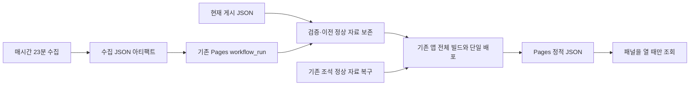

# 항행경보 4단계: 단일 Pages 배포 연결

로컬 구현·검증 문서다. 이번 작업에서는 commit, push, Actions 원격 실행, 실제 Pages 배포를 하지 않는다. 수집기·인증 방식·`KHOA_NAV_WARNING_SERVICE_KEY`·매시간 23분 수집 일정과 목록/상세 디자인은 유지한다.

## 기존 구조와 선택

- `.github/workflows/collect-navigational-warnings.yml`: UTC/KST 매시 23분, 순차 수집·재시도 후 v1 JSON 아티팩트 저장. 실패 실행도 이전 정상 자료와 실패 상태를 보관할 수 있다. 배포 권한은 없다.
- `.github/workflows/deploy-pages.yml`: push/main·수동·일일 일정의 단일 전체 앱 배포. 조석은 성공 배포 아티팩트/Pages를 복구하고 필요할 때만 API로 32일 묶음을 갱신한다. `pages` concurrency 그룹을 사용한다.
- 앱은 항행경보 패널을 열 때 정적 JSON을 읽는다. Pages 빌드의 `VITE_BASE_PATH`는 `configure-pages`가 확인한 `base_path`에서 정하므로 실제 Pages 하위 경로와 일치한다. 로컬 빌드는 기존 저장소 이름/명시적 환경변수 규칙을 유지한다.

선택은 **수집 완료 → 기존 Pages 워크플로 → 전체 앱 빌드/배포**다. 데이터 전용 Pages 배포나 자동 commit을 만들지 않는다. 경로는 `/badakkomkkomi/data/navigational-warnings/latest.json`, `status.json`이다. 로컬에서는 base를 명시해 이 하위 경로도 검증한다.



이번 구현은 매시간 **전체 빌드가 필요**하다. 같은 SHA의 이전 앱 산출물을 재사용하려면 출처·빌드 환경·완전한 자산·SW 정책 검증과 별도 복구 경로가 필요하다. 이번에는 그러한 우회를 추가하지 않았다. 최초 운영 실행 후 실제 Actions 시간/사용량을 측정하고 필요하면 별도 최적화한다. 브라우저는 앱 전체를 매시간 다시 내려받는 구조가 아니라 패널을 열 때 두 JSON만 조회한다.

## 워크플로 보호

기존 Pages 워크플로가 정확한 수집 워크플로 이름의 `workflow_run: completed`를 받는다. 같은 저장소/main의 schedule/manual 실행만 허용하고, API에서 path·branch·event·완료 상태·run attempt를 재검증한다. 다른 워크플로가 같은 이름을 붙인 아티팩트는 원래 workflow run ID와 맞지 않으면 거부한다. 만료·이전 attempt를 새 결과로 채택하지 않는다. 아티팩트는 runner 임시 폴더에 받고 JSON만 읽는다.

배포는 기존 `concurrency: pages`, `cancel-in-progress:false` 및 단 하나의 `actions/deploy-pages`를 유지한다. checkout은 최신 main이며 실제 checkout SHA를 기록해 배포 직전 main과 다시 비교한다. `workflow_run`의 이벤트 SHA로 이전 앱을 덮지 않는다. 대기 실행이 합쳐지거나 늦게 도착해도 이미 게시한 최신 정상 자료/실패 상태를 더 과거 아티팩트로 되돌리지 않는다.

항행경보 이벤트에서 **조석 API는 호출하지 않는다**. 기존 조석 복구와 검증만 수행한다. 조석 정상 자료를 복구하지 못하면 전체 배포를 중단한다. push·수동·기존 일일 조석 갱신 정책과 조석 캐시 플러그인은 유지한다.

근거: [GitHub workflow_run](https://docs.github.com/en/actions/reference/workflows-and-actions/events-that-trigger-workflows#workflow_run), [동시 실행 제어](https://docs.github.com/en/actions/how-tos/write-workflows/choose-when-workflows-run/control-workflow-concurrency), [전체 Pages 아티팩트 배포](https://docs.github.com/en/pages/getting-started-with-github-pages/using-custom-workflows-with-github-pages).

## 정상 자료 선택과 실패 보존

`scripts/prepare-navigational-warnings.mjs`는 API 키 없이 아티팩트와 게시된 Pages를 읽는다. v1 원문·구역 구조와 수집 시각을 유지한다.

|상황|처리|
|---|---|
|새 정상 수집|완전 검증된 더 최신 snapshot을 선택|
|새 정상 0건|정상 시각이 있는 빈 snapshot을 채택. 미수집과 구분|
|새 수집 실패|게시된 가장 최신 정상 snapshot을 유지하고 실패 status를 반영|
|첫 수집 실패·정상 자료 없음|snapshot 정상 시각 null, status failed. 정상 0건으로 바꾸지 않음|
|아티팩트 누락·손상·만료|게시 자료 유지, publication delayed. API 실패라고 추정하지 않음|
|게시된 두 JSON 모두 404|이전 항행경보가 없는 첫 연결로 판단. 저장소의 명시적 미수집 seed 사용 가능|
|게시 자료 네트워크 오류·혼합/손상|기존 자료가 없다고 가정하지 않고 배포 중단. 현재 사이트 보존|
|과거 실행이 늦게 도착|정상 시각/시도 시각 비교로 더 최신 자료·상태 유지|

정상 자료와 최신 수집 상태는 독립적으로 선택한다. 예를 들어 실패 수집기의 백업보다 Pages의 정상 자료가 더 최신이면 그 정상 자료와 새 실패 상태를 결합한다. 아티팩트가 잘못됐다는 이유로 정상 0건을 만들지 않는다.

## 수집 상태와 배포 준비 상태

기존 `status`(success/failed/not_collected/not_configured)와 `lastSuccessfulAt`, `lastAttemptAt`, 수집 `generatedAt`를 유지한다. `status.json`에는 선택적 `publication`만 추가한다.

- `state`: `ready`는 게시용 JSON 준비 완료, `delayed`는 정상 게시 자료로 복구한 상태다.
- `preparedAt`: 배포용 파일을 준비한 시각. 수집 시각이나 배포 완료 시각을 바꾸지 않는다.
- `snapshotSha256`: 실제 latest.json UTF-8 본문의 해시. 서로 다른 세대의 두 파일을 감지한다.
- `reason`, `collectionRunId`, `collectionRunAttempt`: 채택/복구 근거와 확인된 수집 실행 식별자다.

**JSON 준비를 실제 배포 성공이라고 표시하지 않는다.** 실제 성공은 `deploy-pages` 완료와 Actions summary에서 확인한다. 브라우저의 `publicationState=received`는 일치하는 두 파일을 받아 검증했다는 뜻이다. CDN 전체의 배포 완료 증명은 아니다.

실제 배포 자체가 실패하면 새 status도 게시할 수 없다. 따라서 클라이언트가 아직 게시되지 않은 최신 아티팩트나 정확한 실패 원인을 알아낼 수는 없다. 확인 가능한 fallback은 `delayed`, 그 외에는 마지막 수집 시도 후 75분(시간별 수집+여유)을 지나면 **‘갱신 지연’**으로 안내한다. 배포 실패라고 단정하지 않는다. 마지막 정상 수집 후 3시간의 ‘오래됨’은 독립적으로 계산한다. 두 기준은 `src/config/navigationalWarnings.ts`에 분리돼 있다.

조타실 UI는 이번 요청의 보호 범위라 변경하지 않았다. ‘앱 자동 갱신 연결 준비 중’ 문구는 실제 운영 전환을 승인할 때 별도 검토해야 한다.

## 요청·캐시

- 패널을 열 때만 로딩한다. 목록/상세 전환은 재요청하지 않는다.
- 같은 base의 동시 요청은 합치고, 검증된 결과는 메모리에서 60초 재사용한다. 폴링/매초 요청은 없다.
- 실제 네트워크 조회 때만 두 파일에 같은 새 `v` nonce를 붙이고 `cache:no-store`를 사용한다. GitHub Pages의 임의 Cache-Control 설정을 전제하지 않는다.
- 항행경보 폴더를 SW precache에서 제외하고 일반 JSON 캐시보다 앞선 전용 `NetworkOnly` 규칙을 사용한다. 기존 조석 NetworkFirst/검증 플러그인은 그대로다. 구 SW가 남아 있는 전환 중에도 새 query가 이전 고정 JSON과 구별된다.
- hash나 수집 시각이 맞지 않는 두 파일은 정상 결과로 확정하지 않는다. 이전에 검증한 메모리 자료가 있으면 오류와 갱신 지연을 함께 표시한다. 그렇지 않으면 로드 오류다.
- 오프라인/오류 결과를 정상 0건으로 처리하지 않는다. 같은 페이지에서 이미 읽은 자료는 재사용할 수 있지만, 새로 접속한 오프라인 기기에 항행경보 JSON을 SW에서 고정 제공하지 않는다.

Workbox 정책 근거: [공식 NetworkOnly 전략](https://developer.chrome.com/docs/workbox/modules/workbox-strategies#network_only). 로컬 실제 SW 검증에서는 이전 일반 JSON 캐시와 HTTP max-age=600 응답이 있어도 같은 URL의 새 JSON을 읽고, 오프라인에서 이전 캐시를 성공으로 위장하지 않는지 검사한다.

## 로컬 검증

```powershell
npm test
npm run lint
$env:VITE_BASE_PATH = '/badakkomkkomi/'
npm run build
Remove-Item Env:VITE_BASE_PATH
npm run verify
node scripts/verify-navigational-warning-preview.mjs
# 기존 로컬 Playwright 도구를 사용하는 브라우저 검증:
# PLAYWRIGHT_MODULE과 CHROME_EXECUTABLE 설정 후
node src/tests/navigationalWarningSw.browser.mjs
```

실제 Pages에 요청하거나 운영 JSON을 바꾸는 준비 CLI를 로컬 프로젝트 루트에서 실행하지 않는다. 단위 테스트는 임시 폴더와 가짜 HTTPS 응답으로 준비/복구를 검증한다. SW 브라우저 테스트는 dist를 localhost 임시 포트에 제공하고 메모리 테스트 응답만 사용한다. 실제 수집/배포를 하지 않는다.

## 최초 실제 배포 전 확인

1. main에 이번 변경을 반영하는 시점은 사용자 결정이다. 이번에는 Git 쓰기나 원격 실행을 하지 않았다.
2. Pages Source가 GitHub Actions이며 실제 base URL이 `/badakkomkkomi/`인지 확인한다. 워크플로는 Pages가 반환한 `base_path`를 빌드에 전달한다. 커스텀 도메인이라면 Pages 설정과 실제 경로도 확인한다.
3. Repository Actions Secret `KHOA_NAV_WARNING_SERVICE_KEY`와 기존 조석 `KHOA_SERVICE_KEY`를 확인한다. 새 Secret이나 브라우저용 API 키는 추가하지 않는다.
4. Pages 배포 작업의 기존 pages/id-token 쓰기 권한과 actions 읽기 권한, 환경 보호 규칙을 확인한다. 다운로드는 기본 `github.token`을 사용한다.
5. 수집 워크플로를 수동 실행하거나 매시 23분을 기다려 실제 정상 아티팩트를 확보한다. 없는 경우에도 명시적 미수집/지연 상태로만 게시한다. 조석 정상 baseline이 없으면 경보 이벤트로는 bootstrap하지 않는다.
6. 최초 단일 Pages 배포 후 Actions 실제 성공, 두 JSON의 해시/수집 시각, 모바일 재진입, 온라인 갱신과 SW 전환을 운영 주소에서 확인한다. 이 원격 검증은 아직 수행하지 않았다.
