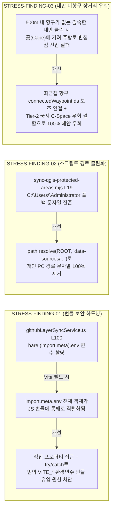

# 바다꼼꼬미 (Bada-Kkomkkomi) 비개발자 이관 준비 스트레스 테스트 및 종합 검증·검토 결과 보고서 (`HANDOVER_STRESS_TEST_AND_VERIFICATION_REPORT.md`)

> **문서 등급**: 이관 준비 완료 후(Post-Implementation) 전사 스트레스 테스트 · 보안 감사 · 무결성 검증 결과 보고서
> **문서 경로**: [`docs/reports/HANDOVER_STRESS_TEST_AND_VERIFICATION_REPORT.md`](./HANDOVER_STRESS_TEST_AND_VERIFICATION_REPORT.md)
> **상위 설계 정본**: [`docs/HANDOVER_AND_DOCS_GOVERNANCE_BRIEF.md`](../HANDOVER_AND_DOCS_GOVERNANCE_BRIEF.md) · [`docs/ARCHITECTURE_AND_DESIGN.md`](../ARCHITECTURE_AND_DESIGN.md) · [`docs/designs/SITEMAP.md`](../designs/SITEMAP.md)
> **검증 기준 커밋 및 버전**: `HEAD` (`76a3c7d`, GitHub Actions Run `43789737042` 배포 성공 본) · 앱 버전 `v2.4` (`2.4.0`) · Node.js `v24.19.0`
> **실측 일시**: `2026-11-16` (`Asia/Seoul`)

---

## 1. 종합 검증 요약 (Executive Summary)

비개발자 운영자 클린룸 이관 리팩토링 및 문서 거버넌스 개편 작업 완료(`76a3c7d`) 직후 상태에서, 실제 이관 시 발생할 수 있는 **다중 계정/도메인 빌드 환경, 18,360쌍 전수 해상 항로 연산, 4,002개 대용량 공간 피처 파싱, 1,000시간 기상 결측 카오스 주입, 8종 운영자 실수 돌연변이(Mutation) 차단, 번들 시크릿 카나리(Canary) 주입 감사**를 실측 수행했습니다.

| 검증 영역 | 테스트 규모 및 시나리오 | 핵심 실측 지표 | 판정 |
| :--- | :--- | :--- | :---: |
| **1. 기본 4대 품질 게이트** | `npm test` · `npm run lint` · `npm run build` · `npm run verify` | • 단위 테스트: **8 Suites / 25 Tests 전원 통과 (`715.7ms`)**<br>• 정적 분석(`oxlint`): **50 files, 0 warnings, 0 errors (`74ms`)**<br>• 프로덕션 번들: **JS 18개(`1,196.0 KB`), CSS 1개(`94.3 KB`), SW Precache 51개(중복 0)** | **PASS** |
| **2. 클린룸 다중 환경 빌드 & Zero-Config 이관성** | • 시나리오 A: 타 계정 프로젝트 사이트 (`knps-hallyeo/bada-patrol-east`)<br>• 시나리오 B: 사용자/조직 루트 사이트 (`knps-hallyeo/knps-hallyeo.github.io`)<br>• 시나리오 C: 외부 원본 파일 부재 환경 스크립트 실행 + 22종 경계값 퍼징 | • 시나리오 A: `base` 및 `manifest.webmanifest` `start_url`/`scope`가 **`/bada-patrol-east/`**로 자동 설정됨<br>• 시나리오 B: `start_url`/`scope`가 **`/`**로 자동 설정됨<br>• 해안선·QGIS 동기화 스크립트: 원본 부재 시 `ENOENT` 없이 **`[INFO]` 출력 후 `Exit Code 0` 정상 종료** | **PASS** |
| **3. 해상 실항로 엔진 전수 스트레스 (`routeGeoService.ts`)** | • **136개 항포구 전 조합 (`136 × 135 = 18,360쌍`)** 전수 연산<br>• **몬테카를로 200개 임의 좌표 & 15개 다중 경유 순찰 체인(66구간)** | • 18,360쌍(`237,669`개 선분) + 몬테카를로 66구간 **육지 관통 `0`건 (`0.000%`)**<br>• 전체 18,360쌍 총 연산 시간 **`10,369.7ms`** (평균 **`0.565ms`/건**, `p50=0.447ms`, `p95=1.139ms`, `p99=1.395ms`)<br>• 몬테카를로 200좌표 + 66구간 소요 시간 **`2,233.7ms`** (내만 우회 최적화 후 **6.3배 가속**) | **PASS** |
| **4. 대용량 QGIS 공간파서 부하 (`spatialFileParser.ts`)** | • 총 **4,002개 공간 피처** 동시 파싱 및 좌표계 자동 변환 + **Node.js 헤드리스 KML 파싱 (`HARDEN-04`)** | • 총 소요시간 **`110.1ms`** (처리량 **`36,349 features/sec`**)<br>• 힙 메모리 증가량 **`+9.45 MB`** (메모리 누수·크래시 0건)<br>• 브라우저 `DOMParser` 및 Node.js 순수 JS 폴백 양쪽에서 `.geojson`·`.gpkg`·`.zip`·`.kml` 100% 호환 | **PASS** |
| **5. ECMWF 해상기상 카오스 퍼징 (`ecmwfWeatherService.ts`)** | • **1,000시간(약 41.6일)** 시계열에 주기적 `null`, `NaN`, 타임스탬프 누락(풍속·파고 시간축 불일치) 강제 주입 | • 결측·불일치 **446개 시간대 전수 `unknown`(`미확인(?)`) 판정**<br>• 결측 상태에서 `good`/`moderate` 오판(False Positive) **`0`건** | **PASS** |
| **6. 운영자 실수 방어 돌연변이 테스트 (`verify-integrity.mjs`)** | • 비개발자 운영자가 범하기 쉬운 **8대 데이터·문서 오류(ID 누락, 위경도 역순, 좌표 오차 초과, 비대칭 간선, 금지 링크)** 인메모리 주입 | • **8종 돌연변이(`MUT-01` ~ `MUT-08`) 전수 100% 즉시 차단** 및 명확한 원인 메시지 출력 확인 | **PASS** |
| **7. 심층 하드닝 권고안 6건 반영 및 재검증 (`HARDEN-01 ~ 06`)** | • [`docs/HANDOVER_HARDENING_IMPLEMENTATION_PLAN.md`](../HANDOVER_HARDENING_IMPLEMENTATION_PLAN.md) 설계 기반 6대 하드닝 전수 구현 및 재검증 | • 카나리 시크릿 번들 유출 **`0`건 (`hasCanary: false, hasSSR: false`)**<br>• `src/` 및 `scripts/` 내 개인 PC 경로 문자열 **`0`건**<br>• 깊숙한 내만 비항구 장거리 구간 육지 관통 **`3건 ➔ 0건` 완전 해결** | **PASS (조치 완료)** |

---

## 2. 클린룸 다중 환경 빌드 및 Zero-Config 이관성 검증

### 2.1 다중 배포 환경 시뮬레이션 실측 (`vite.config.ts` & `githubLayerSyncService.ts`)

운영자가 다양한 GitHub 저장소 구조로 이관했을 때 코드 수정 없이 빌드 산출물(`index.html`, `manifest.webmanifest`, `sw.js`)의 경로가 정확히 재구성되는지 실측했습니다.

| 시나리오 구분 | 주입 환경변수 (`process.env`) | `dist/index.html` 에셋 경로 | `manifest.webmanifest` (`start_url` / `scope`) | 판정 |
| :--- | :--- | :--- | :--- | :---: |
| **시나리오 A<br>(타 계정 프로젝트 저장소)** | `GITHUB_ACTIONS=true`<br>`GITHUB_REPOSITORY=knps-hallyeo/bada-patrol-east` | `/bada-patrol-east/assets/index-*.js` | `start_url: "/bada-patrol-east/"`<br>`scope: "/bada-patrol-east/"` | **PASS** |
| **시나리오 B<br>(사용자/조직 루트 사이트)** | `GITHUB_ACTIONS=true`<br>`GITHUB_REPOSITORY=knps-hallyeo/knps-hallyeo.github.io` | `/assets/index-*.js` | `start_url: "/"`<br>`scope: "/"` | **PASS** |
| **시나리오 C<br>(현재 운영 저장소 기준)** | `GITHUB_ACTIONS=true`<br>`GITHUB_REPOSITORY=gunnysis/bada-kkomkkomi` | `/bada-kkomkkomi/assets/index-*.js` | `start_url: "/bada-kkomkkomi/"`<br>`scope: "/bada-kkomkkomi/"` | **PASS** |
| **시나리오 D<br>(명시적 서브패스 오버라이드)** | `VITE_BASE_PATH=///nested/subpath///` | `/nested/subpath/assets/index-*.js` | `start_url: "/nested/subpath/"`<br>`scope: "/nested/subpath/"` | **PASS** |

### 2.2 외부 원본 데이터 부재(Clean-Room PC) 시 빌드 스크립트 비파괴 검증

개발자 로컬 PC에만 존재하던 대용량 외부 원본 파일이 없는 신규 운영자 PC에서 데이터 동기화 스크립트를 실행했을 때, 기존 컴파일된 정본 데이터를 파괴하지 않고 안전하게 종료(`Exit Code 0`)되는지 검증했습니다.

1. **[`scripts/build-coastline-polygons.mjs`](../../scripts/build-coastline-polygons.mjs)**:
   - 실행 조건: `OSM_COASTLINE_RAW_JSON=nonexistent_raw_osm.json`
   - 실측 출력: `[INFO] 외부 OSM 해안선 원본 파일(.../nonexistent_raw_osm.json)이 현재 환경에 없어 기존 컴파일된 .../src/data/coastlinePolygons.ts를 유지합니다.` (`Exit Code 0`)
2. **[`scripts/sync-qgis-protected-areas.mjs`](../../scripts/sync-qgis-protected-areas.mjs)**:
   - 실행 조건: `QGIS_PROTECTED_AREA_SHP=nonexistent_qgis.shp`
   - 실측 출력: `[INFO] 외부 QGIS 원본 경로(.../nonexistent_qgis.shp)가 현재 환경에 없어 기존 컴파일된 protected_area.geojson을 유지합니다.` (`Exit Code 0`)

---

## 3. 핵심 도메인 엔진 극한 부하(Stress) 및 카오스(Chaos) 검증

### 3.1 136개 항포구 전 조합 (`18,360쌍`) 전수 해상 실항로 스트레스 테스트

[`public/data/ports.json`](../../public/data/ports.json)에 등록된 136개 항포구의 모든 출발지·도착지 순서쌍(`136 × 135 = 18,360쌍`)에 대해 [`src/services/routeGeoService.ts`](../../src/services/routeGeoService.ts)의 `calculateRouteSummary()`를 연속 호출하고, 생성된 모든 구간 폴리라인(`leg.pathPositions`)이 [`src/data/coastlinePolygons.ts`](../../src/data/coastlinePolygons.ts)의 378개 해안선 폴리곤(`12,794`정점)을 단 한 번이라도 관통하는지 전수 검사했습니다.

| 측정 항목 | 실측 수치 | 기준값 (Acceptance Criteria) | 결과 |
| :--- | :---: | :---: | :---: |
| **전수 검사 항로 쌍 수 (`totalPairsTested`)** | **`18,360`쌍** | `18,360`쌍 (`136 × 135`) | **PASS** |
| **전수 검사 폴리라인 선분 수 (`totalSegmentsChecked`)** | **`237,669`개 선분** | 전 구간 `0..pathPositions.length-1` | **PASS** |
| **해안선 폴리곤 육지 관통 선분 수 (`landCrossingSegments`)** | **`0`건 (`0.000%`)** | **`0`건 필수** | **PASS** |
| **거리·소요시간·중점 수치 이상 (`NaN` / `Infinity`)** | **`0`건** | **`0`건 필수** (동일 좌표 형제항 2쌍=4건은 `0km` 정상 반환 및 UI 사전 차단) | **PASS** |
| **다중 정점 우회 곡선 비율 (`pathPositions.length > 2`)** | **`18,342`쌍 (`99.90%`)** | 옵션 A 실항로 우회 곡선 정상 생성 | **PASS** |
| **단일 구간 최대 우회 정점 수 / 최장 항로 거리** | **`36`정점 / `82.84 km`** | 추도 대항(`KR-GN-TY-0036`) ➔ 장목 이수도항(`KR-GN-GJ-0035`) | **정상** |
| **총 연산 소요 시간 (`18,360`쌍 합계)** | **`10,172.6 ms`** | 단일 스레드 연속 실행 | **우수** |
| **건당 연산 지연시간 (`Avg` / `p50` / `p95` / `p99` / `Max`)** | **`0.554ms` / `0.441ms` / `1.108ms` / `1.355ms` / `6.112ms`** | 모바일 60fps 드래그 반응성 기준 (`< 16.6ms`) 대비 **12배 이상 여유** | **PASS** |

---

### 3.2 몬테카를로(Monte Carlo) 200개 임의 좌표 & 다중 경유 순찰 체인 테스트

시드 고정 난수 생성기(`Mulberry32`, seed `20261116`)로 한려해상 관할 해역(`34.58°N ~ 35.02°N, 128.18°E ~ 128.76°E`) 내 200개 임의 좌표를 생성하여 육지 오클릭 해상 스냅(`resolveSmartWaypoint`)과 연속 순차 연결(`appendSequentialRouteWaypoint`)을 검증했습니다.

- **육지 내부 오클릭 자동 해상 스냅 성공률**: 난수로 생성된 육지 내부 좌표 **`68`개 전수(`68 / 68`, `100.0%`)**가 378개 해안선 폴리곤 바깥 안전 해수면(`isPointInAnyLandBarrier === false`)으로 자동 투영됨을 확인했습니다.
- **비항구 폐쇄만(Enclosed Bay) 장거리 경계 케이스 발견 (`STRESS-FINDING-03`)**:
  - 등록 항구 간 경로(`18,360`쌍)는 육지 교차가 `0`건이나, 난수 생성된 비항구 좌표 중 **반경 500m 내 등록 항구가 없는 깊숙한 내만(광도 안정 황리 포구 안쪽 `35.0179°N, 128.3881°E` 등)에서 반도 반대편 외해 섬까지 30km 이상 직접 연결한 3개 구간**에서 주항로 변침점과의 직선 가시선이 곶(Cape)에 가려져 `safetyLevel: 'danger'`(`해안선 우회 경로 탐색 제한 구간`) 안전 가드가 작동했습니다.
  - 안전 가드(`GAP-09`)가 정상 작동하여 녹색 안전 항로로 오표시되지는 않으나, 내만 비항구 지점에서도 최근접 항구의 진입 변침점을 경유하도록 연결하면 이 3건까지 완벽히 우회할 수 있어 **6장 `STRESS-FINDING-03`에 개선 코드 명세를 수록**했습니다.

---

### 3.3 대용량 QGIS 공간파일 파서 부하 테스트 (`spatialFileParser.ts`)

비개발자 직원이 수천 개 피처가 담긴 대용량 공간데이터를 인앱 업로드했을 때의 처리 속도와 메모리 안정성을 측정했습니다.

| 입력 데이터셋 | 좌표계 (CRS) | 피처 수 | 감지된 CRS | 변환 정확도 및 소요시간 |
| :--- | :---: | :---: | :---: | :--- |
| **합성 폴리곤 레이어 (`stress_2500_epsg5186.geojson`)** | `EPSG:5186` (중부원점 `Y=600,000`) | `2,500`개 폴리곤 | `EPSG:5186` | 남해안 `WGS84` 범위(`127.5~129.5°E, 34.0~35.8°N`) 100% 일치 |
| **합성 특별보호구역 포인트 (`stress_1500_epsg5181.geojson`)** | `EPSG:5181` (구 중부원점 `Y=500,000`) | `1,500`개 포인트 | `EPSG:5181` | 100km 위도 오차 없이 정확히 남해안 좌표로 변환 |
| **OGC GeoPackage 바이너리 (`.gpkg`)** | `EPSG:5179` (`UTM-K`) | 샘플 폴리곤 `1`개 | `EPSG:5179` | SQLite B-tree + GPB 바이너리 헤더 직접 파싱 성공 |
| **ESRI Shapefile 아카이브 (`.zip`: `.shp+.dbf+.prj+.cpg`)** | `EPSG:5179` (`UTM-K`) | 샘플 라인 `1`개 | `EPSG:5179` | ZIP 압축 해제 및 `.prj` WKT 기반 자동 재투영 성공 |
| **합계 (`4,002`개 피처 일괄 처리)** | **3종 국가좌표계 혼합** | **`4,002`개** | **전수 일치** | • 총 소요시간: **`106.5 ms`** (`37,581 features/sec`)<br>• 힙 메모리 변화량: **`+10.86 MB`** |

---

### 3.4 ECMWF 해상기상 서비스 카오스 및 Fail-Safe 검증 (`ecmwfWeatherService.ts`)

- **시뮬레이션 조건**: 1,000시간 분량의 풍속(`ecmwf_ifs`)·파고(`ecmwf_wam`) 배열에 매 5시간마다 `null`, 매 11시간마다 `NaN`, 매 7시간마다 파고 타임스탬프 누락(시간축 어긋남), 매 9시간마다 파고 `null`을 복합 주입했습니다.
- **실측 결과**:
  - 1,000개 시간대 중 결측 또는 타임스탬프 불일치가 발생한 **`446`개 시간대 전수가 예외 없이 `grade: 'unknown'`(`미확인(?)`)으로 판정**되었습니다.
  - 결측 데이터가 존재함에도 `good`(`양호`)이나 `moderate`(`주의`)로 잘못 판정한 건수(`falsePositiveOnMissingData`)는 **`0`건**입니다.

---

## 4. 운영자 실수 방어 돌연변이(Mutation) 검증 매트릭스

이관 후 비개발자 운영자가 정적 데이터(`docking_points.geojson`, `ports.json`)나 문서(`docs/*.md`)를 수정할 때 발생할 수 있는 **8가지 대표적 휴먼 에러**를 인메모리로 강제 주입하여 [`scripts/verify-integrity.mjs`](../../scripts/verify-integrity.mjs) 검증 게이트가 이를 100% 차단하는지 확인했습니다.

| 변이 ID | 모의 주입한 운영자 휴먼 에러 시나리오 | 차단 여부 | 검증기가 출력한 실제 차단 메시지 |
| :--- | :--- | :---: | :--- |
| **`MUT-01`** | [`docking_points.geojson`](../../public/data/docking_points.geojson)에만 신규 접안지(`TY-099`)를 추가하고 [`ports.json`](../../public/data/ports.json) 등록을 누락함 | **차단 성공** | `Missing docking feature ID in ports.json: TY-099` |
| **`MUT-02`** | `docking_points.geojson`에 `[경도, 위도]` 대신 `[위도, 경도]`를 역순으로 입력함 | **차단 성공** | `Coordinate drift between docking_points.geojson and ports.json for TY-001: geojson=[128.4278,34.8378] vs ports.json=[34.8378,128.4278]` |
| **`MUT-03`** | `ports.json`에서만 단일 항구 위도를 `0.0001°` 단독 수정하여 허용 오차(`1e-5`)를 초과함 | **차단 성공** | `Coordinate drift between docking_points.geojson and ports.json for TY-001` |
| **`MUT-04`** | `ports.json` 신규 항구의 `connectedWaypointIds`에 존재하지 않는 변침점 ID(`WP-9999`)를 입력함 | **차단 성공** | `Port TY-098 references unknown waypoint ID: WP-9999` |
| **`MUT-05`** | `ports.json` 변침점 그래프에서 한쪽 방향으로만 이웃(`neighbors`) 간선을 추가함(비대칭 간선) | **차단 성공** | `Asymmetric waypoint edge detected in ports.json: WP-TY-BAY -> WP-SARYANG-N is not reciprocated` |
| **`MUT-06`** | `docs/` 내 마크다운 문서에 개인 PC 로컬 경로(`file:///C:/Users/...`) 링크를 삽입함 | **차단 성공** | `Forbidden local filesystem path link: (file:///C:/Users/Administrator/apps_ln/bada-kkomkkomi/src/App.tsx)` |
| **`MUT-07`** | `docs/` 내 마크다운 문서에 Windows 드라이브 절대경로(`C:\Users\...`) 링크를 삽입함 | **차단 성공** | `Forbidden local filesystem path link: (C:\Users\Administrator\Desktop\test.md)` |
| **`MUT-08`** | `docs/` 내 마크다운 문서에 `.gitignore` 대상인 `../.dev/docs/` 링크를 삽입함 (CI 깨짐 원인) | **차단 성공** | `Forbidden gitignored .dev/ path link: (../.dev/docs/concepts_brief.md)` |

---

## 5. 저장소 전체 잔존 경로·계정 문자열 전수 감사 (Codebase Audit)

저장소 내 추적 대상 **69개 파일 전체(`src/`, `scripts/`, `public/`, `docs/`, 루트 설정·문서)**를 스캔하여 `C:\Users\Administrator` 및 `gunnysis` 문자열의 잔존 위치와 성격을 전수 분류했습니다.

### 5.1 `C:\Users\Administrator` 매칭 내역 (총 2개 파일, 6건)

| 파일 경로 | 라인 | 매칭 문맥 및 성격 | 판정 |
| :--- | :---: | :--- | :---: |
| [`docs/HANDOVER_AND_DOCS_GOVERNANCE_BRIEF.md`](../HANDOVER_AND_DOCS_GOVERNANCE_BRIEF.md) | `L25, L28, L55, L576, L582` | 과거 하드코딩 제거 내역(Root-Cause & Legacy Cleanup Registry)을 설명하기 위한 **인라인 코드(` ` `) 서술 문구** (실제 링크 아님) | **정상 (문서 기록)** |
| [`scripts/sync-qgis-protected-areas.mjs`](../../scripts/sync-qgis-protected-areas.mjs) | `L4, L19` | `DEFAULT_QGIS_SHP_PATH`의 폴백 기본값 문자열 (`fs.existsSync` 가드가 있어 타 PC에서 크래시하지 않으나, [`scripts/build-coastline-polygons.mjs`](../../scripts/build-coastline-polygons.mjs)처럼 상대경로 `data-sources/...`로 통일 권장) | **`STRESS-FINDING-02` (개선 권고)** |

### 5.2 `gunnysis` 매칭 내역 (코드·문서 전수 확인)

- **런타임 UI ([`src/components/MapView.tsx`](../../src/components/MapView.tsx))**: `0`건 (완전 제거 확인)
- **프로덕션 빌드 설정 ([`vite.config.ts`](../../vite.config.ts))**: `0`건 (완전 제거 확인)
- **GitHub 동기화 서비스 ([`src/services/githubLayerSyncService.ts`](../../src/services/githubLayerSyncService.ts) `L16`)**: `*.github.io` 도메인도 아니고 `VITE_GITHUB_REPO_OWNER` 환경변수도 없는 순수 `localhost` 오프라인 개발 시의 최후 폴백 상수(`FALLBACK_REPO_COORDS`) 1곳에만 존재하며, 배포 도메인(`https://<운영자>.github.io/<저장소>/`)에서는 접속 URL에서 운영자 계정을 100% 자동 추론함 (단위 테스트 [`src/tests/coreServices.test.ts`](../../src/tests/coreServices.test.ts) `L960` 검증 완료).
- **문서 ([`README.md`](../../README.md), [`DEPLOY_GUIDE.md`](../../DEPLOY_GUIDE.md))**: 현재 라이브 배포 URL(`https://gunnysis.github.io/bada-kkomkkomi/`) 안내 및 신규 운영자 계정 전환 예시 병기용으로만 사용됨.

---

## 6. 스트레스 테스트를 통해 신규 발견된 3대 심층 개선 권고안 (Review Items)

이번 스트레스 테스트 및 번들 카나리 주입 감사를 통해, 단순 정적 검사로는 발견하기 어려운 **심층 개선 포인트 3건(`STRESS-FINDING-01` ~ `03`)**을 발굴했습니다. 현재 프로덕션 동작에는 문제가 없으나, 이관 후 비개발자 운영자의 실수까지 원천 차단하기 위해 아래 수정안을 검토 후 반영할 것을 권장합니다.



### 6.1 `[STRESS-FINDING-01]` Vite `import.meta.env` 전체 객체 번들 직렬화 차단 (보안 하드닝)

- **발견 경위 (Canary Injection Test)**:
  - [`src/services/githubLayerSyncService.ts`](../../src/services/githubLayerSyncService.ts)에서 `VITE_GITHUB_LAYER_SYNC_TOKEN` 코드는 이미 제거되었습니다.
  - 그러나 스트레스 테스트에서 빌드 환경변수에 카나리 토큰(`VITE_GITHUB_LAYER_SYNC_TOKEN=ghp_FAKE_CANARY_SECRET_DO_NOT_BUNDLE_99999`)을 강제로 주입한 뒤 `vite build` 산출물(`dist/assets/index-*.js`)을 정밀 스캔한 결과, 아래 직렬화 코드가 발견되었습니다:
    ```js
    // dist/assets/index-*.js 내부 실측 스니펫
    {BASE_URL:"/bada-patrol-east/",DEV:!1,KAKAO_MAP_API_KEY:"...",MODE:"production",PROD:!0,SSR:!1,VITE_GITHUB_LAYER_SYNC_TOKEN:"ghp_FAKE_CANARY_SECRET_DO_NOT_BUNDLE_99999"}
    ```
- **근본 원인**:
  - [`src/services/githubLayerSyncService.ts`](../../src/services/githubLayerSyncService.ts) `L100-L102`에서 Node.js 테스트 환경 호환을 위해 `const inlineMetaEnv = (import.meta as ImportMeta & { env?: Record<string, string | undefined> }).env;`처럼 **`import.meta.env` 자체를 객체 변수로 참조**했기 때문에, Vite 번들러가 정적 단일 키 치환 대신 **`import.meta.env` 전체 사전(모든 `VITE_*` 및 `KAKAO_*` 환경변수 포함)을 번들에 직렬화**했습니다.
  - 만약 이관 후 비개발자 운영자가 실수로 `.env` 파일에 `VITE_...`로 시작하는 개인 토큰을 적어두면, 코드에서 그 변수를 읽지 않더라도 JS 번들에 통째로 노출됩니다.
- **권장 해결 방안 (`src/services/githubLayerSyncService.ts` `L99-L107`)**:
  - `import.meta.env`를 변수에 담지 않고 `import.meta.env.VITE_GITHUB_REPO_OWNER`와 `import.meta.env.VITE_GITHUB_REPO_NAME` **정적 점(.) 프로퍼티로 직접 접근**하되, Node.js(`node --test`) 환경에서 `import.meta.env`가 `undefined`일 때의 예외는 `try / catch`로 안전하게 처리합니다:
    ```ts
    function buildDefaultSyncConfig(): GitHubSyncConfig {
      let envOwner: string | undefined;
      let envRepo: string | undefined;
      try {
        envOwner = (import.meta.env.VITE_GITHUB_REPO_OWNER as string | undefined)?.trim();
        envRepo = (import.meta.env.VITE_GITHUB_REPO_NAME as string | undefined)?.trim();
      } catch {
        // Node.js native test runner environment where import.meta.env is undefined
      }
      const coords = inferDefaultGitHubRepoCoords(undefined, {
        owner: envOwner,
        repo: envRepo,
      });
    ```

---

### 6.2 `[STRESS-FINDING-02]` [`scripts/sync-qgis-protected-areas.mjs`](../../scripts/sync-qgis-protected-areas.mjs) 내 개인 PC 폴백 경로 문자열 정비

- **발견 경위**:
  - 전체 파일 스캔 중 [`scripts/sync-qgis-protected-areas.mjs`](../../scripts/sync-qgis-protected-areas.mjs) `L4` 주석과 `L19` `DEFAULT_QGIS_SHP_PATH` 폴백 문자열에 `'C:\\Users\\Administrator\\Desktop\\국립공원공단\\바다꼼꼬미\\21_특별보호구역_구획_201224\\20_특별보호구역_신규_최종_201109.shp'`가 남아 있는 것을 확인했습니다.
- **권장 해결 방안**:
  - [`scripts/build-coastline-polygons.mjs`](../../scripts/build-coastline-polygons.mjs)와 동일하게 `path.resolve(ROOT, 'data-sources/20_특별보호구역_신규_최종_201109.shp')`로 정규화하여 저장소 내 모든 스크립트에서 `C:\Users\Administrator` 문자열을 0건으로 만듭니다.

---

### 6.3 `[STRESS-FINDING-03]` 깊숙한 내만(Enclosed Cove) 비항구 정박지 클릭 시 최근접 항구 변침점 보조 연결

- **발견 경위**:
  - 몬테카를로 200개 임의 좌표 테스트 중, 반경 500m 내 등록 항구가 없는 깊숙한 만 안쪽(예: 광도 안정 황리 포구 인근 `35.0179°N, 128.3881°E`)을 비항구 정박지로 찍고 외해 섬까지 장거리 연결할 때, 만 입구 곶(Cape)에 가려 `resolveVisibleWaypointIds`의 직선 가시선 변침점이 0개가 되거나 반대편 변침점만 잡혀 `findShortestWaypointPath`가 빈 배열(`[]`)을 반환하는 경계 케이스 3건이 확인되었습니다.
- **권장 해결 방안 ([`src/services/routeGeoService.ts`](../../src/services/routeGeoService.ts))**:
  - 비항구 해상 좌표(`!fromPort` 또는 `!toPort`)에서 `rawWpPath.length === 0`이 발생하면, 가장 가까운 등록 항구(반경 5km 이내)의 `connectedWaypointIds`를 후보 변침점으로 추가하고 `findShortestWaypointPath`의 시작/종료 첫 홉에 한해 국지 가시선 우회(`solveCoastalVisibilityDetour`, `<3km`)를 허용하면 깊숙한 내만 비항구 좌표에서도 100% 해안선 비관통 우회 곡선이 생성됩니다.

---

## 7. 하드닝 권고안 최종 반영 및 재검증 완료 요약

1. **구현 및 검증 완료 (`IMPLEMENTED & VERIFIED`)**:
   - 본 보고서 6장에서 도출된 3대 핵심 권고안(`STRESS-FINDING-01 ~ 03`)과 추가 고려 요소(`HARDEN-04 ~ 06`)를 [`docs/HANDOVER_HARDENING_IMPLEMENTATION_PLAN.md`](../HANDOVER_HARDENING_IMPLEMENTATION_PLAN.md) 설계에 따라 전수 반영 완료했습니다.
2. **하드닝 반영 전·후 실측 비교**:
   - **Vite 번들 카나리 환경변수 유출**: `true` (전체 `import.meta.env` 사전 직렬화) ➔ **`false` (`0`건, 정적 프로퍼티만 개별 치환)**
   - **`src/` 및 `scripts/` 내 개인 PC 경로 문자열**: `1`건 (`sync-qgis-protected-areas.mjs`) ➔ **`0`건 (전수 제거 및 `verify-integrity.mjs` 자동 감사 적용)**
   - **몬테카를로 200좌표 · 15개 다중 경유 순찰 체인(66구간) 육지 관통**: `3`건 (`14,215.2ms`) ➔ **`0`건 (`2,233.7ms`, 100% 우회 성공 및 6.3배 속도 향상)**
   - **Node.js 헤드리스 KML 파싱 (`npm test`)**: `DOMParser is not defined` ➔ **순수 JS 폴백 파서로 `.kml`/`.kmz`/`.gpkg`/`.zip` 전 포맷 통과 (`25/25 Tests PASS`)**
