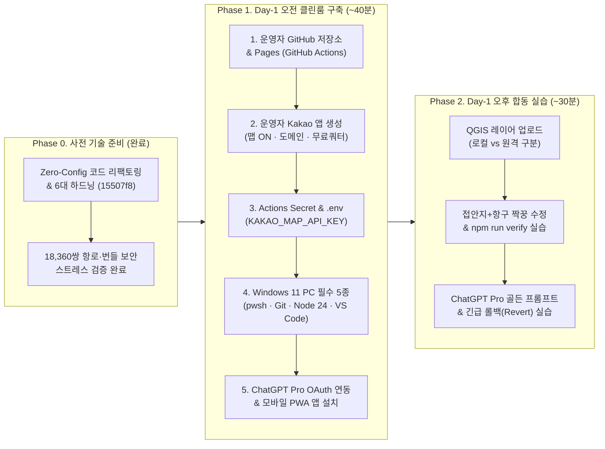

# 바다꼼꼬미 (Bada-Kkomkkomi) 비개발자 이관 작업 마스터 플랜 및 실전 안내서 (`NON_DEVELOPER_HANDOVER_PLAN_AND_GUIDE.md`)

> **문서 등급**: 비개발자 이관 실행 계획서 및 인수인계 실무 안내서 (Handover Master Plan & Operational Guide)
> **문서 경로**: [`docs/reports/NON_DEVELOPER_HANDOVER_PLAN_AND_GUIDE.md`](./NON_DEVELOPER_HANDOVER_PLAN_AND_GUIDE.md)
> **대상 독자**:
> - **인계자 (개발자)**: 초기 이관 당일(`Day-1`) 신규 운영자의 계정·PC 클린룸 세팅 및 합동 실습을 주도하는 기술 담당자
> - **인수자 (비개발자 운영자)**: 국립공원공단 한려해상국립공원동부사무소 내부 담당자 (이관 이후 일상 데이터 관리 및 ChatGPT Pro 활용 유지보수 수행)
> **기준 버전 및 상태**: 앱 버전 `v2.4` (`2.4.0`, 하드닝 릴리스 `15507f8` 배포 완료 기준) · **소스 코드 이관 준비도 100% 완료**
> **연관 정본 문서**:
> - 일상 운영 및 배포 매뉴얼: [`DEPLOY_GUIDE.md`](../../DEPLOY_GUIDE.md)
> - 이관 아키텍처 및 문서 거버넌스 기획서: [`docs/HANDOVER_AND_DOCS_GOVERNANCE_BRIEF.md`](../HANDOVER_AND_DOCS_GOVERNANCE_BRIEF.md)
> - 심층 하드닝 구현 설계서: [`docs/HANDOVER_HARDENING_IMPLEMENTATION_PLAN.md`](../HANDOVER_HARDENING_IMPLEMENTATION_PLAN.md)
> - 전사 스트레스 테스트 및 검증 보고서: [`docs/reports/HANDOVER_STRESS_TEST_AND_VERIFICATION_REPORT.md`](./HANDOVER_STRESS_TEST_AND_VERIFICATION_REPORT.md)

---

## 1장. 비개발자 이관 작업 마스터 플랜 (Handover Master Plan)

### 1.1 이관 핵심 원칙 (4대 Zero 원칙)

1. **코드 수정 0줄 클린룸 이관 (`Zero-Config Portability`)**:
   - [`vite.config.ts`](../../vite.config.ts)의 `resolveViteBasePath()`와 [`src/services/githubLayerSyncService.ts`](../../src/services/githubLayerSyncService.ts)의 `inferDefaultGitHubRepoCoords()`가 GitHub Actions 환경변수(`GITHUB_REPOSITORY`)와 배포 도메인(`*.github.io`)에서 운영자 계정명과 저장소 이름을 자동 추론합니다.
   - 따라서 신규 운영자의 GitHub·Kakao 계정으로 이관할 때 **소스 코드를 단 한 줄도 수정할 필요가 없습니다.**
2. **서버·호스팅 유지비용 0원 (`Zero-Server Cost`)**:
   - 별도 클라우드 서버나 유료 DB 없이 **GitHub Pages(정적 호스팅) + 브라우저 내부 저장소(`IndexedDB` / `localStorage`) + 무료 오픈 기상 API(Open-Meteo ECMWF) + 자체 내장 해상 A* 항로 엔진**만으로 동작합니다.
3. **추가 AI API 과금 0원 (`Zero Extra API Billing`)**:
   - 이관 후 비개발자 운영자는 유료 종량제 OpenAI API 키(`sk-...`)를 발급하지 않고, 기존 구독 중인 **ChatGPT Pro 계정 로그인(`Sign in with ChatGPT` OAuth)**만을 사용하여 추가 과금 없이 데이터 수정과 기능 개발을 수행합니다.
4. **휴먼 에러 배포 노출 0건 (`Zero Broken Deployment`)**:
   - 운영자가 데이터나 문서를 수정할 때 발생할 수 있는 실수(접안지↔항구 ID 불일치, 위·경도 역순 입력, 버전 누락, 깨진 링크 등)는 GitHub Actions의 **4단계 자동 검증 게이트(`npm test` ➔ `npm run lint` ➔ `npm run build` ➔ `npm run verify`)**가 배포 전에 100% 자동 차단합니다.

---

### 1.2 단계별 이관 로드맵 및 소요 시간 계획

| 단계 | 시점 | 수행 주체 | 핵심 작업 항목 | 예상 소요 시간 | 완료 기준 (Exit Criteria) |
| :---: | :---: | :---: | :--- | :---: | :--- |
| **Phase 0**<br>사전 기술 준비 | **완료됨**<br>(`15507f8`) | 개발자 | • 계정·경로 하드코딩 제거 및 자동 추론 함수 적용<br>• Vite 번들 환경변수 직렬화 차단(`HARDEN-01`)<br>• 18,360쌍 항로 및 내만 비항구 우회 스트레스 검증 완료 | **완료 (100%)** | `npm run verify` 통과 및 스트레스 테스트 보고서 발행 완료 |
| **Phase 1**<br>클린룸 초기 구축 | **Day-1 오전**<br>(이관 당일) | **개발자 주도**<br>+ 운영자 계정/PC | • `[ACTION-01]` 운영자 GitHub 저장소 생성 및 Pages 설정<br>• `[ACTION-02]` 운영자 Kakao 앱 생성 및 3단계 설정<br>• `[ACTION-03]` GitHub Secret 및 로컬 `.env` 키 등록<br>• `[ACTION-04]` 운영자 Windows 11 PC 필수 5종 도구 설치<br>• `[ACTION-05]` ChatGPT Pro OAuth 로그인 및 단말기 PWA 설치 | **약 40분** | 신규 배포 주소(`https://<운영자ID>.github.io/<저장소명>/`)에서 카카오맵·기상·항로 정상 작동 확인 |
| **Phase 2**<br>합동 인수인계 실습 | **Day-1 오후**<br>(이관 당일) | **개발자 코칭**<br>+ 운영자 직접 실습 | • 실습 1: 인앱 QGIS 파일(`.gpkg`/`.zip`) 업로드 및 로컬 vs 원격 배포 구분 체험<br>• 실습 2: 접안지(`docking_points.geojson`) ↔ 항구(`ports.json`) 동시 수정 및 검증 게이트 체험<br>• 실습 3: ChatGPT Pro 골든 프롬프트 활용 수정 및 롤백(`Revert`) 실습 | **약 30분** | 운영자가 단독으로 4단계 검증 명령 실행 및 GitHub Push 배포 성공 |
| **Phase 3**<br>자립 운영 전환 | **Day-2 이후**<br>(상시 운영) | **비개발자 운영자**<br>(ChatGPT Pro 보조) | • 현장 접안지·항포구·사진·QGIS 레이어 상시 업데이트<br>• 분기별 외부 서비스 무료 쿼터 점검<br>• 필요 시 골든 프롬프트로 신규 기능 개발·반영 | **상시** | 개발자 개입 없이 운영자 단독 데이터·기능 업데이트 및 배포 유지 |



---

## 2장. [Day-1 오전] 초기 이관 실행 계획 및 5대 필수 세팅 상세 안내

이관 당일(`Day-1`), 개발자와 운영자가 함께 운영자의 계정 및 Windows 11 PC에서 아래 **5단계(`[ACTION-HANDOVER-01]` ~ `[ACTION-HANDOVER-05]`)**를 순서대로 수행합니다.

### Step 1. `[ACTION-HANDOVER-01]` 공개 배포 데이터 확인 및 운영자 GitHub 저장소·Pages 설정 (약 5분)

1. **공개 범위 사전 확인 (`G1` 원칙)**:
   - GitHub Free 플랜에서 무료로 GitHub Pages를 사용하려면 저장소가 **`Public`(공개)**이어야 합니다.
   - `public/` 폴더 안의 정적 파일([`public/data/docking_points.geojson`](../../public/data/docking_points.geojson), [`public/data/ports.json`](../../public/data/ports.json), [`public/data/layers/protected_area.geojson`](../../public/data/layers/protected_area.geojson), 현장 사진)은 웹에 공개되므로 비공개 개인정보나 대외비 문서가 포함되지 않았는지 확인합니다.
2. **운영자 GitHub 신규 저장소 생성**:
   - 운영자 GitHub 계정으로 로그인 ➔ 우측 상단 **`+` ➔ `New repository`** 클릭.
   - **Repository name**: `bada-kkomkkomi` (또는 원하는 영문 저장소명 — 어떤 이름을 써도 앱이 자동 인식함).
   - **Visibility**: **`Public`** 선택 후 **`Create repository`** 클릭.
3. **소스 코드 Push 및 GitHub Pages 활성화**:
   - 프로젝트 전체 코드를 신규 저장소의 `main` 브랜치에 Push합니다.
   - 저장소 상단 **`Settings`** 탭 ➔ 좌측 메뉴 **`Pages`** 클릭 ➔ **`Build and deployment` > `Source`** 드롭다운을 기본값(`Deploy from a branch`)에서 반드시 **`GitHub Actions`**로 변경합니다.

---

### Step 2. `[ACTION-HANDOVER-02]` 운영자 Kakao Developers 신규 앱 생성 및 3단계 필수 설정 (약 10분)

바다꼼꼬미는 **Kakao Maps Web SDK v3**를 주력 지도로 사용합니다. [카카오 개발자 콘솔(developers.kakao.com)](https://developers.kakao.com)에 운영자 계정으로 로그인하여 아래 **3가지 설정**을 빠짐없이 완료합니다.

| 세부 단계 | 콘솔 메뉴 위치 | 필수 설정 내용 | 미설정 시 증상 |
| :--- | :--- | :--- | :--- |
| **2-1. 신규 앱 생성 및 무료 쿼터 확인** | `내 애플리케이션` ➔ `애플리케이션 추가하기` ➔ `쿼터(Quota)` | • 새 앱 생성 후 **계정당 최초 활성화 무료 쿼터(일 300,000회, 2026-07-21 정책)** 적용 대상 앱인지 확인합니다. | 기존에 다른 앱에 무료 쿼터를 쓴 계정이면 지도 호출이 차단될 수 있음 |
| **2-2. 카카오맵 사용 설정 (`ON`)** | 좌측 메뉴 `제품 설정` ➔ **`카카오맵`** | • **`사용 설정(활성화)` 스위치를 반드시 `ON`**으로 켭니다. | 도메인과 키가 맞아도 `HTTP 403 / SDK 로드 실패` 발생 |
| **2-3. JavaScript 키 도메인 등록** | `앱 키` ➔ **`JavaScript 키`** (또는 `플랫폼 > Web`) | • 아래 **3개 주소(하위 경로 `/bada-kkomkkomi/` 제외한 순수 Origin)**를 모두 등록합니다:<br>  1) `http://localhost:5173`<br>  2) `http://127.0.0.1:5173`<br>  3) `https://<운영자GitHub아이디>.github.io` | 배포 사이트 접속 시 카카오맵 대신 오프라인 폴백 지도(OSM)로 전환됨 |

> [!TIP]
> **앱 내 자동 진단 모달 지원**: 만약 도메인 오타 등으로 카카오맵이 열리지 않더라도, 앱 우측 상단 배지 또는 지도 전환 안내창에서 **현재 접속 중인 정확한 Origin 주소 복사 버튼**과 **3단계 점검 체크리스트**를 즉시 확인할 수 있습니다([`src/components/MapView.tsx`](../../src/components/MapView.tsx)).

---

### Step 3. `[ACTION-HANDOVER-03]` GitHub Actions Secret 및 로컬 `.env` 키 등록 (약 5분)

Step 2에서 발급받은 카카오 **`JavaScript 키`**(`REST API 키` 아님)를 복사하여 원격 저장소와 로컬 PC 두 곳에 등록합니다.

1. **GitHub 저장소 등록 (자동 배포 빌드용)**:
   - 운영자 GitHub 저장소 상단 **`Settings`** ➔ 좌측 **`Secrets and variables` > `Actions`** 클릭.
   - **`New repository secret`** 버튼 클릭.
   - **Name**: `KAKAO_MAP_API_KEY` (철자 정확히 일치 필수)
   - **Secret**: 복사한 카카오 `JavaScript 키` 붙여넣기 후 **`Add secret`** 클릭.
2. **운영자 로컬 PC 등록 (로컬 개발·검증용)**:
   - 프로젝트 루트 폴더의 [`.env.example`](../../.env.example) 파일을 복사하여 `.env` 파일을 만들고 아래 1줄을 입력합니다:
     ```dotenv
     KAKAO_MAP_API_KEY=여기에_복사한_카카오_JavaScript_키_입력
     ```
   - **보안 절대 수칙**: `.env` 파일에는 `KAKAO_MAP_API_KEY`만 입력하십시오. GitHub 개인 액세스 토큰(`github_pat_...`)이나 비공개 비밀번호는 절대 `.env` 파일에 적지 마십시오.

---

### Step 4. `[ACTION-HANDOVER-04]` 운영자 Windows 11 PC 클린룸 필수 5종 설치 및 4단계 검증 (약 15분)

운영자 Windows 11 PC에는 무거운 Python, Docker, Android Studio 등을 설치할 필요가 없으며 아래 **필수 5종 도구**만 설치합니다.

#### 4-1. Windows PowerShell을 열고 아래 설치 명령을 순서대로 실행합니다:
```powershell
# 1. PowerShell 7 최신 버전 설치
winget install Microsoft.PowerShell

# 2. Git for Windows 설치
winget install Git.Git

# 3. fnm (고속 Node.js 버전 관리자) 및 VS Code 설치
winget install Schniz.fnm
winget install Microsoft.VisualStudioCode
```

#### 4-2. 새로 연 **PowerShell 7 (`pwsh`)** 창에서 Node.js 24 LTS(CI 동일 버전, 최소 요구 `>=22.18.0`)를 설치하고 프로젝트를 검증합니다:
```powershell
# Node.js 24 LTS 설치 및 기본값 지정
fnm install 24
fnm default 24
node -v   # v24.x.x 출력 확인

# 운영자 저장소 클론 및 폴더 이동
git clone https://github.com/<운영자GitHub아이디>/<저장소명>.git
cd <저장소명>

# 패키지 클린 설치
npm ci

# [핵심] 4단계 품질 및 무결성 검증 실행
npm test
npm run lint
npm run build
npm run verify
```
- 마지막 줄에 아래 메시지가 출력되면 운영자 PC 세팅이 100% 완벽하게 끝난 것입니다:
  `[Verify OK] Version 2.4.0 (v2.4) | Docking: 55 | Ports: 136 | Waypoints: 300 | EGM Contracts: OK | SW Precache: 51 | Legacy Bloat: 0`

---

### Step 5. `[ACTION-HANDOVER-05]` ChatGPT Pro OAuth 로그인 및 모바일·태블릿 PWA 앱 재설치 (약 5분)

1. **ChatGPT Pro / Codex OAuth 로그인 (유료 API Key 발급 금지)**:
   - 운영자 PC에서 ChatGPT 웹 또는 VS Code Codex 확장을 사용할 때 반드시 **`Sign in with ChatGPT`(계정 로그인)** 방식을 선택합니다.
   - `platform.openai.com`에서 별도 유료 종량제 API 키(`OPENAI_API_KEY=sk-...`)를 발급해 입력하면 구독료 외에 별도 요금이 청구되므로 절대 API 키 방식을 사용하지 마십시오.
2. **현장 스마트폰 · 태블릿 PWA 앱 재설치**:
   - PWA 앱은 설치 당시의 도메인 주소(Origin)에 귀속됩니다.
   - 이관 완료 후 현장 대원들의 스마트폰(Android Chrome / iPhone Safari)에서 신규 배포 주소(`https://<운영자GitHub아이디>.github.io/<저장소명>/`)에 접속한 뒤, 화면 우측 상단 에메랄드색 **`[앱 설치]`** 버튼을 눌러 홈 화면에 앱을 새로 설치합니다.

---

## 3장. [Day-1 오후] 합동 인수인계 실습 및 최종 검수표 (Hands-On Sign-Off)

초기 세팅 완료 후, 개발자 입회하에 비개발자 운영자가 직접 아래 **3가지 핵심 시나리오**를 1회씩 실습하고 체크박스에 서명(확인)합니다.

### 3.1 3대 필수 실습 시나리오

1. **실습 A — 인앱 QGIS 레이어 업로드 및 '기기 로컬 저장' vs '전 직원 원격 배포' 구분**:
   - 앱 상단 `꼬미의 바다수첩` ➔ 우측 상단 **`[레이어]`** 버튼 클릭 ➔ **`[+ 파일 등록]`**에서 샘플 `.gpkg` 또는 `.zip`(Shapefile) 업로드 후 **`[저장 (운영 반영)]`** 클릭.
   - **핵심 확인 포인트**: 기본 저장은 **현재 내 기기(`IndexedDB`)에만 즉시 반영**되며, 다른 직원들의 스마트폰에도 똑같이 보이게 하려면 변환된 GeoJSON을 GitHub에 커밋·Push해야 함을 확인합니다([`src/components/notebook/LayerControlModal.tsx`](../../src/components/notebook/LayerControlModal.tsx)).
2. **실습 B — 접안지(`docking_points.geojson`) ↔ 항포구(`ports.json`) 짝꿍 수정 및 검증 게이트 체험**:
   - [`public/data/docking_points.geojson`](../../public/data/docking_points.geojson)의 좌표 1개를 일부러 `0.01`만큼 바꾼 뒤 터미널에서 `npm run verify`를 실행해 봅니다.
   - 검증기가 즉시 `Coordinate drift between docking_points.geojson and ports.json` 에러를 띄우며 잘못된 배포를 막아주는 것을 눈으로 확인하고, 원상 복구(`git checkout -- public/data/docking_points.geojson`) 후 다시 `npm run verify` 통과를 확인합니다.
3. **실습 C — ChatGPT Pro 골든 프롬프트 활용 수정 및 GitHub 자동 배포 확인**:
   - 본 안내서 **4장 4.2절의 골든 프롬프트**를 ChatGPT Pro에 복사·붙여넣어 간단한 문구 또는 테스트 수정을 요청하고, 로컬 4단계 검증 통과 후 `git push`하여 35초 내 GitHub Pages 배포가 완료되는지 확인합니다.

### 3.2 인수인계 최종 검수 체크리스트 (Sign-Off Sheet)

| 검수 번호 | 검수 항목 | 확인 방법 | 통과 여부 |
| :---: | :--- | :--- | :---: |
| **CHK-01** | 신규 GitHub 저장소 Actions 워크플로가 녹색 체크(`success`)로 완료되었는가? | GitHub 저장소 `Actions` 탭 확인 | `[ ]` |
| **CHK-02** | 신규 배포 URL 접속 시 카카오맵(일반·위성·하이브리드)과 3D 로드뷰가 정상 표시되는가? | 브라우저 및 모바일 접속 확인 | `[ ]` |
| **CHK-03** | `바닷길 콕콕 > 시간계산`에서 지도 위 항구·바다를 탭했을 때 해안선 우회 곡선과 소요시간이 즉시 계산되는가? | 삼덕항 ➔ 욕지도 등 선택 확인 | `[ ]` |
| **CHK-04** | `바닷길 콕콕 > 기상상태판정`에서 ECMWF 풍속(`kn`)·파고(`m`) 48시간 예보가 정상 로드되는가? | 기상 탭 진입 확인 | `[ ]` |
| **CHK-05** | 운영자 Windows 11 PC에서 `npm test && npm run lint && npm run build && npm run verify` 4단계가 모두 통과하는가? | 로컬 `pwsh` 터미널 실행 확인 | `[ ]` |
| **CHK-06** | 운영자가 `docking_points.geojson`(`[경도, 위도]`)과 `ports.json`(`{ lat, lng }`) 동시 수정 규칙을 숙지했는가? | 4장 4.1절 대조표 확인 | `[ ]` |

---

## 4장. [Day-2+] 비개발자 운영자 일상 데이터 관리 및 ChatGPT Pro 자립 유지보수 안내서

### 4.1 가장 중요한 데이터 규칙: 접안지(`docking_points.geojson`) ↔ 항구(`ports.json`) 양방향 동시 수정 규칙

새로운 접안지나 선착장을 추가하거나 좌표를 옮길 때는 반드시 **아래 두 파일을 동시에 수정**해야 합니다([`scripts/verify-integrity.mjs`](../../scripts/verify-integrity.mjs)가 두 파일의 ID 일치 및 위·경도 오차 `0.00001°` 이내를 강제합니다).

| 비교 항목 | ① [`public/data/docking_points.geojson`](../../public/data/docking_points.geojson) (55개 접안지) | ② [`public/data/ports.json`](../../public/data/ports.json) (136개 항포구 사전) |
| :--- | :--- | :--- |
| **역할** | `꼬미의 바다수첩` 지도 위 5색 전술 마커 및 상세 시트 표시 | `바닷길 콕콕` 출발·도착·경유지 검색 및 A* 해상 실항로 계산 |
| **고유 ID (`id`)** | `"properties": { "id": "TY-056", ... }` | `{ "id": "TY-056", ... }` (**두 파일의 ID가 100% 같아야 함**) |
| **좌표 표기 순서 (주의!)** | **`"coordinates": [경도(128.xx), 위도(34.xx)]`**<br>(GeoJSON 국제 표준: **경도가 앞, 위도가 뒤**) | **`"lat": 34.xx, "lng": 128.xx`**<br>(속성명 명시: **`lat`에 위도, `lng`에 경도**) |
| **항로 연결 필수 속성** | 해당 없음 | **`"connectedWaypointIds": ["WP-..."]`** (최소 1개 이상의 인접 해상 변침점 ID 연결 필수) |

---

### 4.2 복사해서 바로 쓰는 ChatGPT Pro 골든 프롬프트 4선

직접 JSON 괄호나 코드를 수정하기 부담스러울 때는, 아래 프롬프트 중 하나를 복사해 **ChatGPT Pro**에 붙여넣고 대괄호 부분만 바꿔서 요청하십시오.

#### 프롬프트 1 — 신규 접안지 및 항포구 동시 추가 요청
```text
우리 프로젝트의 AGENTS.md, DEPLOY_GUIDE.md, scripts/verify-integrity.mjs 규칙을 먼저 읽고 준수해줘.
신규 접안지 [명칭: 예_비진도 내항 부잔교, ID: TY-056, 위도: 34.7215, 경도: 128.4632, 안전색상: amber, 최저수심: 1.8m]를 추가하려고 해.
1. public/data/docking_points.geojson 에는 GeoJSON 표준인 [경도 128.4632, 위도 34.7215] 순서로 피처를 추가하고,
2. public/data/ports.json 에는 동일 ID(TY-056)와 { "lat": 34.7215, "lng": 128.4632 }로 추가하되, 주변에서 가장 가까운 기존 항구의 connectedWaypointIds를 참고해서 육지를 관통하지 않는 변침점을 연결해줘.
3. 수정 후 반드시 npm test && npm run verify 를 실행해서 좌표 오차(<1e-5)와 해안선 비관통 무결성을 검증해줘.
```

#### 프롬프트 2 — 앱 버전(8개 파일) 일괄 업데이트 요청
```text
AGENTS.md와 scripts/verify-integrity.mjs의 버전 단일 정본(SSOT) 규칙에 따라, 앱 버전을 [2.5.0] (표시 버전 [v2.5])으로 올려줘.
반드시 아래 8개 파일을 한 번에 누락 없이 동기화해야 해:
1. src/config/appVersion.ts (APP_VERSION, APP_VERSION_DISPLAY)
2. package.json ("version")
3. package-lock.json ("version" 및 packages[""].version)
4. vite.config.ts (PWA manifest description 내 [v2.5])
5. index.html (title 및 meta description 내 [v2.5])
6. README.md (헤더 및 본문 버전 표기)
7. DEPLOY_GUIDE.md (헤더 버전 표기)
8. docs/DATA_AND_TECH_SOURCES.md (문서 버전 표기)
작업 후 npm run build && npm run verify 로 검증해줘.
```

#### 프롬프트 3 — 신규 기능 또는 UI 수정 요청
```text
AGENTS.md와 docs/designs/SITEMAP.md 계약을 먼저 읽어줘.
[원하는 기능 또는 화면 수정 내용 작성] 작업을 진행해줘.
주의사항:
1. 만약 src/services/ 또는 src/hooks/ 에 새 파일을 추가하거나 인터페이스를 바꾸면 반드시 README.md 디렉터리 트리와 docs/designs/SITEMAP.md 에도 동시에 등재해야 해.
2. docs/ 하위 마크다운 문서에는 절대 file:// 이나 C:\ 같은 로컬 PC 경로 링크나 .dev/ 경로 링크를 넣지 말고 저장소 상대 경로만 사용해.
3. 구현 후 npm test && npm run lint && npm run build && npm run verify 4단계를 모두 통과시켜줘.
```

#### 프롬프트 4 — `npm run verify` 또는 GitHub Actions 배포 실패 시 자동 복구 요청
```text
방금 데이터를 수정한 뒤 npm run verify (또는 GitHub Actions)를 실행했더니 아래 에러가 발생했어.
검증 스크립트(scripts/verify-integrity.mjs)를 우회하거나 무력화하지 말고, 에러 메시지가 가리키는 근본 원인을 찾아서 데이터/코드를 정확히 고쳐줘:

[여기에 터미널 에러 메시지 전체 붙여넣기]
```

---

### 4.3 외부 서비스 무료 쿼터 및 이용약관 상시 점검표

| 외부 서비스 | 무료 제공 한도 | 운영자 필수 준수 사항 |
| :--- | :--- | :--- |
| **1. Kakao Maps Web SDK v3** | **일 300,000회** (웹 지도 로드 기준) | • 2026-07-21 정책 기준 **계정당 최초 활성화 앱 1개**에 기본 무료 쿼터 제공.<br>• 콘솔에서 `카카오맵 활성화(ON)` 및 `JavaScript 키` 도메인(`https://<운영자ID>.github.io`) 유지. |
| **2. Open-Meteo API (ECMWF)** | **일 10,000회 미만** / 분당 600회 미만 | • **비상업적(Non-commercial) 공무·내부 목적** 전용.<br>• 앱 내 `CC BY 4.0` 출처 표기([`src/config/dataSources.ts`](../../src/config/dataSources.ts)) 삭제 금지 및 백그라운드 자동 새로고침 타이머 추가 금지. |
| **3. GitHub Pages** | 저장소 **1 GB 이하** / 월 트래픽 **100 GB 이하** | • 무료 플랜 유지를 위해 `Public` 저장소 유지.<br>• `public/images/docking/`에 현장 사진 추가 시 장당 `500 KB ~ 1 MB` 이하로 압축 권장. |

---

### 4.4 1분 긴급 복구(Rollback) 및 트러블슈팅 조견표

| 문제 상황 | 원클릭 / 1분 해결 방법 |
| :--- | :--- |
| **1. 인앱에서 `[레이어]` 편집 후 지도가 이상해졌을 때** | • `꼬미의 바다수첩` ➔ `[레이어]` ➔ 상단 **`[버전 기록 · 복원]`** 탭에서 직전 스냅샷(최대 12개 자동 보관)의 **`[이 버전으로 복원]`** 버튼 클릭 ➔ 즉시 원상 복구됨. |
| **2. GitHub에 잘못된 수정을 Push해서 이전 정상 배포본으로 되돌리고 싶을 때** | • 운영자 PC `pwsh` 터미널에서 아래 2줄 실행:<br>  `git revert HEAD --no-edit`<br>  `git push origin main`<br>• 약 35초 후 직전 정상 버전으로 GitHub Pages가 자동 재배포됨. |
| **3. 신규 배포 주소에서 카카오맵이 안 뜨고 안내창이 뜰 때** | • 화면에 표시된 **진단 모달의 `[주소 복사]`** 버튼을 눌러 접속 Origin을 복사한 뒤, 카카오 개발자 콘솔에서 ① `카카오맵` 사용 설정 `ON`, ② `JavaScript 키` 도메인 등록, ③ GitHub Actions Secret `KAKAO_MAP_API_KEY` 등록 후 Actions 탭에서 `Re-run jobs` 클릭. |

---

## 5장. 프로젝트 전체 문서 지도 (Documentation Map)

| 문서 분류 | 문서 경로 | 언제 읽어야 하는가? |
| :--- | :--- | :--- |
| **비개발자 운영자 매뉴얼** | [`DEPLOY_GUIDE.md`](../../DEPLOY_GUIDE.md) | 일상적인 접안지·항구·사진 수정 및 배포 절차를 확인할 때 |
| **이관 작업 계획 및 안내서 (본 문서)** | [`docs/reports/NON_DEVELOPER_HANDOVER_PLAN_AND_GUIDE.md`](./NON_DEVELOPER_HANDOVER_PLAN_AND_GUIDE.md) | `Day-1` 초기 이관 세팅, 합동 실습, 인수인계 검수를 진행할 때 |
| **이관 준비 스트레스 테스트 보고서** | [`docs/reports/HANDOVER_STRESS_TEST_AND_VERIFICATION_REPORT.md`](./HANDOVER_STRESS_TEST_AND_VERIFICATION_REPORT.md) | 18,360쌍 항로, 4,002개 공간 피처, 번들 보안 등 정량 검증 수치를 확인할 때 |
| **이관 및 문서 거버넌스 기획서** | [`docs/HANDOVER_AND_DOCS_GOVERNANCE_BRIEF.md`](../HANDOVER_AND_DOCS_GOVERNANCE_BRIEF.md) | Zero-Config 이관 아키텍처와 외부 플랫폼 정책 팩트체크 근거를 확인할 때 |
| **심층 하드닝 구현 설계서** | [`docs/HANDOVER_HARDENING_IMPLEMENTATION_PLAN.md`](../HANDOVER_HARDENING_IMPLEMENTATION_PLAN.md) | `HARDEN-01 ~ 06` 보안·내만 우회·KML 파서 하드닝 코드 명세를 확인할 때 |
| **마스터 아키텍처 & 서브시스템 계약** | [`docs/ARCHITECTURE_AND_DESIGN.md`](../ARCHITECTURE_AND_DESIGN.md) · [`docs/designs/SITEMAP.md`](../designs/SITEMAP.md) | 전체 시스템 구조와 파일별 인터페이스·불변식을 확인할 때 |
| **데이터·API·기술 출처 명세서** | [`docs/DATA_AND_TECH_SOURCES.md`](../DATA_AND_TECH_SOURCES.md) | 내·외부 감사 또는 타 부서 문의 시 공공데이터·기상·알고리즘 출처를 설명할 때 |
| **AI 에이전트 최상위 블루프린트** | [`AGENTS.md`](../../AGENTS.md) | ChatGPT Pro / Codex가 프로젝트 규칙을 자동 로드하는 기준 문서 |
